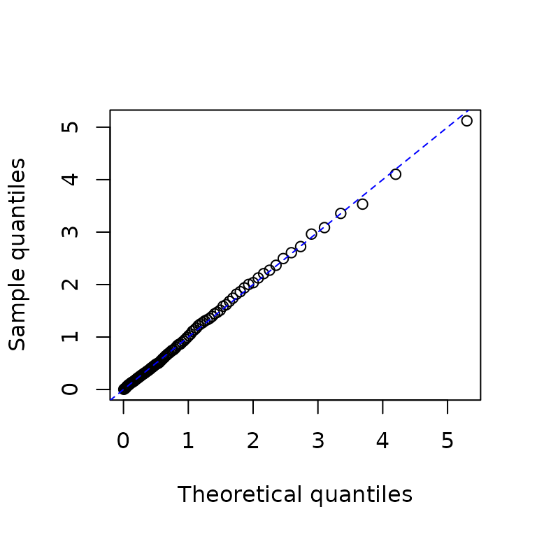

# Get started with emhawkes

This vignette introduces model specification, simulation, estimation and
a first residual check. It is included in the R package and also
published on the website. For more models, see [Extended
examples](https://ksublee.github.io/emhawkes/articles/extended_example.html).

## Basic Hawkes model

### Univariate Hawkes process

``` r

library(emhawkes)
```

This section shows how to specify, simulate, and fit a univariate Hawkes
model. First, create an `hspec` object to define the model. The S4 class
`hspec` includes slots such as `mu`, `alpha`, `beta`, `dimens`, `rmark`,
and `impact`.

In a univariate model, `mu`, `alpha`, and `beta` can be supplied as
numeric values, which are converted to matrices. The following example
defines an unmarked univariate Hawkes model.

``` r

mu1 <- 0.3; alpha1 <- 1.2; beta1 <- 1.5
hspec1 <- new("hspec", mu = mu1, alpha = alpha1, beta = beta1)
show(hspec1)
#> An object of class "hspec" of 1-dimensional Hawkes process
#> 
#> Slot mu: 
#>      [,1]
#> [1,]  0.3
#> 
#> Slot alpha: 
#>      [,1]
#> [1,]  1.2
#> 
#> Slot beta: 
#>      [,1]
#> [1,]  1.5
```

The `hsim` function simulates a path from an `hspec` object. The `size`
argument specifies the number of rows, including the initial state. The
optional arguments `lambda_component0` and `N0` specify the initial
intensity components and event counts, respectively. The intensity of
the basic univariate Hawkes model is

``` math
\lambda(t) = \mu + \int_{-\infty}^t \alpha e^{-\beta (t-s)} d N(s) = \mu + \lambda_c(0) e^{-\beta t} + \int_0^t \alpha e^{-\beta (t-s)} d N(s)
```

where `lambda_component0` denotes

``` math
\lambda_c(0) = \int_{-\infty}^0 \alpha e^{\beta s} d N(s).
```

The default `lambda_component0 = "auto"` uses unconditional component
means for supported stable constant numeric linear models, and zero
components otherwise. The selected rule is reported in a message; zero
initialization recommends supplying components explicitly. Use `"mean"`
to require supported finite means, `"zero"` to start from baseline
intensities, or a scalar/matrix to specify the components directly. Mean
initialization is deterministic and does not sample a stationary initial
state. For a sufficiently long simulation of a stable model, the effect
of the initial intensity diminishes over time. The default initial value
of the counting process, `N0`, is zero.

``` r

set.seed(1107)
res1 <- hsim(hspec1, size = 1000)
#> Initial intensity components: auto -> mean (unconditional component means).
summary(res1)
#> -------------------------------------------------------
#> Simulation result of exponential (marked) Hawkes model.
#> Realized path :
#>        arrival N1 mark lambda1
#>  [1,]  0.00000  0    0 1.50000
#>  [2,]  0.68807  1    1 0.72751
#>  [3,]  0.80014  2    1 1.67567
#>  [4,]  0.97835  3    1 2.27150
#>  [5,]  1.19847  4    1 2.57966
#>  [6,]  1.30725  5    1 3.25578
#>  [7,]  2.17530  6    1 1.43023
#>  [8,]  2.47434  7    1 1.78797
#>  [9,]  2.53174  8    1 2.76622
#> [10,]  2.81626  9    1 2.69260
#> [11,]  3.16047 10    1 2.44375
#> [12,]  3.85436 11    1 1.48087
#> [13,] 16.59833 12    1 0.30000
#> [14,] 17.34735 13    1 0.69015
#> [15,] 18.73374 14    1 0.49874
#> [16,] 23.69435 15    1 0.30082
#> [17,] 23.72337 16    1 1.44967
#> [18,] 28.03254 17    1 0.30366
#> [19,] 28.16824 18    1 1.28198
#> [20,] 28.19783 19    1 2.38725
#> ... with 980 more rows 
#> -------------------------------------------------------
```

The `hsim` function returns an S3 object of class `hreal` with the
following components.

- `hspec` is the model specification.

- `inter_arrival` contains the times between consecutive events.

- `arrival` is the cumulative sum of `inter_arrival`.

- `type` identifies the counting process associated with each event:
  type $`i`$ corresponds to $`N_i`$.

- `mark` contains the mark associated with each event.

- `N` contains the cumulative event counts for each type.

- `Nc` contains the cumulative marks for each type.

- `lambda` contains the intensity immediately before each event.

- `rambda` contains the intensity immediately after each event.

- `lambda_component` and `rambda_component` contain the intensity
  components $`\lambda_{ij}`$ immediately before and after each event,
  respectively.

With the default initial values, `inter_arrival`, `type`, `mark`, `N`,
and `Nc` begin with zero. The
[`summary()`](https://rdrr.io/r/base/summary.html) function displays the
first 20 rows of the realized path by default. The
[`print()`](https://rdrr.io/r/base/print.html) function also displays
the model specification and intensity components.

In this univariate model, `lambda == mu + lambda_component`.

``` r

# The first and third columns are equal.
cbind(res1$lambda[1:5], res1$lambda_component[1:5], mu1 + res1$lambda_component[1:5])
#>           [,1]      [,2]      [,3]
#> [1,] 1.5000000 1.2000000 1.5000000
#> [2,] 0.7275103 0.4275103 0.7275103
#> [3,] 1.6756694 1.3756694 1.6756694
#> [4,] 2.2714992 1.9714992 2.2714992
#> [5,] 2.5796567 2.2796567 2.5796567
```

For all rows except the first, `rambda` equals `lambda + alpha` in this
model.

``` r

# The second and third columns are equal except in the initial row.
cbind(res1$lambda[1:5], res1$rambda[1:5], res1$lambda[1:5] + alpha1)
#>           [,1]     [,2]     [,3]
#> [1,] 1.5000000 1.500000 2.700000
#> [2,] 0.7275103 1.927510 1.927510
#> [3,] 1.6756694 2.875669 2.875669
#> [4,] 2.2714992 3.471499 3.471499
#> [5,] 2.5796567 3.779657 3.779657
```

The following calculation verifies the exponential decay between events.

``` r

# By definition, the following two are equal:
res1$lambda[2:6]
#> [1] 0.7275103 1.6756694 2.2714992 2.5796567 3.2557793
mu1 + (res1$rambda[1:5] - mu1) * exp(-beta1 * res1$inter_arrival[2:6])
#> [1] 0.7275103 1.6756694 2.2714992 2.5796567 3.2557793
```

Use `logLik` to evaluate the log-likelihood from the model specification
and observed inter-arrival times.

``` r

logLik(hspec1, inter_arrival = res1$inter_arrival)
#> Initial intensity components: auto -> mean (unconditional component means).
#> loglikelihood 
#>     -213.4226
```

Use `hfit` for maximum likelihood estimation. The `hspec0` object
supplies the initial parameter values for optimization. For this
univariate model, `inter_arrival` is the only required data argument. If
the initial intensity component is known, pass it as
`lambda_component0`; otherwise, the function determines it internally.
The default optimization method is BFGS.

``` r

# Initial parameter values for numerical optimization.
mu0 <- 0.5; alpha0 <- 1.0; beta0 <- 1.8
hspec0 <- new("hspec", mu = mu0, alpha = alpha0, beta = beta0)
# Supply the initial values through hspec0.
mle <- hfit(hspec0, inter_arrival = res1$inter_arrival)
#> Initial intensity components: auto -> mean (unconditional component means).
summary(mle)
#> --------------------------------------------
#> Maximum Likelihood estimation
#> BFGS maximization, 24 iterations
#> Return code 0: successful convergence 
#> Log-Likelihood: -212.6902 
#> 3  free parameters
#> Estimates:
#>        Estimate Std. error t value Pr(> t)    
#> mu1     0.33554    0.03494   9.604  <2e-16 ***
#> alpha1  1.16515    0.09938  11.725  <2e-16 ***
#> beta1   1.51820    0.12947  11.727  <2e-16 ***
#> ---
#> Signif. codes:  0 '***' 0.001 '**' 0.01 '*' 0.05 '.' 0.1 ' ' 1
#> --------------------------------------------
```

Use
[`fitted_hspec()`](https://ksublee.github.io/emhawkes/reference/fitted_hspec.md)
to reconstruct the estimated model and
[`fit_initial_state()`](https://ksublee.github.io/emhawkes/reference/fit_initial_state.md)
to reuse its initial-state settings. The fit remains a `maxLik` object.
[`coef()`](https://rdrr.io/r/stats/coef.html),
[`summary()`](https://rdrr.io/r/base/summary.html), and
[`vcov()`](https://rdrr.io/r/stats/vcov.html) provide the usual
estimation results.

``` r

estimated <- fitted_hspec(mle)
initial <- fit_initial_state(mle)
inferred <- do.call(logLik, c(list(object = estimated,
  inter_arrival = res1$inter_arrival, infer = TRUE), initial))
c(fitted = as.numeric(logLik(mle)), restored = inferred$loglikelihood)
#>    fitted  restored 
#> -212.6902 -212.6902
head(inferred$lambda)
#>        lambda1
#> [1,] 1.4429344
#> [2,] 0.7251523
#> [3,] 1.6470433
#> [4,] 2.2251136
#> [5,] 2.5224834
#> [6,] 3.1773322
head(inferred$res_process1)
#> [1] 0.1978360 0.4464937 0.6454466 0.3726250 2.2239999 0.6382222
```

### A first residual check

For an ordinary Hawkes model, integrated-intensity residuals should
follow an exponential distribution with rate 1 when the model is
adequate. Compare their quantiles with the reference distribution.

``` r

p <- ppoints(100)
q <- quantile(inferred$res_process1, probs = p)
plot(qexp(p), q, xlab = "Theoretical quantiles", ylab = "Sample quantiles")
abline(0, 1, col = "blue", lty = 2)
```



By default,
[`hfit()`](https://ksublee.github.io/emhawkes/reference/hfit.md) uses
the final Hessian and standard errors from `maxLik`. For saved fits, new
simulations, fuller residual diagnostics and optional
`final_hessian = "stable"` checks, see [Fitting and
inference](https://ksublee.github.io/emhawkes/articles/fitting-and-inference.html).
A stable Hessian alone does not establish reliable confidence intervals.

### Bivariate Hawkes model

The intensity process of a basic bivariate Hawkes model is defined by

``` math
 \lambda_1(t) = \mu_1 + \int_{-\infty}^t \alpha_{11} e^{-\beta_{11}(t-s)} d N_1(s) + \int_{-\infty}^t \alpha_{12} e^{-\beta_{12}(t-s)} d N_2(s),
```

``` math
 \lambda_2(t) = \mu_2 + \int_{-\infty}^t \alpha_{21} e^{-\beta_{21}(t-s)} d N_1(s) + \int_{-\infty}^t \alpha_{22} e^{-\beta_{22}(t-s)} d N_2(s).
```

For this bivariate model, `mu` is a 2-by-1 matrix, and `alpha` and
`beta` are 2-by-2 matrices.

``` math
\mu = \begin{bmatrix} \mu_1 \\ \mu_2 \end{bmatrix}, \quad
\alpha = \begin{bmatrix} \alpha_{11} & \alpha_{12} \\ \alpha_{21} & \alpha_{22} \end{bmatrix}, \quad
\beta = 
\begin{bmatrix} \beta_{11} & \beta_{12} \\ \beta_{21} & \beta_{22} \end{bmatrix}
```

`rmark` generates marks during simulation and can be omitted for
unmarked models. The 2-by-2 matrix `lambda_component0` specifies the
initial values of `lambda11`, `lambda12`, `lambda21`, and `lambda22`.
The intensity processes are represented by

``` math
 \lambda_1(t) = \mu_1 + \lambda_{11}(t) + \lambda_{12}(t), 
```

``` math
 \lambda_2(t) = \mu_2 + \lambda_{21}(t) + \lambda_{22}(t). 
```

The terms $`\lambda_{ij}`$ are called intensity components, and
`lambda_component0` specifies their initial values $`\lambda_{ij}(0)`$.
If `lambda_component0` is omitted, the function determines these values
internally.

``` r

mu2 <- matrix(c(0.2), nrow = 2)
alpha2 <- matrix(c(0.5, 0.9, 0.9, 0.5), nrow = 2, byrow = TRUE)
beta2 <- matrix(c(2.25, 2.25, 2.25, 2.25), nrow = 2, byrow = TRUE)
hspec2 <- new("hspec", mu=mu2, alpha=alpha2, beta=beta2)
print(hspec2)
#> An object of class "hspec" of 2-dimensional Hawkes process
#> 
#> Slot mu: 
#>      [,1]
#> [1,]  0.2
#> [2,]  0.2
#> 
#> Slot alpha: 
#>      [,1] [,2]
#> [1,]  0.5  0.9
#> [2,]  0.9  0.5
#> 
#> Slot beta: 
#>      [,1] [,2]
#> [1,] 2.25 2.25
#> [2,] 2.25 2.25
```

Use `hsim` to simulate the model.

``` r

set.seed(1107)
res2 <- hsim(hspec2,  size=1000)
#> Initial intensity components: auto -> mean (unconditional component means).
summary(res2)
#> -------------------------------------------------------
#> Simulation result of exponential (marked) Hawkes model.
#> Realized path :
#>       arrival N1 N2 mark lambda1 lambda2
#>  [1,] 0.00000  0  0    0 0.52941 0.52941
#>  [2,] 0.57028  1  0    1 0.29130 0.29130
#>  [3,] 1.66175  1  1    1 0.25073 0.28505
#>  [4,] 2.17979  1  2    1 0.49638 0.38238
#>  [5,] 2.47685  1  3    1 0.81319 0.54975
#>  [6,] 2.64001  2  3    1 1.24825 0.78866
#>  [7,] 2.70249  3  3    1 1.54519 1.49341
#>  [8,] 2.94547  4  3    1 1.26810 1.46968
#>  [9,] 3.39313  4  4    1 0.77271 0.99242
#> [10,] 3.52533  4  5    1 1.29379 1.15989
#> [11,] 3.56971  5  5    1 2.00432 1.52115
#> [12,] 3.70761  5  6    1 1.88965 1.82866
#> [13,] 4.30122  5  7    1 0.88106 0.75983
#> [14,] 4.34337  6  7    1 1.63800 1.16393
#> [15,] 4.40222  7  7    1 1.89764 1.83275
#> [16,] 4.58943  8  7    1 1.64219 1.86211
#> [17,] 5.14665  9  7    1 0.75437 0.93131
#> [18,] 5.18186  9  8    1 1.17407 1.70707
#> [19,] 5.36167  9  9    1 1.45050 1.53925
#> [20,] 5.89118 10  9    1 0.85331 0.75875
#> ... with 980 more rows 
#> -------------------------------------------------------
```

In multivariate models, `type` identifies the counting process
associated with each event.

``` r

# A bivariate model has two event types: 1 and 2.
res2$type[1:10]
#>  [1] 0 1 2 2 2 1 1 1 2 2
```

In multivariate models, the column names of `N` are `N1`, `N2`, `N3`,
and so on.

``` r

res2$N[1:3, ]
#>      N1 N2
#> [1,]  0  0
#> [2,]  1  0
#> [3,]  1  1
```

Similarly, the column names of `lambda` are `lambda1`, `lambda2`,
`lambda3`, and so on.

``` r

res2$lambda[1:3, ]
#>        lambda1   lambda2
#> [1,] 0.5294118 0.5294118
#> [2,] 0.2913028 0.2913028
#> [3,] 0.2507301 0.2850475
```

In this bivariate model, the columns of `lambda_component` are
`lambda11`, `lambda12`, `lambda21`, and `lambda22`.

``` r

res2$lambda_component[1:3, ]
#>        lambda11    lambda12   lambda21    lambda22
#> [1,] 0.11764706 0.211764706 0.21176471 0.117647059
#> [2,] 0.03260813 0.058694641 0.05869464 0.032608134
#> [3,] 0.04569443 0.005035631 0.08224997 0.002797573
```

By definition, the following two expressions are equivalent:

``` r

mu2[1] + rowSums(res2$lambda_component[1:5, c("lambda11", "lambda12")])
#> [1] 0.5294118 0.2913028 0.2507301 0.4963769 0.8131889
res2$lambda[1:5, "lambda1"]
#> [1] 0.5294118 0.2913028 0.2507301 0.4963769 0.8131889
```

Extract the observed `inter_arrival` and `type` vectors from the
simulation result. Both are required to fit a bivariate model.

``` r

inter_arrival2 <- res2$inter_arrival
type2 <- res2$type
```

Use `logLik` to evaluate the log-likelihood.

``` r

logLik(hspec2, inter_arrival = inter_arrival2, type = type2)
#> Initial intensity components: auto -> mean (unconditional component means).
#> loglikelihood 
#>     -974.2809
```

Use `hfit` to estimate the parameters from `inter_arrival` and `type`.
The values of `mu`, `alpha`, and `beta` in `hspec0` provide starting
points for optimization. Here, we use the simulation parameters by
setting `hspec0 <- hspec2`. For observed data, choose initial values
because the true parameters are unknown.

By default, `reduced = TRUE` groups equal starting values within each
parameter matrix. Here, the two entries of `mu` share one parameter, the
diagonal and off-diagonal entries of `alpha` give two parameters, and
all entries of `beta` share one parameter. The fit therefore estimates
four parameters. `hfit` prints a short explanation once before
optimization.

``` r

hspec0 <- hspec2
mle <- hfit(hspec0, inter_arrival = inter_arrival2, type = type2)
#> Initial intensity components: auto -> mean (unconditional component means).
#> hfit: equal starting values within each matrix share a parameter (reduced = TRUE; mu, alpha, beta).
#> Use reduced = FALSE to estimate matrix entries separately.
summary(mle)
#> --------------------------------------------
#> Maximum Likelihood estimation
#> BFGS maximization, 33 iterations
#> Return code 0: successful convergence 
#> Log-Likelihood: -970.1408 
#> 4  free parameters
#> Estimates:
#>          Estimate Std. error t value  Pr(> t)    
#> mu1       0.19095    0.01638  11.656  < 2e-16 ***
#> alpha1.1  0.48217    0.07430   6.489 8.64e-11 ***
#> alpha1.2  0.98625    0.09576  10.300  < 2e-16 ***
#> beta1.1   2.07987    0.17203  12.091  < 2e-16 ***
#> ---
#> Signif. codes:  0 '***' 0.001 '**' 0.01 '*' 0.05 '.' 0.1 ' ' 1
#> --------------------------------------------
```

``` r

coef(mle)
#>       mu1  alpha1.1  alpha1.2   beta1.1 
#> 0.1909541 0.4821725 0.9862541 2.0798690
```

``` r

miscTools::stdEr(mle)
#>        mu1   alpha1.1   alpha1.2    beta1.1 
#> 0.01638200 0.07430500 0.09575744 0.17202504
```

The restored matrices retain the shared parameters from this fit. The
diagonal entries of `alpha` remain equal, as do its off-diagonal
entries.

``` r

estimated2 <- fitted_hspec(mle)
estimated2@alpha
#>           [,1]      [,2]
#> [1,] 0.4821725 0.9862541
#> [2,] 0.9862541 0.4821725
estimated2@beta
#>          [,1]     [,2]
#> [1,] 2.079869 2.079869
#> [2,] 2.079869 2.079869
```

Set `reduced = FALSE` to estimate all ten matrix entries separately,
even when their starting values are equal. Use
`suppressMessages(hfit(...))` to hide the startup explanation. For
function components, parameters with the same name are shared under
either setting. A zero in a numeric matrix is an estimated starting
value; use a component function to fix selected entries at zero.

### Observed data and initial state

The first row represents the initial state and is not an event. For
event times measured from the observation start, prepare the input as
follows:

``` r

inter_arrival <- c(0, diff(c(0, event_times)))
type <- c(0, event_types)
mark <- c(0, event_marks)
```

Omit `type` for a univariate model and `mark` for unit marks. The
vectors must have the same length; event types range from 1 to the model
dimension. Event order is preserved, including events at the same time.
The likelihood currently ends at the last supplied event.

`N0` and `Nc0` specify initial event counts and mark totals. Pass `Nc0`
by name in `hfit`, and use the same initial state when comparing
simulation and likelihood results. `lambda_component0` can be a scalar
or a matrix matching `alpha` and `beta`. If supplied, `N` and `Nc` must
have one row per input row and one column per dimension, and must agree
with the events and initial counts. Their rows contain the cumulative
values after each event.

## Choosing the optimizer

[`hfit()`](https://ksublee.github.io/emhawkes/reference/hfit.md) uses
the optional maxLik package by default. To use R’s optimization
functions directly, select `optimizer = "stats"`; likelihood engine
selection and model specification are unchanged. This route also works
without maxLik. The earlier fitting examples require maxLik and are not
evaluated when it is unavailable.

``` r

library(emhawkes)
poisson <- new("hspec", mu = 0.5, alpha = 0, beta = 1)
fit_stats <- hfit(poisson, c(0, 0.2, 0.3, 0.5), optimizer = "stats",
                  lambda_component0 = 0, fixed = c(FALSE, TRUE, TRUE),
                  control = list(maxit = 500, reltol = 1e-12))
summary(fit_stats)
#> Hawkes maximum likelihood fit (stats::optim, BFGS)
#> Log likelihood: 0.2958369
#> Convergence code: 0 (Normal convergence.)
#>        Estimate Std. Error z value Pr(>|z|)  
#> mu1      3.0000     1.7321  1.7321  0.08326 .
#> alpha1   0.0000     0.0000      NA       NA  
#> beta1    1.0000     0.0000      NA       NA  
#> ---
#> Signif. codes:  0 '***' 0.001 '**' 0.01 '*' 0.05 '.' 0.1 ' ' 1
#> Fixed parameters: alpha1, beta1
fit_diagnostics(fit_stats)$computation$optimizer
#> $requested
#> [1] "stats"
#> 
#> $used
#> [1] "optim"
#> 
#> $method
#> [1] "BFGS"
```

The stats route supports BFGS, Nelder-Mead, CG and L-BFGS-B. Linear
inequality constraints use
[`constrOptim()`](https://rdrr.io/r/stats/constrOptim.html) and require
an interior starting point; equality constraints are not supported. Use
`control$maxit` rather than maxLik’s `iterlim`. It defaults to stable
final curvature; boundary estimates have no Wald covariance. Use
[`fitted_hspec()`](https://ksublee.github.io/emhawkes/reference/fitted_hspec.md)
and
[`fit_initial_state()`](https://ksublee.github.io/emhawkes/reference/fit_initial_state.md)
with either provider. Changing providers does not guarantee identical
estimates or cure convergence and identification problems.

## Further reading

- [Fitting and
  inference](https://ksublee.github.io/emhawkes/articles/fitting-and-inference.html):
  parameter settings, initial states, fitted models, residual
  diagnostics and standard errors.
- [Extended
  examples](https://ksublee.github.io/emhawkes/articles/extended_example.html):
  marked, state-dependent and multi-kernel models, with an FRPP
  migration note.
- [FRPP
  examples](https://ksublee.github.io/frpp/articles/frpp-examples.html):
  custom residual laws in the separate frpp package; simple cases remain
  supported in emhawkes.
- [Computation](https://ksublee.github.io/emhawkes/articles/computation.html):
  likelihood engines, analytic gradients, Jacobians and performance.
- [Reference](https://ksublee.github.io/emhawkes/reference/index.html):
  function arguments and return values.
