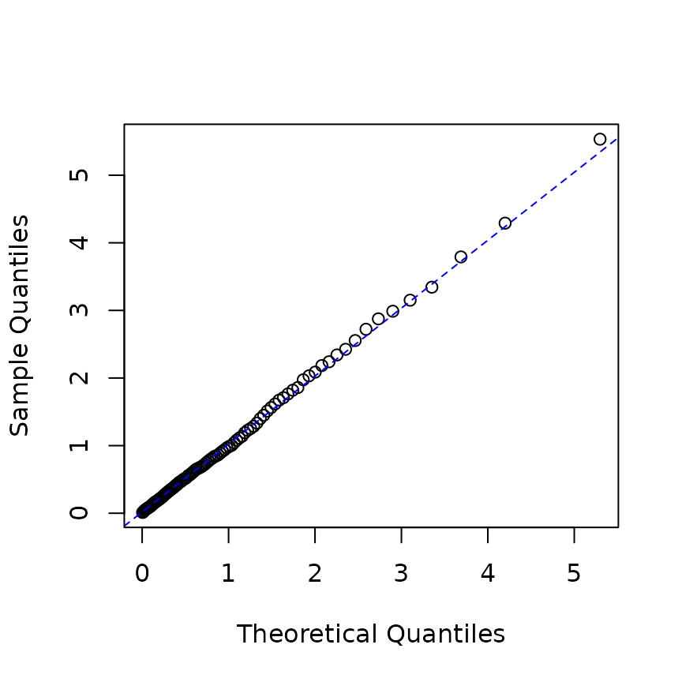
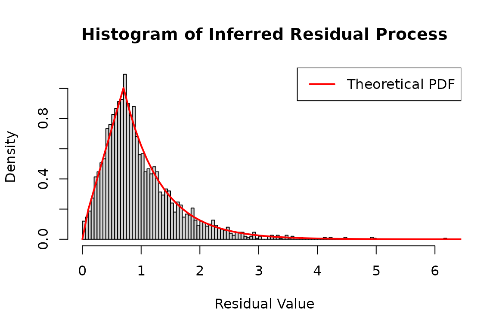
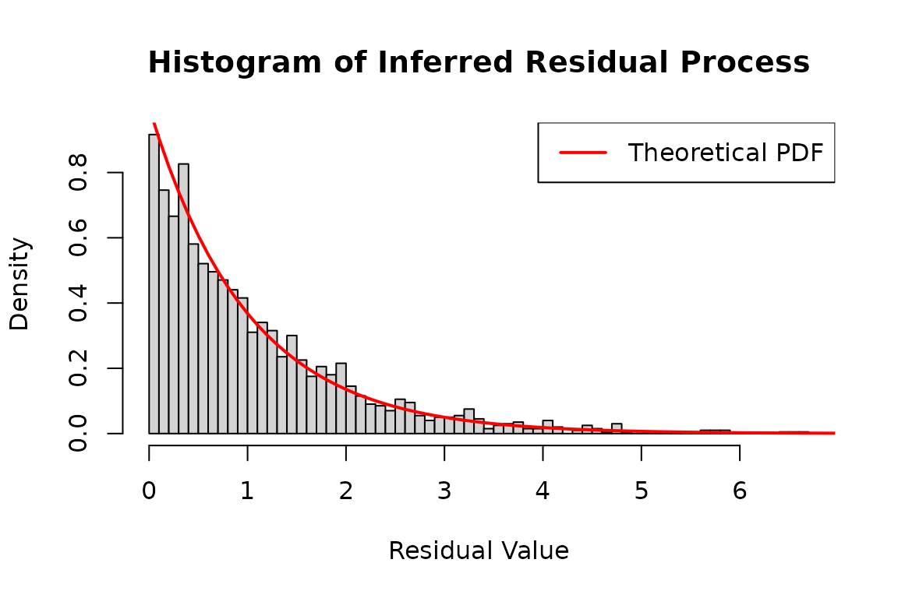
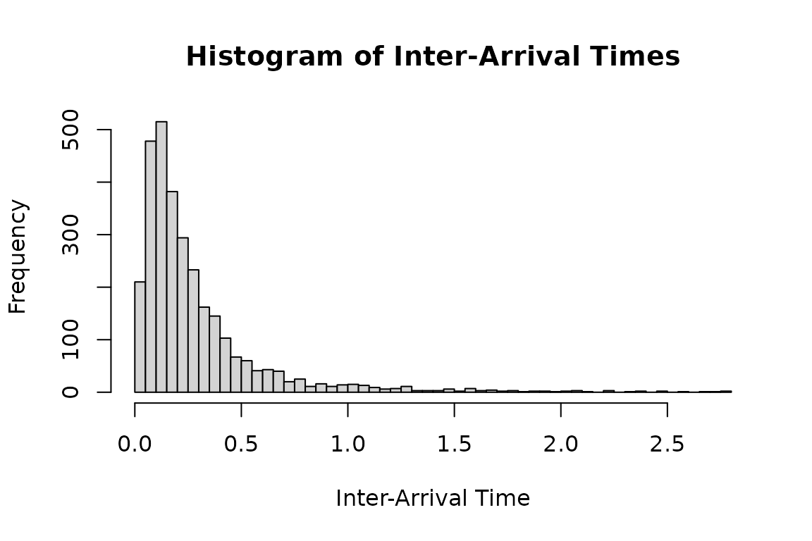
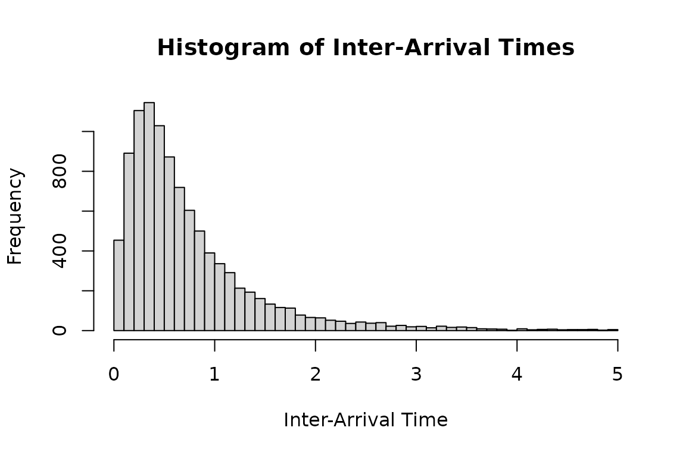
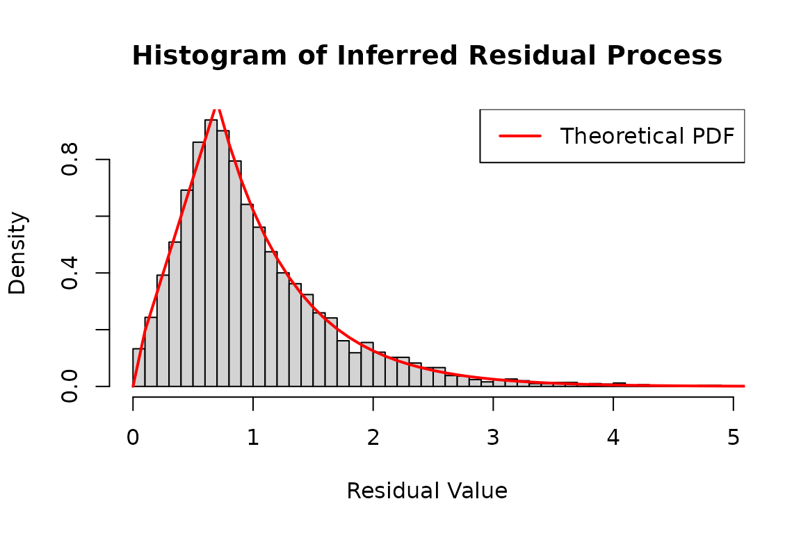

# Extended examples for the emhawkes package

## Basic Hawkes model

### Univariate Hawkes process

``` r

library(emhawkes)
```

This section shows how to specify, simulate, and fit a univariate Hawkes
model. First, create an `hspec` object to define the model. The S4 class
`hspec` includes slots such as `mu`, `alpha`, `beta`, `dimens`, `rmark`,
and `impact`.

In a univariate model, `mu`, `alpha`, and `beta` can be supplied as
numeric values, which are converted to matrices. The following example
defines an unmarked univariate Hawkes model.

``` r

mu1 <- 0.3; alpha1 <- 1.2; beta1 <- 1.5
hspec1 <- new("hspec", mu = mu1, alpha = alpha1, beta = beta1)
show(hspec1)
#> An object of class "hspec" of 1-dimensional Hawkes process
#> 
#> Slot mu: 
#>      [,1]
#> [1,]  0.3
#> 
#> Slot alpha: 
#>      [,1]
#> [1,]  1.2
#> 
#> Slot beta: 
#>      [,1]
#> [1,]  1.5
```

The `hsim` function simulates a path from an `hspec` object. The `size`
argument specifies the number of rows, including the initial state. The
optional arguments `lambda_component0` and `N0` specify the initial
intensity components and event counts, respectively. The intensity of
the basic univariate Hawkes model is

``` math
\lambda(t) = \mu + \int_{-\infty}^t \alpha e^{-\beta (t-s)} d N(s) = \mu + \lambda_c(0) e^{-\beta t} + \int_0^t \alpha e^{-\beta (t-s)} d N(s)
```

where `lambda_component0` denotes

``` math
\lambda_c(0) = \int_{-\infty}^0 \alpha e^{\beta s} d N(s).
```

If `lambda_component0` is omitted, the function determines the initial
intensity components internally. For a sufficiently long simulation of a
stable model, the effect of the initial intensity diminishes over time.
The default initial value of the counting process, `N0`, is zero.

``` r

set.seed(1107)
res1 <- hsim(hspec1, size = 1000)
summary(res1)
#> -------------------------------------------------------
#> Simulation result of exponential (marked) Hawkes model.
#> Realized path :
#>        arrival N1 mark lambda1
#>  [1,]  0.00000  0    0 0.90000
#>  [2,]  0.97794  1    1 0.43838
#>  [3,]  1.09001  2    1 1.43128
#>  [4,]  1.28999  3    1 2.02711
#>  [5,]  1.53225  4    1 2.33527
#>  [6,]  1.65001  5    1 3.01139
#>  [7,]  2.51807  6    1 1.36377
#>  [8,]  2.81710  7    1 1.74553
#>  [9,]  2.87547  8    1 2.72378
#> [10,]  3.16415  9    1 2.65016
#> [11,]  3.51378 10    1 2.40131
#> [12,]  4.22355 11    1 1.43843
#> [13,] 16.96752 12    1 0.30000
#> [14,] 17.71654 13    1 0.69015
#> [15,] 19.10293 14    1 0.49874
#> [16,] 24.06354 15    1 0.30082
#> [17,] 24.09256 16    1 1.44967
#> [18,] 28.40173 17    1 0.30366
#> [19,] 28.53743 18    1 1.28198
#> [20,] 28.56702 19    1 2.38725
#> ... with 980 more rows 
#> -------------------------------------------------------
```

The `hsim` function returns an S3 object of class `hreal` with the
following components.

- `hspec` is the model specification.

- `inter_arrival` contains the times between consecutive events.

- `arrival` is the cumulative sum of `inter_arrival`.

- `type` identifies the counting process associated with each event:
  type $`i`$ corresponds to $`N_i`$.

- `mark` contains the mark associated with each event.

- `N` contains the cumulative event counts for each type.

- `Nc` contains the cumulative marks for each type.

- `lambda` contains the intensity immediately before each event.

- `rambda` contains the intensity immediately after each event.

- `lambda_component` and `rambda_component` contain the intensity
  components $`\lambda_{ij}`$ immediately before and after each event,
  respectively.

With the default initial values, `inter_arrival`, `type`, `mark`, `N`,
and `Nc` begin with zero. The
[`summary()`](https://rdrr.io/r/base/summary.html) function displays the
first 20 rows of the realized path by default. The
[`print()`](https://rdrr.io/r/base/print.html) function also displays
the model specification and intensity components.

In this univariate model, `lambda == mu + lambda_component`.

``` r

# The first and third columns are equal.
cbind(res1$lambda[1:5], res1$lambda_component[1:5], mu1 + res1$lambda_component[1:5])
#>          [,1]     [,2]     [,3]
#> [1,] 0.900000 0.600000 0.900000
#> [2,] 0.438383 0.138383 0.438383
#> [3,] 1.431282 1.131282 1.431282
#> [4,] 2.027111 1.727111 2.027111
#> [5,] 2.335269 2.035269 2.335269
```

For all rows except the first, `rambda` equals `lambda + alpha` in this
model.

``` r

# The second and third columns are equal except in the initial row.
cbind(res1$lambda[1:5], res1$rambda[1:5], res1$lambda[1:5] + alpha1)
#>          [,1]     [,2]     [,3]
#> [1,] 0.900000 0.900000 2.100000
#> [2,] 0.438383 1.638383 1.638383
#> [3,] 1.431282 2.631282 2.631282
#> [4,] 2.027111 3.227111 3.227111
#> [5,] 2.335269 3.535269 3.535269
```

The following calculation verifies the exponential decay between events.

``` r

# By definition, the following two are equal:
res1$lambda[2:6]
#> [1] 0.438383 1.431282 2.027111 2.335269 3.011391
mu1 + (res1$rambda[1:5] - mu1) * exp(-beta1 * res1$inter_arrival[2:6])
#> [1] 0.438383 1.431282 2.027111 2.335269 3.011391
```

Use `logLik` to evaluate the log-likelihood from the model specification
and observed inter-arrival times.

``` r

logLik(hspec1, inter_arrival = res1$inter_arrival)
#> The initial values for intensity processes are not provided. Internally determined initial values are used.
#> loglikelihood 
#>     -214.2385
```

Use `hfit` for maximum likelihood estimation. The `hspec0` object
supplies the initial parameter values for optimization. For this
univariate model, `inter_arrival` is the only required data argument. If
the initial intensity component is known, pass it as
`lambda_component0`; otherwise, the function determines it internally.
The default optimization method is BFGS.

``` r

# Initial parameter values for numerical optimization.
mu0 <- 0.5; alpha0 <- 1.0; beta0 <- 1.8
hspec0 <- new("hspec", mu = mu0, alpha = alpha0, beta = beta0)
# Supply the initial values through hspec0.
mle <- hfit(hspec0, inter_arrival = res1$inter_arrival)
summary(mle)
#> --------------------------------------------
#> Maximum Likelihood estimation
#> BFGS maximization, 24 iterations
#> Return code 0: successful convergence 
#> Log-Likelihood: -213.4658 
#> 3  free parameters
#> Estimates:
#>        Estimate Std. error t value Pr(> t)    
#> mu1     0.33641    0.03486   9.651  <2e-16 ***
#> alpha1  1.16654    0.09480  12.305  <2e-16 ***
#> beta1   1.52270    0.12323  12.357  <2e-16 ***
#> ---
#> Signif. codes:  0 '***' 0.001 '**' 0.01 '*' 0.05 '.' 0.1 ' ' 1
#> --------------------------------------------
```

### Bivariate Hawkes model

The intensity process of a basic bivariate Hawkes model is defined by

``` math
 \lambda_1(t) = \mu_1 + \int_{-\infty}^t \alpha_{11} e^{-\beta_{11}(t-s)} d N_1(s) + \int_{-\infty}^t \alpha_{12} e^{-\beta_{12}(t-s)} d N_2(s),
```

``` math
 \lambda_2(t) = \mu_2 + \int_{-\infty}^t \alpha_{21} e^{-\beta_{21}(t-s)} d N_1(s) + \int_{-\infty}^t \alpha_{22} e^{-\beta_{22}(t-s)} d N_2(s).
```

For this bivariate model, `mu` is a 2-by-1 matrix, and `alpha` and
`beta` are 2-by-2 matrices.

``` math
\mu = \begin{bmatrix} \mu_1 \\ \mu_2 \end{bmatrix}, \quad
\alpha = \begin{bmatrix} \alpha_{11} & \alpha_{12} \\ \alpha_{21} & \alpha_{22} \end{bmatrix}, \quad
\beta = 
\begin{bmatrix} \beta_{11} & \beta_{12} \\ \beta_{21} & \beta_{22} \end{bmatrix}
```

`rmark` generates marks during simulation and can be omitted for
unmarked models. The 2-by-2 matrix `lambda_component0` specifies the
initial values of `lambda11`, `lambda12`, `lambda21`, and `lambda22`.
The intensity processes are represented by

``` math
 \lambda_1(t) = \mu_1 + \lambda_{11}(t) + \lambda_{12}(t), 
```

``` math
 \lambda_2(t) = \mu_2 + \lambda_{21}(t) + \lambda_{22}(t). 
```

The terms $`\lambda_{ij}`$ are called intensity components, and
`lambda_component0` specifies their initial values $`\lambda_{ij}(0)`$.
If `lambda_component0` is omitted, the function determines these values
internally.

``` r

mu2 <- matrix(c(0.2), nrow = 2)
alpha2 <- matrix(c(0.5, 0.9, 0.9, 0.5), nrow = 2, byrow = TRUE)
beta2 <- matrix(c(2.25, 2.25, 2.25, 2.25), nrow = 2, byrow = TRUE)
hspec2 <- new("hspec", mu=mu2, alpha=alpha2, beta=beta2)
print(hspec2)
#> An object of class "hspec" of 2-dimensional Hawkes process
#> 
#> Slot mu: 
#>      [,1]
#> [1,]  0.2
#> [2,]  0.2
#> 
#> Slot alpha: 
#>      [,1] [,2]
#> [1,]  0.5  0.9
#> [2,]  0.9  0.5
#> 
#> Slot beta: 
#>      [,1] [,2]
#> [1,] 2.25 2.25
#> [2,] 2.25 2.25
```

Use `hsim` to simulate the model.

``` r

set.seed(1107)
res2 <- hsim(hspec2,  size=1000)
summary(res2)
#> -------------------------------------------------------
#> Simulation result of exponential (marked) Hawkes model.
#> Realized path :
#>       arrival N1 N2 mark lambda1 lambda2
#>  [1,] 0.00000  0  0    0 0.52941 0.52941
#>  [2,] 0.57028  1  0    1 0.29130 0.29130
#>  [3,] 1.66175  1  1    1 0.25073 0.28505
#>  [4,] 2.17979  1  2    1 0.49638 0.38238
#>  [5,] 2.47685  1  3    1 0.81319 0.54975
#>  [6,] 2.64001  2  3    1 1.24825 0.78866
#>  [7,] 2.70249  3  3    1 1.54519 1.49341
#>  [8,] 2.94547  4  3    1 1.26810 1.46968
#>  [9,] 3.39313  4  4    1 0.77271 0.99242
#> [10,] 3.52533  4  5    1 1.29379 1.15989
#> [11,] 3.56971  5  5    1 2.00432 1.52115
#> [12,] 3.70761  5  6    1 1.88965 1.82866
#> [13,] 4.30122  5  7    1 0.88106 0.75983
#> [14,] 4.34337  6  7    1 1.63800 1.16393
#> [15,] 4.40222  7  7    1 1.89764 1.83275
#> [16,] 4.58943  8  7    1 1.64219 1.86211
#> [17,] 5.14665  9  7    1 0.75437 0.93131
#> [18,] 5.18186  9  8    1 1.17407 1.70707
#> [19,] 5.36167  9  9    1 1.45050 1.53925
#> [20,] 5.89118 10  9    1 0.85331 0.75875
#> ... with 980 more rows 
#> -------------------------------------------------------
```

In multivariate models, `type` identifies the counting process
associated with each event.

``` r

# A bivariate model has two event types: 1 and 2.
res2$type[1:10]
#>  [1] 0 1 2 2 2 1 1 1 2 2
```

In multivariate models, the column names of `N` are `N1`, `N2`, `N3`,
and so on.

``` r

res2$N[1:3, ]
#>      N1 N2
#> [1,]  0  0
#> [2,]  1  0
#> [3,]  1  1
```

Similarly, the column names of `lambda` are `lambda1`, `lambda2`,
`lambda3`, and so on.

``` r

res2$lambda[1:3, ]
#>        lambda1   lambda2
#> [1,] 0.5294118 0.5294118
#> [2,] 0.2913028 0.2913028
#> [3,] 0.2507301 0.2850475
```

In this bivariate model, the columns of `lambda_component` are
`lambda11`, `lambda12`, `lambda21`, and `lambda22`.

``` r

res2$lambda_component[1:3, ]
#>        lambda11    lambda12   lambda21    lambda22
#> [1,] 0.11764706 0.211764706 0.21176471 0.117647059
#> [2,] 0.03260813 0.058694641 0.05869464 0.032608134
#> [3,] 0.04569443 0.005035631 0.08224997 0.002797573
```

By definition, the following two expressions are equivalent:

``` r

mu2[1] + rowSums(res2$lambda_component[1:5, c("lambda11", "lambda12")])
#> [1] 0.5294118 0.2913028 0.2507301 0.4963769 0.8131889
res2$lambda[1:5, "lambda1"]
#> [1] 0.5294118 0.2913028 0.2507301 0.4963769 0.8131889
```

Extract the observed `inter_arrival` and `type` vectors from the
simulation result. Both are required to fit a bivariate model.

``` r

inter_arrival2 <- res2$inter_arrival
type2 <- res2$type
```

Use `logLik` to evaluate the log-likelihood.

``` r

logLik(hspec2, inter_arrival = inter_arrival2, type = type2)
#> The initial values for intensity processes are not provided. Internally determined initial values are used.
#> loglikelihood 
#>     -974.2809
```

Use `hfit` to estimate the parameters from `inter_arrival` and `type`.
The values of `mu`, `alpha`, and `beta` in `hspec0` provide starting
points for optimization. Here, we use the simulation parameters by
setting `hspec0 <- hspec2`. For observed data, choose initial values
because the true parameters are unknown.

The default fit groups equal starting values within each matrix and
estimates four parameters here: one for `mu`, two for `alpha`, and one
for `beta`. `hfit` explains this rule once before optimization.

``` r

hspec0 <- hspec2
mle <- hfit(hspec0, inter_arrival = inter_arrival2, type = type2)
#> hfit: equal starting values within each matrix share a parameter (reduced = TRUE; mu, alpha, beta).
#> Use reduced = FALSE to estimate matrix entries separately.
summary(mle)
#> --------------------------------------------
#> Maximum Likelihood estimation
#> BFGS maximization, 33 iterations
#> Return code 0: successful convergence 
#> Log-Likelihood: -970.1408 
#> 4  free parameters
#> Estimates:
#>          Estimate Std. error t value  Pr(> t)    
#> mu1       0.19095    0.01638  11.656  < 2e-16 ***
#> alpha1.1  0.48217    0.07430   6.489 8.64e-11 ***
#> alpha1.2  0.98625    0.09576  10.300  < 2e-16 ***
#> beta1.1   2.07987    0.17203  12.091  < 2e-16 ***
#> ---
#> Signif. codes:  0 '***' 0.001 '**' 0.01 '*' 0.05 '.' 0.1 ' ' 1
#> --------------------------------------------
```

``` r

coef(mle)
#>       mu1  alpha1.1  alpha1.2   beta1.1 
#> 0.1909541 0.4821725 0.9862541 2.0798690
```

``` r

miscTools::stdEr(mle)
#>        mu1   alpha1.1   alpha1.2    beta1.1 
#> 0.01638200 0.07430500 0.09575744 0.17202504
```

### Parameter settings

The initial values in `hspec0` determine which parameters are estimated
separately. With the default setting `reduced = TRUE`, equal entries
within a parameter matrix share one estimated value. The rule is applied
separately to each matrix; equal values in `mu` and `alpha` do not link
those components. The startup message lists the matrices with shared
entries. Use `suppressMessages(hfit(...))` to hide it.

For example, if `alpha[1,1]` and `alpha[1,2]` have different initial
values, `hfit` estimates them separately. If they have the same initial
value, `hfit` treats them as a single parameter.

The previous example uses a symmetric Hawkes model: `alpha` is
symmetric, and all entries of `beta` are equal.

``` r

print(hspec2)
#> An object of class "hspec" of 2-dimensional Hawkes process
#> 
#> Slot mu: 
#>      [,1]
#> [1,]  0.2
#> [2,]  0.2
#> 
#> Slot alpha: 
#>      [,1] [,2]
#> [1,]  0.5  0.9
#> [2,]  0.9  0.5
#> 
#> Slot beta: 
#>      [,1] [,2]
#> [1,] 2.25 2.25
#> [2,] 2.25 2.25
```

``` r

set.seed(1107)
res2 <- hsim(hspec2, size = 1000)
```

In the first example, all entries of `alpha0` are set to 0.75. This
constrains `alpha11`, `alpha12`, `alpha21`, and `alpha22` to share one
estimated value, even though their simulation values differ. The same
rule applies within `mu0` and `beta0`.

``` r

mu0 <- matrix(c(0.15, 0.15), nrow = 2)
alpha0 <- matrix(c(0.75, 0.75, 0.75, 0.75), nrow = 2, byrow=TRUE)
beta0 <- matrix(c(2.6, 2.6, 2.6, 2.6), nrow = 2, byrow=TRUE)

hspec0 <- new("hspec", mu=mu0, alpha=alpha0, beta=beta0)
summary(hfit(hspec0, inter_arrival = res2$inter_arrival, type = res2$type))
#> hfit: equal starting values within each matrix share a parameter (reduced = TRUE; mu, alpha, beta).
#> Use reduced = FALSE to estimate matrix entries separately.
#> --------------------------------------------
#> Maximum Likelihood estimation
#> BFGS maximization, 46 iterations
#> Return code 0: successful convergence 
#> Log-Likelihood: -979.5687 
#> 3  free parameters
#> Estimates:
#>          Estimate Std. error t value Pr(> t)    
#> mu1       0.19125    0.01633   11.71  <2e-16 ***
#> alpha1.1  0.73981    0.05783   12.79  <2e-16 ***
#> beta1.1   2.09707    0.15936   13.16  <2e-16 ***
#> ---
#> Signif. codes:  0 '***' 0.001 '**' 0.01 '*' 0.05 '.' 0.1 ' ' 1
#> --------------------------------------------
```

This fit estimates one excitation parameter for both self-excitation and
mutual excitation, whose simulation values are 0.5 and 0.9,
respectively.

In the second example, `alpha0` has the same symmetry as the simulation
model. Its diagonal entries are equal, and its off-diagonal entries
share a different value. The model therefore has two excitation
parameters to estimate.

``` r

mu0 <- matrix(c(0.15, 0.15), nrow = 2)
alpha0 <- matrix(c(0.75, 0.751, 0.751, 0.75), nrow = 2, byrow=TRUE)
beta0 <- matrix(c(2.6, 2.6, 2.6, 2.6), nrow = 2, byrow=TRUE)

hspec0 <- new("hspec", mu=mu0, alpha=alpha0, beta=beta0)
summary(hfit(hspec0, inter_arrival = res2$inter_arrival, type = res2$type))
#> hfit: equal starting values within each matrix share a parameter (reduced = TRUE; mu, alpha, beta).
#> Use reduced = FALSE to estimate matrix entries separately.
#> --------------------------------------------
#> Maximum Likelihood estimation
#> BFGS maximization, 30 iterations
#> Return code 0: successful convergence 
#> Log-Likelihood: -970.1408 
#> 4  free parameters
#> Estimates:
#>          Estimate Std. error t value  Pr(> t)    
#> mu1       0.19095    0.01639  11.647  < 2e-16 ***
#> alpha1.1  0.48226    0.07292   6.614 3.74e-11 ***
#> alpha1.2  0.98626    0.09287  10.620  < 2e-16 ***
#> beta1.1   2.08008    0.16593  12.536  < 2e-16 ***
#> ---
#> Signif. codes:  0 '***' 0.001 '**' 0.01 '*' 0.05 '.' 0.1 ' ' 1
#> --------------------------------------------
```

The third example allows `mu1` and `mu2` to differ, even though they are
equal in the simulation model.

``` r

mu0 <- matrix(c(0.15, 0.14), nrow = 2)
alpha0 <- matrix(c(0.75, 0.751, 0.751, 0.75), nrow = 2, byrow=TRUE)
beta0 <- matrix(c(2.6, 2.6, 2.6, 2.6), nrow = 2, byrow=TRUE)

hspec0 <- new("hspec", mu=mu0, alpha=alpha0, beta=beta0)
summary(hfit(hspec0, inter_arrival = res2$inter_arrival, type = res2$type))
#> hfit: equal starting values within each matrix share a parameter (reduced = TRUE; alpha, beta).
#> Use reduced = FALSE to estimate matrix entries separately.
#> --------------------------------------------
#> Maximum Likelihood estimation
#> BFGS maximization, 42 iterations
#> Return code 0: successful convergence 
#> Log-Likelihood: -969.9914 
#> 5  free parameters
#> Estimates:
#>          Estimate Std. error t value Pr(> t)    
#> mu1       0.18300    0.02157   8.484  <2e-16 ***
#> mu2       0.19872    0.02206   9.006  <2e-16 ***
#> alpha1.1  0.48149    0.07569   6.361   2e-10 ***
#> alpha1.2  0.98720    0.09852  10.020  <2e-16 ***
#> beta1.1   2.07973    0.17931  11.598  <2e-16 ***
#> ---
#> Signif. codes:  0 '***' 0.001 '**' 0.01 '*' 0.05 '.' 0.1 ' ' 1
#> --------------------------------------------
```

Set `reduced = FALSE` to estimate each matrix entry separately,
including entries with equal initial values.

``` r

summary(hfit(hspec2, inter_arrival = res2$inter_arrival, type = res2$type, reduced=FALSE))
#> --------------------------------------------
#> Maximum Likelihood estimation
#> BFGS maximization, 51 iterations
#> Return code 0: successful convergence 
#> Log-Likelihood: -966.5055 
#> 10  free parameters
#> Estimates:
#>          Estimate Std. error t value  Pr(> t)    
#> mu1       0.17997    0.02231   8.066 7.24e-16 ***
#> mu2       0.20060    0.02335   8.590  < 2e-16 ***
#> alpha1.1  0.44726    0.10661   4.195 2.73e-05 ***
#> alpha2.1  1.17743        NaN     NaN      NaN    
#> alpha1.2  0.97048    0.10742   9.035  < 2e-16 ***
#> alpha2.2  0.48979        NaN     NaN      NaN    
#> beta1.1   2.52210        NaN     NaN      NaN    
#> beta2.1   3.15498        NaN     NaN      NaN    
#> beta1.2   1.80167    0.07600  23.705  < 2e-16 ***
#> beta2.2   1.51338        NaN     NaN      NaN    
#> ---
#> Signif. codes:  0 '***' 0.001 '**' 0.01 '*' 0.05 '.' 0.1 ' ' 1
#> --------------------------------------------
```

The same rules apply to higher-dimensional models. For function
components, the named entries in `param` define the estimated
parameters. Matching parameter names are shared across functions, even
with `reduced = FALSE`. Use different names for independent parameters
with equal starting values. Conflicting starting values for a shared
name produce a warning, and the first value is used. A zero in a numeric
matrix is an estimated starting value; constants inside a component
function remain fixed.

### Observed data and initial state

The first row is the initial state, followed by the observed events. For
event times measured from the observation start, use
`c(0, diff(c(0, event_times)))` for `inter_arrival` and prepend zero to
the event-type and mark vectors. The likelihood currently ends at the
last supplied event, and the input order is preserved when event times
coincide.

`N0` and `Nc0` specify initial event counts and mark totals. Pass `Nc0`
by name in `hfit`. Use the same initial counts and `lambda_component0`
for simulation and likelihood evaluation when comparing their paths. A
scalar `lambda_component0` is expanded to all kernel components; a
matrix must match the kernel dimensions. For multi-kernel models, supply
`lambda_component0` explicitly.

Counting-process matrices supplied as `N` or `Nc` must agree with the
event data and initial counts. Each row contains the values after that
event. A baseline function called with index `n` uses row `n - 1` for
the preceding state; an impact function uses row `n` for the current
event. Component functions can declare only the arguments they need, and
use `...` to receive the remaining context.

### Residual process

Set `infer = TRUE` in `logLik` to obtain the log-likelihood, intensity
paths, and residual processes. These are computed using the parameters
in the supplied `hspec` object. For a univariate model, `res_process1`
contains the residual inter-arrival times.

``` r

hrp <- new("hspec", mu = 0.3, alpha = 1.2, beta = 1.5)
res_rp <- hsim(hrp, size = 1000)

# inferred result
infered_res <- logLik(hrp, res_rp$inter_arrival, infer = TRUE)

## QQ-plot
p <- ppoints(100)
q <- quantile(infered_res$res_process1, p = p)
plot(qexp(p), q, xlab="Theoretical Quantiles",ylab="Sample Quantiles")
qqline(q, distribution=qexp,col="blue", lty=2)
```



For observed data, estimate the parameters before computing the residual
processes.

``` r


# estimation
mle_rp <- hfit(new("hspec", mu = 0.2, alpha = 1, beta = 2),
               res_rp$inter_arrival)

# construct hspec from estimation result
he <- new("hspec", mu = coef(mle_rp)["mu1"], 
          alpha = coef(mle_rp)["alpha1"], beta = coef(mle_rp)["beta1"])

# infer intensity
infered_res <- logLik(he, res_rp$inter_arrival, res_rp$type, infer = TRUE)

rpe <- infered_res$res_process1

p <- ppoints(100)
q <- quantile(rpe, p=p)
plot(qexp(p), q, xlab="Theoretical Quantiles",ylab="Sample Quantiles")
qqline(q, distribution=qexp,col="blue", lty=2)
```


For an $`n`$-dimensional model, `logLik` returns one residual process
for each event type. In the following bivariate example, these are
`infer_res2$res_process1` and `infer_res2$res_process2`.

``` r

hrp2 <- new("hspec", mu = rep(0.3, 2), 
           alpha = matrix(c(1.2, 1.5, 1.5, 1.2), nrow=2), 
           beta = matrix(rep(3, 4), nrow=2))
res_hrp2 <- hsim(hrp2, size = 2000)

infer_res2 <- logLik(hrp2, res_hrp2$inter_arrival, res_hrp2$type, infer = TRUE)

p <- ppoints(100)
q <- quantile(c(infer_res2$res_process1, infer_res2$res_process2), p=p)
plot(qexp(p), q, xlab="Theoretical Quantiles",ylab="Sample Quantiles")
qqline(q, distribution=qexp,col="blue", lty=2)
```



``` r

# Plot the pooled residuals for both event types.

hist(
  c(infer_res2$res_process1, infer_res2$res_process2),
  breaks = 50,
  probability = TRUE,
  main = "Histogram of Inferred Residual Process",
  xlab = "Residual Value",
  ylab = "Density"
)

x <- seq(0, 8, 0.1)

lines(
  x,
  dexp(x),
  col = 'red',
  lwd = 2
)

legend("topright", legend = "Theoretical PDF", col = "red", lwd = 2)
```



## More complex models

### Multi-kernel model

A multi-kernel Hawkes model requires `type_col_map` in its `hspec`
object. This list maps each event type to the corresponding columns of
the kernel parameter matrices. Consider a bivariate multi-kernel model:

``` math
\lambda_t = \mu + \int_{-\infty}^{t} h(t-u) d N(u)
```

where

``` math
h = \sum_{k=1}^{K} h_k, \quad
h_k (t) = \alpha_k \circ \begin{bmatrix}
e^{-\beta_{k11} t} & e^{-\beta_{k12} t} \\
e^{-\beta_{k21} t} & e^{-\beta_{k22} t}
\end{bmatrix}
```

Here, $`k`$ indexes the kernels, $`\alpha_k`$ is the excitation matrix
for kernel $`k`$, and $`\circ`$ denotes elementwise multiplication.

For a bivariate Hawkes model with two kernels, the intensity processes
are

``` math
 \begin{bmatrix} \lambda_1(t) \\ \lambda_2(t) \end{bmatrix} = 
\begin{bmatrix} \mu_1 \\ \mu_2 \end{bmatrix} + \int_{-\infty}^{t} \begin{bmatrix}
\alpha_{111} e^{-\beta_{111}(t-s)} & \alpha_{112} e^{-\beta_{112}(t-s)} \\
\alpha_{121}e^{-\beta_{121}(t-s)} & \alpha_{122}e^{-\beta_{122}(t-s)}
\end{bmatrix} \begin{bmatrix} d N_1(s) \\ dN_2(s) \end{bmatrix} 
+ \int_{-\infty}^{t} \begin{bmatrix}
\alpha_{211} e^{-\beta_{211}(t-s)} & \alpha_{212} e^{-\beta_{212}(t-s)} \\
\alpha_{221}e^{-\beta_{221}(t-s)} & \alpha_{222}e^{-\beta_{222}(t-s)}
\end{bmatrix} \begin{bmatrix} d N_1(s) \\ dN_2(s) \end{bmatrix}.
```

The parameter matrices are

``` math
 \alpha = \begin{bmatrix} \alpha_{111} & \alpha_{112} & \alpha_{211} & \alpha_{212} \\ \alpha_{121} & \alpha_{122} & \alpha_{221} & \alpha_{222}
\end{bmatrix}, \quad
 \beta = \begin{bmatrix} \beta_{111} & \beta_{112} & \beta_{211} & \beta_{212} \\ \beta_{121} & \beta_{122} & \beta_{221} & \beta_{222}
\end{bmatrix} \quad
```

The mapping must specify which columns correspond to each counting
process $`N_i`$.

``` r

mu <- matrix(c(0.02, 0.02), nrow=2)
      
beta_1 <- matrix(rep(10, 4), nrow=2) 
beta_2 <- matrix(rep(1, 4), nrow=2)
beta  <- cbind(beta_1, beta_2)
      
alpha_1 <- matrix(c(3, 2,
                    2, 3), nrow=2, byrow=TRUE)
alpha_2 <- matrix(c(0.3, 0.2,
                    0.2, 0.3), nrow=2, byrow=TRUE)
alpha <- cbind(alpha_1, alpha_2)

print(alpha)
#>      [,1] [,2] [,3] [,4]
#> [1,]    3    2  0.3  0.2
#> [2,]    2    3  0.2  0.3
```

The first and third columns of $`\alpha`$ correspond to $`N_1`$, and the
second and fourth columns correspond to $`N_2`$. Thus, define
`type_col_map` as follows:

``` r

type_col_map <- list(c(1,3),  # columns for dN1
                     c(2,4))  # columns for dN2
type_col_map
#> [[1]]
#> [1] 1 3
#> 
#> [[2]]
#> [1] 2 4
```

The entry `type_col_map[[i]]` lists the columns associated with event
type `i`. Rows of the intensity matrix identify event types. After a
type `i` event, `type_col_map[[i]]` selects the kernel columns to
update. Use this mapping to extract the corresponding parameters:

``` r

cat("Part of alpha associated with N1: \n")
#> Part of alpha associated with N1:
alpha[, type_col_map[[1]]]  # associated with N1
#>      [,1] [,2]
#> [1,]    3  0.3
#> [2,]    2  0.2
cat("Part of alpha associated with N2: \n")
#> Part of alpha associated with N2:
alpha[, type_col_map[[2]]]  # associated with N2
#>      [,1] [,2]
#> [1,]    2  0.2
#> [2,]    3  0.3

cat("Part of beta associated with N1: \n")
#> Part of beta associated with N1:
beta[, type_col_map[[1]]]  # associated with N1
#>      [,1] [,2]
#> [1,]   10    1
#> [2,]   10    1
cat("Part of beta associated with N2: \n")
#> Part of beta associated with N2:
beta[, type_col_map[[2]]]  # associated with N2
#>      [,1] [,2]
#> [1,]   10    1
#> [2,]   10    1
```

``` r

h <- new("hspec", mu = mu, alpha = alpha, beta=beta, type_col_map = type_col_map)
h
#> An object of class "hspec" of 2-dimensional Hawkes process
#> 
#> Slot mu: 
#>      [,1]
#> [1,] 0.02
#> [2,] 0.02
#> 
#> Slot alpha: 
#>      [,1] [,2] [,3] [,4]
#> [1,]    3    2  0.3  0.2
#> [2,]    2    3  0.2  0.3
#> 
#> Slot beta: 
#>      [,1] [,2] [,3] [,4]
#> [1,]   10   10    1    1
#> [2,]   10   10    1    1
#> 
#> Slot type_col_map: 
#> [[1]]
#> [1] 1 3
#> 
#> [[2]]
#> [1] 2 4
```

For this multi-kernel model, `lambda_component0` must be supplied for
both simulation and estimation.

``` r

set.seed(620)
res_mk <- hsim(h, size = 3000, 
               # Initial intensity components for this example.
               lambda_component0 = matrix(seq(1, 1.7, 0.1), nrow = 2)) 
res_mk
#> -------------------------------------------------------
#> Simulation result of exponential (marked) Hawkes model.
#> An object of class "hspec" of 2-dimensional Hawkes process
#> 
#> Slot mu: 
#>      [,1]
#> [1,] 0.02
#> [2,] 0.02
#> 
#> Slot alpha: 
#>      [,1] [,2] [,3] [,4]
#> [1,]    3    2  0.3  0.2
#> [2,]    2    3  0.2  0.3
#> 
#> Slot beta: 
#>      [,1] [,2] [,3] [,4]
#> [1,]   10   10    1    1
#> [2,]   10   10    1    1
#> 
#> Slot type_col_map: 
#> [[1]]
#> [1] 1 3
#> 
#> [[2]]
#> [1] 2 4
#> 
#> 
#> Realized path :
#>       arrival N1 N2 mark lambda1 lambda2  lambda11  lambda12 lambda13 lambda14
#>  [1,]  0.0000  0  0    0   5.220   5.620 1.0000000 1.200e+00   1.4000   1.6000
#>  [2,]  0.3339  1  0    1   2.247   2.397 0.0354893 4.259e-02   1.0026   1.1459
#>  [3,]  1.2043  1  1    1   1.046   1.064 0.0005036 7.065e-06   0.5455   0.4799
#>  [4,]  1.2103  2  1    1   3.122   4.182 0.0004743 1.884e+00   0.5423   0.6758
#>  [5,]  1.3704  3  1    1   2.299   2.302 0.6051446 3.799e-01   0.7176   0.5758
#>  [6,]  1.4098  3  2    1   4.238   3.474 2.4298143 2.561e-01   0.9783   0.5535
#>  [7,]  1.5416  3  3    1   2.793   2.894 0.6507825 6.043e-01   0.8575   0.6605
#>  [8,]  1.6639  3  4    1   2.498   2.919 0.1914158 7.660e-01   0.7588   0.7614
#>  [9,]  2.0338  3  5    1   1.282   1.454 0.0047375 6.846e-02   0.5242   0.6642
#> [10,]  2.1098  4  5    1   2.276   2.981 0.0022151 9.671e-01   0.4858   0.8009
#> [11,]  2.3626  5  5    1   1.569   1.623 0.2396920 7.722e-02   0.6103   0.6220
#> [12,]  2.7052  5  6    1   1.216   1.178 0.1053725 2.511e-03   0.6462   0.4416
#> [13,]  2.7692  5  7    1   2.339   2.939 0.0555568 1.056e+00   0.6062   0.6018
#> [14,]  2.9333  6  7    1   1.818   2.272 0.0107638 5.920e-01   0.5144   0.6804
#> [15,]  3.0063  7  7    1   3.146   2.862 1.4508962 2.853e-01   0.7571   0.6325
#> [16,]  3.3222  7  8    1   1.453   1.365 0.1889842 1.211e-02   0.7707   0.4612
#> [17,]  3.3779  7  9    1   2.636   3.241 0.1082998 1.153e+00   0.7290   0.6254
#> [18,]  3.4084  8  9    1   3.931   5.226 0.0798097 2.324e+00   0.7071   0.8006
#> [19,]  3.7871  8 10    1   1.380   1.425 0.0698539 5.270e-02   0.6897   0.5482
#> [20,]  3.8329  9 10    1   2.736   3.505 0.0441702 1.298e+00   0.6588   0.7147
#>        lambda21  lambda22 lambda23 lambda24
#>  [1,] 1.1000000 1.300e+00   1.5000   1.7000
#>  [2,] 0.0390382 4.614e-02   1.0742   1.2175
#>  [3,] 0.0003383 7.654e-06   0.5336   0.5098
#>  [4,] 0.0003186 2.826e+00   0.5304   0.8050
#>  [5,] 0.4034302 5.699e-01   0.6224   0.6859
#>  [6,] 1.6198765 3.841e-01   0.7906   0.6594
#>  [7,] 0.4338551 9.064e-01   0.6930   0.8410
#>  [8,] 0.1276106 1.149e+00   0.6132   1.0095
#>  [9,] 0.0031583 1.027e-01   0.4236   0.9046
#> [10,] 0.0014767 1.451e+00   0.3926   1.1165
#> [11,] 0.1597947 1.158e-01   0.4602   0.8671
#> [12,] 0.0702484 3.767e-03   0.4687   0.6156
#> [13,] 0.0370378 1.584e+00   0.4397   0.8588
#> [14,] 0.0071759 8.881e-01   0.3731   0.9834
#> [15,] 0.9672641 4.280e-01   0.5328   0.9142
#> [16,] 0.1259895 1.817e-02   0.5343   0.6665
#> [17,] 0.0721999 1.730e+00   0.5053   0.9142
#> [18,] 0.0532064 3.485e+00   0.4901   1.1777
#> [19,] 0.0465693 7.905e-02   0.4726   0.8065
#> [20,] 0.0294468 1.947e+00   0.4514   1.0569
#> ... with 2980 more rows 
#> -------------------------------------------------------
```

``` r

summary(hfit(h, res_mk$inter_arrival, res_mk$type,
             lambda_component0 = matrix(seq(1, 1.7, 0.1), nrow = 2)))
#> hfit: equal starting values within each matrix share a parameter (reduced = TRUE; mu, alpha, beta).
#> Use reduced = FALSE to estimate matrix entries separately.
#> --------------------------------------------
#> Maximum Likelihood estimation
#> BFGS maximization, 77 iterations
#> Return code 0: successful convergence 
#> Log-Likelihood: 6084.72 
#> 7  free parameters
#> Estimates:
#>          Estimate Std. error t value  Pr(> t)    
#> mu1      0.011162   0.007563   1.476    0.140    
#> alpha1.1 2.474140        NaN     NaN      NaN    
#> alpha1.2 1.380734        NaN     NaN      NaN    
#> alpha1.3 0.044026   0.072601   0.606    0.544    
#> alpha1.4 0.231206        NaN     NaN      NaN    
#> beta1.1  6.202808   0.404706  15.327  < 2e-16 ***
#> beta1.3  0.700741   0.123492   5.674 1.39e-08 ***
#> ---
#> Signif. codes:  0 '***' 0.001 '**' 0.01 '*' 0.05 '.' 0.1 ' ' 1
#> --------------------------------------------
```

### Synchronized intensity model

This is a two-kernel model with the following reparameterization.

``` math
 \mu = \begin{bmatrix} \theta/(1 - \kappa)/2 + \tilde\theta/(1 + \kappa)/2 \\
\theta/(1 - \kappa)/2 - \tilde\theta/(1 + \kappa)/2 \end{bmatrix}, \quad \theta = (\theta^- + \theta^+)/2,\quad \tilde\theta=(\theta^- -\theta^+)/2
```

``` math
\alpha = \begin{bmatrix} \zeta & \tilde\zeta & \zeta & -\tilde\zeta \\
\zeta & -\tilde\zeta & \zeta & \tilde\zeta
\end{bmatrix}, \quad \zeta = (\eta + \nu) / 2, \quad \tilde \zeta = (\eta - \nu)/ 2 
```

``` math
\beta = \begin{bmatrix} \beta_1 & \beta_2 & \beta_1 & \beta_2 \\
\beta_1 & \beta_2 & \beta_1 & \beta_2 \end{bmatrix}, \quad \beta_1 = \beta(1 - \kappa), \quad \beta_2 = \beta(1 + \kappa)
```

To implement this reparameterization, define `mu`, `alpha`, and `beta`
as functions. Each function takes a named parameter vector, `param`, as
its first argument.

``` r

mu <- function(param = c(theta_p = 0.15, theta_n = 0.21, kappa = 0.12)){
  theta    <- (param["theta_n"] + param["theta_p"])/2
  theta_tl <- (param["theta_n"] - param["theta_p"])/2
  matrix(c(theta/2/(1 - param["kappa"]) + theta_tl/2/(1 + param["kappa"]),
           theta/2/(1 - param["kappa"]) - theta_tl/2/(1 + param["kappa"])), nrow=2)
}

alpha <- function(param = c(eta = 5, nu = 3)){
  zeta    <- (param["eta"] + param["nu"])/2
  zeta_tl <- (param["eta"] - param["nu"])/2
  matrix(c(zeta, zeta_tl, zeta, -zeta_tl,
           zeta, -zeta_tl, zeta, zeta_tl), nrow=2, byrow=TRUE)
}

beta <- function(param = c(beta = 12, kappa = 0.12)){
  beta1 <- param["beta"] * (1 - param["kappa"])
  beta2 <- param["beta"] * (1 + param["kappa"])
  matrix(c(beta1, beta2, beta1, beta2,
           beta1, beta2, beta1, beta2), nrow = 2, byrow = TRUE)
}

type_col_map <- list(c(1,2), c(3,4))

h_sy <- new("hspec", mu = mu, alpha = alpha, beta = beta, type_col_map = type_col_map)
h_sy
#> An object of class "hspec" of 2-dimensional Hawkes process
#> 
#> Slot mu: 
#> function (param = c(theta_p = 0.15, theta_n = 0.21, kappa = 0.12)) 
#> {
#>     theta <- (param["theta_n"] + param["theta_p"])/2
#>     theta_tl <- (param["theta_n"] - param["theta_p"])/2
#>     matrix(c(theta/2/(1 - param["kappa"]) + theta_tl/2/(1 + param["kappa"]), 
#>         theta/2/(1 - param["kappa"]) - theta_tl/2/(1 + param["kappa"])), 
#>         nrow = 2)
#> }
#> <bytecode: 0x5595c1c76228>
#> 
#> Slot alpha: 
#> function (param = c(eta = 5, nu = 3)) 
#> {
#>     zeta <- (param["eta"] + param["nu"])/2
#>     zeta_tl <- (param["eta"] - param["nu"])/2
#>     matrix(c(zeta, zeta_tl, zeta, -zeta_tl, zeta, -zeta_tl, zeta, 
#>         zeta_tl), nrow = 2, byrow = TRUE)
#> }
#> <bytecode: 0x5595c2072928>
#> 
#> Slot beta: 
#> function (param = c(beta = 12, kappa = 0.12)) 
#> {
#>     beta1 <- param["beta"] * (1 - param["kappa"])
#>     beta2 <- param["beta"] * (1 + param["kappa"])
#>     matrix(c(beta1, beta2, beta1, beta2, beta1, beta2, beta1, 
#>         beta2), nrow = 2, byrow = TRUE)
#> }
#> <bytecode: 0x5595c278b208>
#> 
#> Slot type_col_map: 
#> [[1]]
#> [1] 1 2
#> 
#> [[2]]
#> [1] 3 4
```

``` r

set.seed(1107)
# run simulation
res_sy <- hsim(h_sy, size = 2000, lambda_component0 = matrix(rep(1, 2 * 4), nrow=2))
summary(res_sy)
#> -------------------------------------------------------
#> Simulation result of exponential (marked) Hawkes model.
#> Realized path :
#>       arrival N1 N2 mark lambda1 lambda2
#>  [1,]  0.0000  0  0    0 4.11567 4.08888
#>  [2,]  7.2506  0  1    1 0.11567 0.08888
#>  [3,]  7.4805  0  2    1 0.42304 0.48724
#>  [4,]  7.4915  1  2    1 3.09049 4.86829
#>  [5,] 17.7981  2  2    1 0.11567 0.08888
#>  [6,] 20.0276  2  3    1 0.11567 0.08888
#>  [7,] 20.0484  2  4    1 2.56966 4.05419
#>  [8,] 20.0609  3  4    1 4.94847 7.88899
#>  [9,] 20.1607  4  4    1 3.58697 3.81330
#> [10,] 20.2304  5  4    1 4.09539 3.38445
#> [11,] 20.5057  5  5    1 0.56602 0.47289
#> [12,] 26.4862  6  5    1 0.11567 0.08888
#> [13,] 32.5114  6  6    1 0.11567 0.08888
#> [14,] 32.6227  6  7    1 1.12663 1.54804
#> [15,] 32.6316  6  8    1 3.79509 5.94053
#> [16,] 32.6480  7  8    1 5.81283 9.13210
#> [17,] 32.6921  7  9    1 6.87877 7.59586
#> [18,] 32.7953  8  9    1 3.51752 4.17621
#> [19,] 32.9249  8 10    1 2.20298 1.94570
#> [20,] 34.7648  9 10    1 0.11567 0.08888
#> ... with 1980 more rows 
#> -------------------------------------------------------
```

The parameters to estimate and their initial values are taken from the
default `param` vectors. Parameters with the same name are shared across
functions. For example, `kappa` appears in both `mu` and `beta`, but
only one `kappa` is estimated.

``` r

fit_sy <- hfit(h_sy, inter_arrival=res_sy$inter_arrival, 
               type=res_sy$type,
               lambda_component0 = matrix(rep(1, 2 * 4), nrow=2))
summary(fit_sy)
#> --------------------------------------------
#> Maximum Likelihood estimation
#> BFGS maximization, 81 iterations
#> Return code 0: successful convergence 
#> Log-Likelihood: -260.6273 
#> 6  free parameters
#> Estimates:
#>         Estimate Std. error t value Pr(> t)    
#> theta_p  0.08291    0.01589   5.219 1.8e-07 ***
#> theta_n  0.16264    0.01691   9.618 < 2e-16 ***
#> kappa    0.40990    0.02367  17.319 < 2e-16 ***
#> eta      5.23254    0.28410  18.418 < 2e-16 ***
#> nu       2.89428        NaN     NaN     NaN    
#> beta    18.01832        NaN     NaN     NaN    
#> ---
#> Signif. codes:  0 '***' 0.001 '**' 0.01 '*' 0.05 '.' 0.1 ' ' 1
#> --------------------------------------------
```

## Extended models

The package supports the following family of extended multivariate
marked Hawkes models:

``` math
 \lambda(t) = \mu + \int_{(-\infty,t)\times E} h(t, u, z)M(du \times dz)
```

where the kernel $`h`$ is

``` math
h(t, u, z) = (\alpha + g(t, z))\Gamma(t),
```

The components are:

- $`\alpha`$ is a constant matrix.

- $`g(t, z)`$ describes additional effects on the intensities and may
  depend on the mark or the history of the underlying processes.

- $`\Gamma(t)`$ is a matrix of exponential decay terms, with
  $`\Gamma_{ij}(t) = e^{-\beta_{ij}t}`$.

- $`M`$ is a vector of random measures on the product of the time and
  mark spaces.

### Linear impact model

In the linear impact model,

``` math
 g(t, z) = \eta (z-1).
```

The `impact` function represents $`g(t, z)`$, the additional effect of a
mark on future intensity. For details, see [Marked Hawkes process
modeling of price dynamics and volatility
estimation](https://www.sciencedirect.com/science/article/abs/pii/S0927539816300810).

Its first argument, `param`, contains the model parameters. Additional
arguments, such as `n` and `mark`, provide information about the model
or realized path. Include `...` to accept other arguments supplied by
the package. The `rmark` function generates marks during simulation.

``` r

mu <- matrix(c(0.15, 0.15), nrow=2)
alpha <- matrix(c(0.75, 0.6, 0.6, 0.75), nrow=2, byrow=T)
beta <- matrix(c(2.6, 2.6, 2.6, 2.6), nrow=2)
rmark <- function(param = c(p=0.65), ...){
  rgeom(1, p=param[1]) + 1
}

impact <- function(param = c(eta1=0.2), alpha, n, mark, ...){
  ma <- matrix(rep(mark[n]-1, 4), nrow = 2)
  ma * matrix( rep(param["eta1"], 4), nrow=2)
}

hi <- new("hspec", mu=mu, alpha=alpha, beta=beta,
          rmark = rmark,
          impact=impact)
hi
#> An object of class "hspec" of 2-dimensional Hawkes process
#> 
#> Slot mu: 
#>      [,1]
#> [1,] 0.15
#> [2,] 0.15
#> 
#> Slot alpha: 
#>      [,1] [,2]
#> [1,] 0.75 0.60
#> [2,] 0.60 0.75
#> 
#> Slot beta: 
#>      [,1] [,2]
#> [1,]  2.6  2.6
#> [2,]  2.6  2.6
#> 
#> Slot impact: 
#> function (param = c(eta1 = 0.2), alpha, n, mark, ...) 
#> {
#>     ma <- matrix(rep(mark[n] - 1, 4), nrow = 2)
#>     ma * matrix(rep(param["eta1"], 4), nrow = 2)
#> }
#> 
#> Slot rmark: 
#> function (param = c(p = 0.65), ...) 
#> {
#>     rgeom(1, p = param[1]) + 1
#> }
```

``` r

set.seed(1107)
res_impact <- hsim(hi, size=1000, lambda_component0 = matrix(rep(0.1,4), nrow=2))
summary(res_impact)
#> -------------------------------------------------------
#> Simulation result of exponential (marked) Hawkes model.
#> Realized path :
#>       arrival N1 N2 mark lambda1 lambda2
#>  [1,]  0.0000  0  0    0 0.35000 0.35000
#>  [2,]  1.3001  0  1    1 0.15681 0.15681
#>  [3,]  2.5585  1  1    2 0.17302 0.17871
#>  [4,]  2.7982  1  2    1 0.67171 0.59433
#>  [5,]  3.0525  2  2    2 0.72904 0.76653
#>  [6,]  3.3929  3  2    1 0.78108 0.73464
#>  [7,]  3.4509  4  2    3 1.33764 1.16872
#>  [8,]  3.5101  5  2    2 2.15429 1.88085
#>  [9,]  3.5837  6  2    1 2.58987 2.24016
#> [10,]  3.6041  7  2    1 3.17455 2.70074
#> [11,]  3.7053  8  2    1 3.05159 2.57205
#> [12,]  3.9277  9  2    1 2.19788 1.84482
#> [13,]  3.9610 10  2    1 2.71584 2.25450
#> [14,]  4.2448 11  2    1 1.73576 1.44339
#> [15,]  4.7277 12  2    4 0.81551 0.68947
#> [16,]  5.1473 12  3    1 0.82698 0.73426
#> [17,]  5.3229 12  4    2 0.95877 0.99505
#> [18,]  5.4219 13  4    1 1.39371 1.53772
#> [19,]  5.4869 14  4    2 1.83388 1.82882
#> [20,]  5.8857 14  5    1 1.08385 1.02887
#> ... with 980 more rows 
#> -------------------------------------------------------
```

``` r

fit <- hfit(hi, 
            inter_arrival = res_impact$inter_arrival,
            type = res_impact$type,
            mark = res_impact$mark,
            lambda_component0 = matrix(rep(0.1,4), nrow=2))
#> hfit: equal starting values within each matrix share a parameter (reduced = TRUE; mu, alpha, beta).
#> Use reduced = FALSE to estimate matrix entries separately.

summary(fit)
#> --------------------------------------------
#> Maximum Likelihood estimation
#> BFGS maximization, 38 iterations
#> Return code 0: successful convergence 
#> Log-Likelihood: -1525.501 
#> 5  free parameters
#> Estimates:
#>          Estimate Std. error t value  Pr(> t)    
#> mu1      0.131904   0.008914  14.798  < 2e-16 ***
#> alpha1.1 0.676090   0.080586   8.390  < 2e-16 ***
#> alpha1.2 0.603453   0.075153   8.030 9.77e-16 ***
#> beta1.1  2.221258   0.173268  12.820  < 2e-16 ***
#> eta1     0.116345   0.055318   2.103   0.0354 *  
#> ---
#> Signif. codes:  0 '***' 0.001 '**' 0.01 '*' 0.05 '.' 0.1 ' ' 1
#> --------------------------------------------
```

For linear mark effects, specify the `eta` slot directly. The resulting
intensity process is

``` math
 \lambda(t) = \mu + \int_{(-\infty, t)\times E} (\alpha + \eta (z-1)) e^{-\beta(t-u)}  M(du \times dz).
```

``` r


rmark <- function(param = c(p=0.65), ...){
  rgeom(1, p=param[1]) + 1
}

h <-  new("hspec", mu=0.15, alpha=0.7, beta=1.6, eta=0.3,
          rmark = rmark)
h
#> An object of class "hspec" of 1-dimensional Hawkes process
#> 
#> Slot mu: 
#>      [,1]
#> [1,] 0.15
#> 
#> Slot alpha: 
#>      [,1]
#> [1,]  0.7
#> 
#> Slot beta: 
#>      [,1]
#> [1,]  1.6
#> 
#> Slot eta: 
#>      [,1]
#> [1,]  0.3
#> 
#> Slot rmark: 
#> function (param = c(p = 0.65), ...) 
#> {
#>     rgeom(1, p = param[1]) + 1
#> }
```

``` r

set.seed(1107)
res <- hsim(h, size = 1000)
summary(res)
#> -------------------------------------------------------
#> Simulation result of exponential (marked) Hawkes model.
#> Realized path :
#>       arrival N1 mark lambda1
#>  [1,]  0.0000  0    0 0.20833
#>  [2,]  1.9559  1    1 0.15255
#>  [3,]  3.2143  2    1 0.24381
#>  [4,]  3.9750  3    1 0.38501
#>  [5,]  4.5731  4    1 0.50912
#>  [6,]  7.7740  5    1 0.15632
#>  [7,] 11.9290  6    2 0.15092
#>  [8,] 13.4270  7    1 0.24108
#>  [9,] 23.3482  8    1 0.15000
#> [10,] 31.9666  9    3 0.15000
#> [11,] 32.0257 10    2 1.33257
#> [12,] 32.1598 11    1 1.91124
#> [13,] 36.9851 12    1 0.15109
#> [14,] 37.1167 13    2 0.71795
#> [15,] 38.4261 14    1 0.34298
#> [16,] 38.9803 15    1 0.51792
#> [17,] 42.9827 16    2 0.15177
#> [18,] 48.4580 17    1 0.15016
#> [19,] 48.7737 18    1 0.57247
#> [20,] 48.7910 19    2 1.24194
#> ... with 980 more rows 
#> -------------------------------------------------------
```

``` r

fit <- hfit(h, 
            inter_arrival = res$inter_arrival,
            type = res$type,
            mark = res$mark)
summary(fit)
#> --------------------------------------------
#> Maximum Likelihood estimation
#> BFGS maximization, 35 iterations
#> Return code 0: successful convergence 
#> Log-Likelihood: -1684.238 
#> 4  free parameters
#> Estimates:
#>        Estimate Std. error t value Pr(> t)    
#> mu1     0.14557    0.00846  17.207 < 2e-16 ***
#> alpha1  0.63917    0.06978   9.159 < 2e-16 ***
#> beta1   1.48983    0.12334  12.079 < 2e-16 ***
#> eta1    0.33626    0.07713   4.360 1.3e-05 ***
#> ---
#> Signif. codes:  0 '***' 0.001 '**' 0.01 '*' 0.05 '.' 0.1 ' ' 1
#> --------------------------------------------
```

To estimate the parameters of the mark distribution as well, supply its
density or probability mass function in the `dmark` slot.

``` r

h_md <- h

h_md@dmark <- function(param = c(p = 0.1), n=n, mark=mark, ...){
   dgeom(mark[n] - 1, prob = param["p"])
}

mle_md <- hfit(h_md, 
               inter_arrival = res$inter_arrival, type = res$type, mark = res$mark)
summary(mle_md)
#> --------------------------------------------
#> Maximum Likelihood estimation
#> BFGS maximization, 45 iterations
#> Return code 0: successful convergence 
#> Log-Likelihood: -2657.079 
#> 5  free parameters
#> Estimates:
#>        Estimate Std. error t value Pr(> t)    
#> mu1    0.145574   0.008468  17.191 < 2e-16 ***
#> alpha1 0.639168   0.069878   9.147 < 2e-16 ***
#> beta1  1.489843   0.126225  11.803 < 2e-16 ***
#> eta1   0.336259   0.076805   4.378 1.2e-05 ***
#> p      0.658970   0.012235  53.859 < 2e-16 ***
#> ---
#> Signif. codes:  0 '***' 0.001 '**' 0.01 '*' 0.05 '.' 0.1 ' ' 1
#> --------------------------------------------
```

### Hawkes flocking model

The function $`g`$ need not depend on the mark. In the Hawkes flocking
model, the kernel components are
``` math
\alpha = \begin{bmatrix}\alpha_{11} & \alpha_{12} & 0 & 0 \\\alpha_{12}& \alpha_{11} & 0 & 0 \\0 & 0 & \alpha_{33} & \alpha_{34} \\0 & 0 & \alpha_{34} & \alpha_{33} \end{bmatrix},
```
``` math
 
g = \begin{bmatrix} 0 & 0 & \alpha_{1w} 1_{\{C_1(t) < C_2(t)\}} & \alpha_{1n} 1_{\{C_1(t) < C_2(t)\}} \\ 
0 & 0 & \alpha_{1n} 1_{\{C_1(t) > C_2(t)\}} & \alpha_{1w}1_{\{C_1(t) > C_2(t)\}} \\
\alpha_{2w} 1_{\{C_2(t) < C_1(t)\}} & \alpha_{2n}1_{\{C_2(t) < C_1(t)\}} & 0 & 0 \\
\alpha_{2n} 1_{\{C_2(t) > C_1(t)\}} & \alpha_{2w}1_{\{C_2(t) > C_1(t)\}} & 0 & 0 \end{bmatrix},
```

where

``` math
C_1(t) = N_1(t) - N_2(t), \quad C_2(t) = N_3(t) - N_4(t).
```
For details, see [Systemic risk in market microstructure of crude oil
and gasoline futures prices: A Hawkes flocking model
approach](https://onlinelibrary.wiley.com/doi/full/10.1002/fut.22048).

The `alpha` slot can contain a function that returns a matrix. In the
following example, the function returns a $`4\times4`$ matrix with some
entries fixed at zero. Only the parameters in `param` are estimated. For
simulation, a fixed matrix and a function returning the same matrix give
the same model.

``` r

mu <- matrix(c(0.02, 0.02, 0.04, 0.04), nrow = 4)


alpha <- function(param = c(alpha11 = 0.2, alpha12 = 0.3, alpha33 = 0.3, alpha34 = 0.4)){
  matrix(c(param["alpha11"], param["alpha12"], 0, 0,
           param["alpha12"], param["alpha11"], 0, 0,
           0, 0, param["alpha33"], param["alpha34"],
           0, 0, param["alpha34"], param["alpha33"]), nrow = 4, byrow = TRUE)
}


beta <- matrix(c(rep(0.7, 8), rep(1.1, 8)), nrow = 4, byrow = TRUE)
```

The `impact` function below implements the model definition. Its `N`
argument contains the counting process values, and `n` identifies the
current event index. Include both arguments because the function uses
them, along with `...` to accept other arguments supplied by the
package.

``` r

impact <- function(param = c(alpha1n=0.25, alpha1w=0.1, alpha2n=0.1, alpha2w=0.2),
                   N=N, n=n, ...){
  
  Psi <- matrix(c(0, 0, param['alpha1w'], param['alpha1n'],
                  0, 0, param['alpha1n'], param['alpha1w'],
                  param['alpha2w'], param['alpha2n'], 0, 0,
                  param['alpha2n'], param['alpha2w'], 0, 0), nrow=4, byrow=TRUE)
  
  ind <- N[,"N1"][n] - N[,"N2"][n] > N[,"N3"][n] - N[,"N4"][n]
  
  km <- matrix(c(!ind, !ind, !ind, !ind,
                 ind, ind, ind, ind,
                 ind, ind, ind, ind,
                 !ind, !ind, !ind, !ind), nrow = 4, byrow = TRUE)
  
  km * Psi
}

hspec_fl <- new("hspec",
                mu = mu, alpha = alpha, beta = beta, impact = impact)
hspec_fl
#> An object of class "hspec" of 4-dimensional Hawkes process
#> 
#> Slot mu: 
#>      [,1]
#> [1,] 0.02
#> [2,] 0.02
#> [3,] 0.04
#> [4,] 0.04
#> 
#> Slot alpha: 
#> function (param = c(alpha11 = 0.2, alpha12 = 0.3, alpha33 = 0.3, 
#>     alpha34 = 0.4)) 
#> {
#>     matrix(c(param["alpha11"], param["alpha12"], 0, 0, param["alpha12"], 
#>         param["alpha11"], 0, 0, 0, 0, param["alpha33"], param["alpha34"], 
#>         0, 0, param["alpha34"], param["alpha33"]), nrow = 4, 
#>         byrow = TRUE)
#> }
#> <bytecode: 0x5595c0ddc758>
#> 
#> Slot beta: 
#>      [,1] [,2] [,3] [,4]
#> [1,]  0.7  0.7  0.7  0.7
#> [2,]  0.7  0.7  0.7  0.7
#> [3,]  1.1  1.1  1.1  1.1
#> [4,]  1.1  1.1  1.1  1.1
#> 
#> Slot impact: 
#> function (param = c(alpha1n = 0.25, alpha1w = 0.1, alpha2n = 0.1, 
#>     alpha2w = 0.2), N = N, n = n, ...) 
#> {
#>     Psi <- matrix(c(0, 0, param["alpha1w"], param["alpha1n"], 
#>         0, 0, param["alpha1n"], param["alpha1w"], param["alpha2w"], 
#>         param["alpha2n"], 0, 0, param["alpha2n"], param["alpha2w"], 
#>         0, 0), nrow = 4, byrow = TRUE)
#>     ind <- N[, "N1"][n] - N[, "N2"][n] > N[, "N3"][n] - N[, "N4"][n]
#>     km <- matrix(c(!ind, !ind, !ind, !ind, ind, ind, ind, ind, 
#>         ind, ind, ind, ind, !ind, !ind, !ind, !ind), nrow = 4, 
#>         byrow = TRUE)
#>     km * Psi
#> }
```

``` r

set.seed(1107)
hr_fl <- hsim(hspec_fl, size=2000)
summary(hr_fl)
#> -------------------------------------------------------
#> Simulation result of exponential (marked) Hawkes model.
#> Realized path :
#>        arrival N1 N2 N3 N4 mark  lambda1  lambda2  lambda3  lambda4
#>  [1,]  0.00000  0  0  0  0    0 0.070000 0.070000 0.110000 0.110000
#>  [2,]  0.84055  0  0  1  0    1 0.047761 0.047761 0.067768 0.067768
#>  [3,]  7.35095  0  0  2  0    1 0.021340 0.020291 0.040254 0.040332
#>  [4,]  8.74603  1  0  2  0    1 0.058165 0.020110 0.104718 0.126289
#>  [5,] 29.54186  2  0  2  0    1 0.020000 0.020000 0.040000 0.040000
#>  [6,] 30.90333  2  1  2  0    1 0.097114 0.135671 0.040000 0.062366
#>  [7,] 31.08275  3  1  2  0    1 0.352605 0.298414 0.040000 0.222539
#>  [8,] 33.42583  4  1  2  0    1 0.123299 0.132184 0.040000 0.061465
#>  [9,] 33.75532  5  1  2  0    1 0.260826 0.347283 0.179195 0.054939
#> [10,] 34.28018  6  1  2  0    1 0.325287 0.454414 0.230420 0.048387
#> [11,] 35.06698  6  2  2  0    1 0.311303 0.443397 0.204307 0.043530
#> [12,] 35.31209  6  3  2  0    1 0.518076 0.545110 0.241844 0.042695
#> [13,] 35.91748  6  4  2  0    1 0.542398 0.494637 0.195086 0.041385
#> [14,] 36.30025  7  4  2  0    1 0.649096 0.536065 0.141792 0.172180
#> [15,] 36.96094  7  5  2  0    1 0.542096 0.533891 0.185908 0.103906
#> [16,] 36.99520  7  5  2  1    1 0.822615 0.716974 0.180512 0.294145
#> [17,] 37.01805  8  5  2  1    1 0.809878 0.804326 0.567094 0.580389
#> [18,] 37.57785  9  5  2  1    1 0.688962 0.752790 0.432793 0.331931
#> [19,] 39.12437  9  5  2  2    1 0.314339 0.369832 0.148166 0.093268
#> [20,] 40.15404 10  5  2  2    1 0.163160 0.238789 0.203723 0.153817
#> ... with 1980 more rows 
#> -------------------------------------------------------
```

``` r

fit_fl <- hfit(hspec_fl, hr_fl$inter_arrival, hr_fl$type)
#> hfit: equal starting values within each matrix share a parameter (reduced = TRUE; mu, beta).
#> Use reduced = FALSE to estimate matrix entries separately.
summary(fit_fl)
#> --------------------------------------------
#> Maximum Likelihood estimation
#> BFGS maximization, 84 iterations
#> Return code 0: successful convergence 
#> Log-Likelihood: -3050.319 
#> 12  free parameters
#> Estimates:
#>         Estimate Std. error t value  Pr(> t)    
#> mu1     0.028055   0.004303   6.520 7.05e-11 ***
#> mu3     0.033179   0.004269   7.772 7.72e-15 ***
#> alpha11 0.199720   0.029033   6.879 6.02e-12 ***
#> alpha12 0.312236   0.030478  10.245  < 2e-16 ***
#> alpha33 0.283861   0.037351   7.600 2.97e-14 ***
#> alpha34 0.341250   0.040022   8.526  < 2e-16 ***
#> beta1.1 0.734703   0.053393  13.760  < 2e-16 ***
#> beta3.1 0.899924   0.078003  11.537  < 2e-16 ***
#> alpha1n 0.250338   0.044940   5.571 2.54e-08 ***
#> alpha1w 0.107483   0.029917   3.593 0.000327 ***
#> alpha2n 0.083683   0.037982   2.203 0.027580 *  
#> alpha2w 0.172788   0.034472   5.012 5.37e-07 ***
#> ---
#> Signif. codes:  0 '***' 0.001 '**' 0.01 '*' 0.05 '.' 0.1 ' ' 1
#> --------------------------------------------
```

### Bid-ask price model

This model describes bid and ask prices using a system of counting
processes and their conditional intensities:

``` math
 
N_t = \begin{bmatrix}
N_1(t) \\ N_2(t) \\ N_3(t) \\ N_4(t)
\end{bmatrix},
\quad
\lambda_t =
\begin{bmatrix} \lambda_1(t) \\ \lambda_2(t) \\ \lambda_3(t) \\ \lambda_4(t)
\end{bmatrix}
```

In the unmarked case, the changes in ask and bid prices are
$`N_1(t) - N_2(t)`$ and $`N_3(t) - N_4(t)`$, respectively. The marked
example below uses `Nc` to accumulate price changes. The midprice
$`p(t)`$ is the average of the ask and bid prices, including their
initial levels.

The base intensity process is

``` math
\mu = \begin{bmatrix} \mu_1 \\ \zeta \ell(t-) \\ \zeta \ell(t-) \\ \mu_1 \end{bmatrix}, \quad \ell(t) = \frac{L(t)}{p(t)} 
```

where $`L(t) \in \{0, 1, 2, \ldots\}`$ measures the bid-ask spread above
its minimum level, so $`L(t)=0`$ corresponds to the minimum spread. For
details, see [Modeling bid and ask price dynamics with an extended
Hawkes process and its empirical applications for high-frequency stock
market
data](https://academic.oup.com/jfec/article/21/4/1099/6513935?login=true).

In the `mu` function below, `n` identifies the current event index, and
`Nc` is used to calculate the spread level and midprice.

``` r

# presumed initial bid and ask prices
initial_ask_price <- 1250 #cents
initial_bid_price <- 1150 #cents

initial_level <- round((initial_ask_price - initial_bid_price) - 1)
initial_mid_price <- (initial_bid_price + initial_ask_price) / 2

mu <- function(param = c(mu1 = 0.08, zeta1 = 0.10), n=n, Nc=Nc, ...){

  if(n == 1){
    
    level <- initial_level
    mid <- initial_mid_price
    
  } else {
    
    level <- Nc[n-1,1] - Nc[n-1,2] - (Nc[n-1,3] - Nc[n-1,4]) + initial_level
    ask <- initial_ask_price + (Nc[n-1,1] - Nc[n-1,2]) 
    bid <- initial_bid_price + (Nc[n-1,3] - Nc[n-1,4]) 
    mid <- (ask + bid) / 2
    
  }
  
  if(level <= 0){
    matrix(c(param["mu1"], 0,
             0, param["mu1"]), nrow = 4)
  } else {
    matrix(c(param["mu1"], param["zeta1"] * level / mid,
             param["zeta1"]*level / mid, param["mu1"]), nrow = 4)

  }

}
```

In addition, the kernel is represented by

``` math
h(t, u) = 
\begin{bmatrix} \alpha_{s1} & \alpha_{m} & \alpha_{s2} & 0 \\   \alpha_{w1} & \alpha_{n1}(u) & \alpha_{n1}(u) & \alpha_{w2} \\  \alpha_{w2} & \alpha_{n2}(u) & \alpha_{n2}(u) & \alpha_{w1} \\  0 & \alpha_{s2} & \alpha_{m} & \alpha_{s1} \\   \end{bmatrix},
```

where

``` math
\alpha_{n1}(u) = - \sum_{j=1}^4 \lambda_{2j}(u) + \xi \ell(u), \quad \alpha_{n2}(u) = - \sum_{j=1}^4 \lambda_{3j}(u) + \xi \ell(u),
```

Here, $`\xi \geq 0`$ is a constant, and $`\lambda_{ij}`$ is a component
of $`\lambda_i`$, defined by

``` math
\lambda_{ij}(t) = \int_{-\infty}^t h_{ij}(t, u) d N_j(u).
```

The following code places the constant part of $`h`$ in `alpha` and the
state-dependent part in `impact`. The `lambda_component` argument
supplies the values of $`\lambda_{ij}`$. Individual components can be
negative after a reset. The equal decay rates used here allow simulation
as long as the sum of the components in each row remains nonnegative.

``` r


alpha <- function(param = c(alpha_s1=4, alpha_m=26, alpha_s2=5,
                            alpha_w1=11, alpha_w2=7)){
  matrix(c(param["alpha_s1"], param["alpha_m"], param["alpha_s2"], 0,
           param["alpha_w1"], 0, 0, param["alpha_w2"],
           param["alpha_w2"], 0, 0, param["alpha_w1"],
           0, param["alpha_s2"], param["alpha_m"], param["alpha_s1"]), nrow = 4, byrow = TRUE)
}

impact <- function(param = c(xi = 2.7), n=n, Nc=Nc, lambda_component = lambda_component, ... ){
  if(n == 1){
    level <-  initial_level
    # mid <- initial_mid_price
  } else {
    level <- Nc[n,1] - Nc[n,2] - (Nc[n,3] - Nc[n,4]) + initial_level
    ask <- initial_ask_price + (Nc[n,1] - Nc[n,2])
    bid <- initial_bid_price + (Nc[n,3] - Nc[n,4])
    mid <- (ask + bid)/2
  }
  
  lambda_component_matrix <- matrix(lambda_component[n, ], nrow=4, byrow=TRUE)

  l2 <- sum(lambda_component_matrix[2,]) # sum of second row
  l3 <- sum(lambda_component_matrix[3,]) # sum of third row

  im <- matrix(c(0, 0, 0, 0,
                 0, -l2 + param["xi"]*level/mid, -l2 + param["xi"]*level/mid, 0,
                 0, -l3 + param["xi"]*level/mid, -l3 + param["xi"]*level/mid, 0,
                 0, 0, 0, 0), nrow = 4, byrow = TRUE)

}

beta <- matrix(rep(50, 16), nrow = 4, byrow=TRUE)

rmark <- function(n=n, Nc=Nc, type, ...){
  if(n == 1){
    level <-  initial_level
  } else {
    level <- Nc[n-1,1] - Nc[n-1,2] - (Nc[n-1,3] - Nc[n-1,4]) + initial_level
  }
  if (type[n] == 2 | type[n] == 3){
    min(level,  rgeom(1, p=0.65) + 1)
  } else {
    rgeom(1, p=0.65) + 1
  }
}


h_ba <- new("hspec", mu = mu, alpha = alpha, beta = beta, impact=impact, rmark = rmark)
h_ba
#> An object of class "hspec" of 4-dimensional Hawkes process
#> 
#> Slot mu: 
#> function (param = c(mu1 = 0.08, zeta1 = 0.1), n = n, Nc = Nc, 
#>     ...) 
#> {
#>     if (n == 1) {
#>         level <- initial_level
#>         mid <- initial_mid_price
#>     }
#>     else {
#>         level <- Nc[n - 1, 1] - Nc[n - 1, 2] - (Nc[n - 1, 3] - 
#>             Nc[n - 1, 4]) + initial_level
#>         ask <- initial_ask_price + (Nc[n - 1, 1] - Nc[n - 1, 
#>             2])
#>         bid <- initial_bid_price + (Nc[n - 1, 3] - Nc[n - 1, 
#>             4])
#>         mid <- (ask + bid)/2
#>     }
#>     if (level <= 0) {
#>         matrix(c(param["mu1"], 0, 0, param["mu1"]), nrow = 4)
#>     }
#>     else {
#>         matrix(c(param["mu1"], param["zeta1"] * level/mid, param["zeta1"] * 
#>             level/mid, param["mu1"]), nrow = 4)
#>     }
#> }
#> 
#> Slot alpha: 
#> function (param = c(alpha_s1 = 4, alpha_m = 26, alpha_s2 = 5, 
#>     alpha_w1 = 11, alpha_w2 = 7)) 
#> {
#>     matrix(c(param["alpha_s1"], param["alpha_m"], param["alpha_s2"], 
#>         0, param["alpha_w1"], 0, 0, param["alpha_w2"], param["alpha_w2"], 
#>         0, 0, param["alpha_w1"], 0, param["alpha_s2"], param["alpha_m"], 
#>         param["alpha_s1"]), nrow = 4, byrow = TRUE)
#> }
#> <bytecode: 0x5595c1d1abb0>
#> 
#> Slot beta: 
#>      [,1] [,2] [,3] [,4]
#> [1,]   50   50   50   50
#> [2,]   50   50   50   50
#> [3,]   50   50   50   50
#> [4,]   50   50   50   50
#> 
#> Slot impact: 
#> function (param = c(xi = 2.7), n = n, Nc = Nc, lambda_component = lambda_component, 
#>     ...) 
#> {
#>     if (n == 1) {
#>         level <- initial_level
#>     }
#>     else {
#>         level <- Nc[n, 1] - Nc[n, 2] - (Nc[n, 3] - Nc[n, 4]) + 
#>             initial_level
#>         ask <- initial_ask_price + (Nc[n, 1] - Nc[n, 2])
#>         bid <- initial_bid_price + (Nc[n, 3] - Nc[n, 4])
#>         mid <- (ask + bid)/2
#>     }
#>     lambda_component_matrix <- matrix(lambda_component[n, ], 
#>         nrow = 4, byrow = TRUE)
#>     l2 <- sum(lambda_component_matrix[2, ])
#>     l3 <- sum(lambda_component_matrix[3, ])
#>     im <- matrix(c(0, 0, 0, 0, 0, -l2 + param["xi"] * level/mid, 
#>         -l2 + param["xi"] * level/mid, 0, 0, -l3 + param["xi"] * 
#>             level/mid, -l3 + param["xi"] * level/mid, 0, 0, 0, 
#>         0, 0), nrow = 4, byrow = TRUE)
#> }
#> 
#> Slot rmark: 
#> function (n = n, Nc = Nc, type, ...) 
#> {
#>     if (n == 1) {
#>         level <- initial_level
#>     }
#>     else {
#>         level <- Nc[n - 1, 1] - Nc[n - 1, 2] - (Nc[n - 1, 3] - 
#>             Nc[n - 1, 4]) + initial_level
#>     }
#>     if (type[n] == 2 | type[n] == 3) {
#>         min(level, rgeom(1, p = 0.65) + 1)
#>     }
#>     else {
#>         rgeom(1, p = 0.65) + 1
#>     }
#> }
```

``` r

set.seed(1107)
hr_ba <- hsim(h_ba, size=1000, lambda_component0 = matrix(rep(1, 16), 4))
summary(hr_ba)
#> -------------------------------------------------------
#> Simulation result of exponential (marked) Hawkes model.
#> Realized path :
#>       arrival N1 N2 N3 N4 mark lambda1    lambda2   lambda3 lambda4
#>  [1,]  0.0000  0  0  0  0    0 4.08000  4.0082500 4.0082500  4.0800
#>  [2,]  3.6673  1  0  0  0    2 0.08000  0.0082500 0.0082500  0.0800
#>  [3,]  6.9225  2  0  0  0    1 0.08000  0.0084097 0.0084097  0.0800
#>  [4,] 20.0251  2  0  0  1    1 0.08000  0.0084894 0.0084894  0.0800
#>  [5,] 24.3957  2  0  0  2    3 0.08000  0.0085762 0.0085762  0.0800
#>  [6,] 24.4026  2  0  1  2    1 0.08000  4.9856950 7.8296138  2.9239
#>  [7,] 27.9067  3  0  1  2    1 0.08000  0.0087500 0.0087500  0.0800
#>  [8,] 27.9378  3  1  1  2    1 0.92442  2.3309869 1.4865661  0.0800
#>  [9,] 33.8868  3  1  2  2    2 0.08000  0.0087500 0.0087500  0.0800
#> [10,] 33.8900  3  1  2  3    1 4.33027  0.2054120 0.2054120 22.1814
#> [11,] 34.3764  4  1  2  3    1 0.08000  0.0086631 0.0086631  0.0800
#> [12,] 34.4342  4  2  2  3    1 0.30328  0.6227650 0.3994842  0.0800
#> [13,] 36.5641  5  2  2  3    2 0.08000  0.0086631 0.0086631  0.0800
#> [14,] 36.5658  5  3  2  3    2 3.74917 10.0990280 6.4298623  0.0800
#> [15,] 40.4590  5  3  2  4    1 0.08000  0.0086631 0.0086631  0.0800
#> [16,] 40.4666  5  3  3  4    1 0.08000  4.8059475 7.5472032  2.8213
#> [17,] 43.8835  6  3  3  4    5 0.08000  0.0086631 0.0086631  0.0800
#> [18,] 44.8818  7  3  3  4    2 0.08000  0.0090607 0.0090607  0.0800
#> [19,] 47.6976  7  3  3  5    2 0.08000  0.0092193 0.0092193  0.0800
#> [20,] 51.7138  8  3  3  5    1 0.08000  0.0093932 0.0093932  0.0800
#> ... with 980 more rows 
#> -------------------------------------------------------
```

The following likelihood calculation and fit do not estimate the mark
distribution because no `dmark` function is supplied.

``` r

logLik(h_ba, inter_arrival = hr_ba$inter_arrival, type = hr_ba$type,
       mark = hr_ba$mark, Nc = hr_ba$Nc,
       lambda_component0 = matrix(rep(1, 16), 4))
#> loglikelihood 
#>     -1817.794
```

``` r

mle_ba <- hfit(h_ba, inter_arrival = hr_ba$inter_arrival, type = hr_ba$type,
               mark = hr_ba$mark,
               lambda_component0 = matrix(rep(1, 16), 4))
#> hfit: equal starting values within each matrix share a parameter (reduced = TRUE; beta).
#> Use reduced = FALSE to estimate matrix entries separately.
summary(mle_ba)
#> --------------------------------------------
#> Maximum Likelihood estimation
#> BFGS maximization, 31 iterations
#> Return code 0: successful convergence 
#> Log-Likelihood: -1810.892 
#> 9  free parameters
#> Estimates:
#>           Estimate Std. error t value  Pr(> t)    
#> mu1       0.069541   0.003565  19.505  < 2e-16 ***
#> zeta1     0.101083   0.007944  12.724  < 2e-16 ***
#> alpha_s1  4.656214   0.886332   5.253 1.49e-07 ***
#> alpha_m  23.561095   1.714956  13.739  < 2e-16 ***
#> alpha_s2  5.850205   1.171918   4.992 5.98e-07 ***
#> alpha_w1 10.286378   0.771129  13.339  < 2e-16 ***
#> alpha_w2  7.403771   0.941129   7.867 3.64e-15 ***
#> beta1.1  51.872684        NaN     NaN      NaN    
#> xi        1.764779        NaN     NaN      NaN    
#> ---
#> Signif. codes:  0 '***' 0.001 '**' 0.01 '*' 0.05 '.' 0.1 ' ' 1
#> --------------------------------------------
```

## Point processes with flexible residuals

### One-dimensional model

The following example defines a point process with a custom residual
distribution. For details, see [Self and mutually exciting point process
embedding flexible residuals and intensity with discretely Markovian
dynamics](https://link.springer.com/article/10.1007/s11009-025-10159-5).
The residual density has a trapezoidal section and an exponential tail.
The `dresidual`, `presidual`, and `qresidual` functions receive their
distribution parameters through the `param` vector. The ordinary Hawkes
model is the special case with an exponential residual distribution of
rate 1. Use `set_residual` to wrap the distribution functions with
log-density and tail-probability support.

``` r

mu1_d <- 0.5; alpha1_d <- 1; beta1_d <- 1.2; a <- 0.7; ell <- 1.6
hspec1_d <- set_residual(
  new("hspec", mu = mu1_d, alpha = alpha1_d, beta = beta1_d),
  param = c(a = a, ell = ell),
  dresidual = dtzexp, presidual = ptzexp,
  qresidual = qtzexp, rresidual = rtzexp
)
```

``` r

dh1_real <- hsim(hspec1_d, size = 3000)
hist(
  dh1_real$inter_arrival[dh1_real$inter_arrival < 3],
  breaks = 50,
  main = "Histogram of Inter-Arrival Times",
  xlab = "Inter-Arrival Time",
  ylab = "Frequency"
)
```



Use `logLik` to evaluate the observed inter-arrival times under
`hspec1_d`. Setting `infer = TRUE` also returns the intensity and
residual processes in `infer_res_dh1`.

``` r

# Infer the residual process using the log-likelihood method
# 'infer_res_dh1' contains the inferred process data based on the inter-arrival times
infer_res_dh1 <- logLik(hspec1_d, inter_arrival = dh1_real$inter_arrival, infer = TRUE)

# Plot a histogram of the inferred residual process
hist(
  infer_res_dh1$res_process1,
  breaks = 100,
  probability = TRUE,
  main = "Histogram of Inferred Residual Process",
  xlab = "Residual Value",
  ylab = "Density"
)

x <- seq(0, 8, 0.1)

lines(
  x,
  dtzexp(x, a = a, ell = ell),
  col = 'red',
  lwd = 2
)

# Add legend for clarity
legend("topright", legend = "Theoretical PDF", col = "red", lwd = 2)
```


### Two-dimensional model

The same approach extends to multiple dimensions, using parameter
matrices as in a multivariate Hawkes model.

``` r

mu2_d <- matrix(c(0.3), nrow = 2)
alpha2_d <- matrix(c(0.5, 0.8, 0.8, 0.5), nrow = 2, byrow = TRUE)
beta2_d <- matrix(c(1.5, 1.5, 1.5, 1.5), nrow = 2, byrow = TRUE)
a <- 0.7; ell <- 1.6

hspec2_du <- set_residual(
  new("hspec", mu = mu2_d, alpha = alpha2_d, beta = beta2_d),
  param = c(a = a, ell = ell),
  dresidual = dtzexp, presidual = ptzexp,
  qresidual = qtzexp, rresidual = rtzexp
)
print(hspec2_du)
#> An object of class "hspec" of 2-dimensional Hawkes process
#> 
#> Slot mu: 
#>      [,1]
#> [1,]  0.3
#> [2,]  0.3
#> 
#> Slot alpha: 
#>      [,1] [,2]
#> [1,]  0.5  0.8
#> [2,]  0.8  0.5
#> 
#> Slot beta: 
#>      [,1] [,2]
#> [1,]  1.5  1.5
#> [2,]  1.5  1.5
#> 
#> Slot rresidual: 
#> function (size, param = c(a = 0.7, ell = 1.6)) 
#> {
#>     do.call(rresidual, c(list(size), distribution_parameters(rresidual, 
#>         param)))
#> }
#> <environment: 0x5595c6d10eb8>
#> 
#> Slot dresidual: 
#> function (x, param = c(a = 0.7, ell = 1.6), log = FALSE) 
#> {
#>     residual_density(dresidual, x, log = log, params = distribution_parameters(dresidual, 
#>         param))
#> }
#> <environment: 0x5595c6d10eb8>
#> 
#> Slot presidual: 
#> function (q, param = c(a = 0.7, ell = 1.6), lower.tail = TRUE, 
#>     log.p = FALSE) 
#> {
#>     residual_cdf(presidual, q, lower.tail = lower.tail, log.p = log.p, 
#>         params = distribution_parameters(presidual, param))
#> }
#> <environment: 0x5595c6d10eb8>
#> 
#> Slot qresidual: 
#> function (p, param = c(a = 0.7, ell = 1.6), lower.tail = TRUE, 
#>     log.p = FALSE) 
#> {
#>     residual_quantile(qresidual, p, lower.tail = lower.tail, 
#>         log.p = log.p, params = distribution_parameters(qresidual, 
#>             param))
#> }
#> <environment: 0x5595c6d10eb8>
```

The following histogram shows inter-arrival times from a model with
`tzexp` residuals.

``` r

set.seed(1107)
duh2_real <- hsim(hspec2_du, size = 10000)
# Plot a histogram of the inter-arrival times less than 5
hist(
  duh2_real$inter_arrival[duh2_real$inter_arrival < 5],
  breaks = 50,
  main = "Histogram of Inter-Arrival Times",
  xlab = "Inter-Arrival Time",
  ylab = "Frequency"
)
```



Use `logLik` with `infer = TRUE` to recover the intensity and residual
processes.

``` r

infer_res_dh2 <- logLik(hspec2_du, 
                        inter_arrival = duh2_real$inter_arrival, 
                        type = duh2_real$type, infer = TRUE)
```

Under a correctly specified model, the inferred residuals follow the
specified residual distribution.

``` r

# Plot a histogram of the inferred residual process
hist(
  infer_res_dh2$res_process2,
  breaks = 50,
  probability = TRUE,
  main = "Histogram of Inferred Residual Process",
  xlab = "Residual Value",
  ylab = "Density"
)

# Generate a sequence of x values for plotting the theoretical distribution
x <- seq(0, 8, 0.1)

# Add a line to the histogram representing the theoretical density function
lines(
  x,
  dtzexp(x, a = a, ell = ell),
  col = 'red',
  lwd = 2
)

# Add legend for clarity
legend("topright", legend = "Theoretical PDF", col = "red", lwd = 2)
```



The transformed residuals in `eres_process1` follow an exponential
distribution with rate 1 under a correctly specified model.

``` r

hist(
  infer_res_dh2$eres_process1,
  breaks = 50,
  probability = TRUE,
  main = "Histogram of Inferred eResidual Process",
  xlab = "Residual Value",
  ylab = "Density"
)

# Generate a sequence of x values for plotting the theoretical distribution
x <- seq(0, 8, 0.1)

# Add a line to the histogram representing the theoretical density function
lines(
  x,
  dexp(x),
  col = 'red',
  lwd = 2
)

# Add legend for clarity
legend("topright", legend = "Theoretical PDF", col = "red", lwd = 2)
```


Use `hfit` for maximum likelihood estimation. The distribution requires
`0 < a <= 3`, `ell > 0`, and a nonnegative density. The last condition
is nonlinear, so the custom objective below checks each candidate with
`dtzexp` and returns `-Inf` when the distribution is invalid.

``` r

residual_loglik <- function(object, inter_arrival, type, param) {
  valid <- tryCatch({
    dtzexp(1, a = param["a"], ell = param["ell"])
    TRUE
  }, error = function(e) FALSE)
  if (!valid) return(-Inf)
  suppressMessages(logLik(object, inter_arrival = inter_arrival, type = type))
}
constraints <- list(
  ineqA = rbind(diag(6), c(0, 0, 0, 0, -1, 0)),
  ineqB = c(rep(0, 6), 3)
)
mle_dh <- hfit(hspec2_du, 
               inter_arrival = duh2_real$inter_arrival, 
               type = duh2_real$type,
               mylogLik = residual_loglik,
               constraints = constraints)
#> hfit: equal starting values within each matrix share a parameter (reduced = TRUE; mu, alpha, beta).
#> Use reduced = FALSE to estimate matrix entries separately.
summary(mle_dh)
#> --------------------------------------------
#> Maximum Likelihood estimation
#> BFGS maximization, 56 iterations
#> Return code 0: successful convergence 
#> Log-Likelihood: -12407.47 
#> 6  free parameters
#> Estimates:
#>          Estimate Std. error t value Pr(> t)    
#> mu1       0.30572    0.00920   33.23  <2e-16 ***
#> alpha1.1  0.53359    0.02487   21.46  <2e-16 ***
#> alpha1.2  0.84366    0.02778   30.37  <2e-16 ***
#> beta1.1   1.59041    0.05863   27.13  <2e-16 ***
#> a         0.71814        NaN     NaN     NaN    
#> ell       1.63789        NaN     NaN     NaN    
#> ---
#> Signif. codes:  0 '***' 0.001 '**' 0.01 '*' 0.05 '.' 0.1 ' ' 1
#> 
#> Warning: constrained likelihood estimation. Inference is probably wrong
#> Constrained optimization based on constrOptim 
#> 1  outer iterations, barrier value -0.0002565707 
#> --------------------------------------------
```

These constraints keep the six parameters nonnegative and enforce
`a <= 3`, the upper limit of the trapezoid-exponential distribution. The
parameter order is `mu1`, `alpha1.1`, `alpha1.2`, `beta1.1`, `a`, and
`ell`.

The following example uses a uniform residual distribution on
$`[0, 2]`$.

``` r


#set.seed(117)
mu2_d <- matrix(c(0.5), nrow = 2)
alpha2_d <- matrix(c(0.3, 0.3, 0.3, 0.3), nrow = 2, byrow = TRUE)
beta2_d <- matrix(c(1.2, 1.2, 1.2, 1.2), nrow = 2, byrow = TRUE)

hspec2_du <- new("hspec", mu=mu2_d, alpha=alpha2_d, beta=beta2_d,
                 rresidual = function(size) runif(n=size, 0, 2),
                 dresidual = function(x, param = numeric(0), log = FALSE)
                   dunif(x, 0, 2, log = log),
                 presidual = function(q, param = numeric(0), lower.tail = TRUE, log.p = FALSE)
                   punif(q, 0, 2, lower.tail = lower.tail, log.p = log.p),
                 qresidual = function(p, param = numeric(0), lower.tail = TRUE, log.p = FALSE)
                   qunif(p, 0, 2, lower.tail = lower.tail, log.p = log.p))

duh2_real <- hsim(hspec2_du, size = 5000)
```

Plot a histogram of the inferred residuals:

``` r


infer_res_duh2 <- logLik(hspec2_du, 
                         inter_arrival = duh2_real$inter_arrival, 
                         type = duh2_real$type, infer = TRUE)

hist(
  infer_res_duh2$res_process1,
  breaks = 50,
  probability = TRUE,
  main = "Histogram of Inferred Residual Process",
  xlab = "Residual Value",
  ylab = "Density"
)
```


