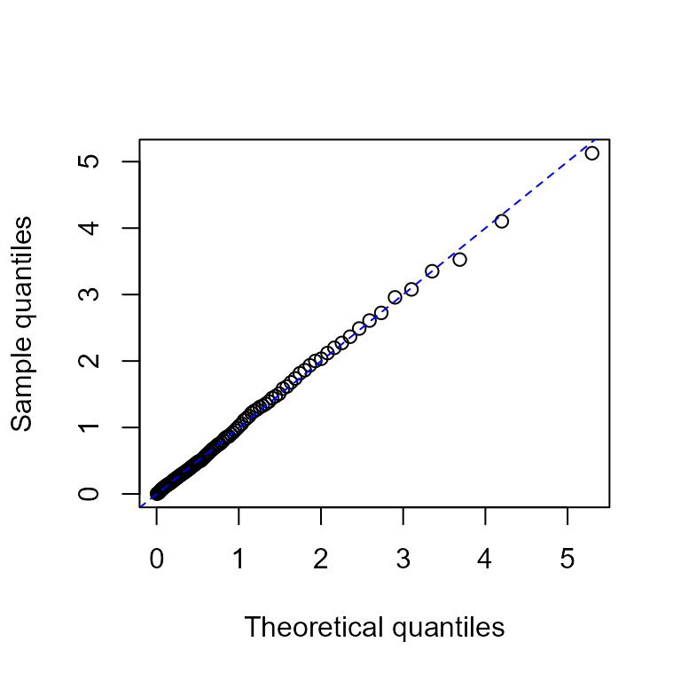

# Get started with emhawkes

This vignette introduces model specification, simulation, estimation and
a first residual check. It is included in the R package and also
published on the website. For more models, see [Extended
examples](https://ksublee.github.io/emhawkes/articles/extended_example.html).

## Basic Hawkes model

### Univariate Hawkes process

[`library`](https://rdrr.io/r/base/library.html)`(`[`emhawkes`](https://github.com/ksublee/emhawkes)`)`

This section shows how to specify, simulate, and fit a univariate Hawkes
model. First, create an `hspec` object to define the model. The S4 class
`hspec` includes slots such as `mu`, `alpha`, `beta`, `dimens`, `rmark`,
and `impact`.

In a univariate model, `mu`, `alpha`, and `beta` can be supplied as
numeric values, which are converted to matrices. The following example
defines an unmarked univariate Hawkes model.

`mu1`` ``<-`` ``0.3``; ``alpha1`` ``<-`` ``1.2``; ``beta1`` ``<-`` ``1.5`` ``hspec1`` ``<-`` ``new``(``"hspec"``, mu ``=`` ``mu1``, alpha ``=`` ``alpha1``, beta ``=`` ``beta1``)`` ``show``(``hspec1``)`` ``#> An object of class "hspec" of 1-dimensional Hawkes process`` ``#> `` ``#> Slot mu: `` ``#> [,1]`` ``#> [1,] 0.3`` ``#> `` ``#> Slot alpha: `` ``#> [,1]`` ``#> [1,] 1.2`` ``#> `` ``#> Slot beta: `` ``#> [,1]`` ``#> [1,] 1.5`

The `hsim` function simulates a path from an `hspec` object. The `size`
argument specifies the number of rows, including the initial state. The
optional arguments `lambda_component0` and `N0` specify the initial
intensity components and event counts, respectively. The intensity of
the basic univariate Hawkes model is

``` math
\lambda(t) = \mu + \int_{-\infty}^t \alpha e^{-\beta (t-s)} d N(s) = \mu + \lambda_c(0) e^{-\beta t} + \int_0^t \alpha e^{-\beta (t-s)} d N(s)
```

where `lambda_component0` denotes

``` math
\lambda_c(0) = \int_{-\infty}^0 \alpha e^{\beta s} d N(s).
```

If `lambda_component0` is omitted, the function determines the initial
intensity components internally. For a sufficiently long simulation of a
stable model, the effect of the initial intensity diminishes over time.
The default initial value of the counting process, `N0`, is zero.

[`set.seed`](https://rdrr.io/r/base/Random.html)`(``1107``)`` ``res1`` ``<-`` `[`hsim`](https://ksublee.github.io/emhawkes/reference/hsim.md)`(``hspec1``, size ``=`` ``1000``)`` `[`summary`](https://rdrr.io/r/base/summary.html)`(``res1``)`` ``#> -------------------------------------------------------`` ``#> Simulation result of exponential (marked) Hawkes model.`` ``#> Realized path :`` ``#> arrival N1 mark lambda1`` ``#> [1,] 0.00000 0 0 0.90000`` ``#> [2,] 0.97794 1 1 0.43838`` ``#> [3,] 1.09001 2 1 1.43128`` ``#> [4,] 1.28999 3 1 2.02711`` ``#> [5,] 1.53225 4 1 2.33527`` ``#> [6,] 1.65001 5 1 3.01139`` ``#> [7,] 2.51807 6 1 1.36377`` ``#> [8,] 2.81710 7 1 1.74553`` ``#> [9,] 2.87547 8 1 2.72378`` ``#> [10,] 3.16415 9 1 2.65016`` ``#> [11,] 3.51378 10 1 2.40131`` ``#> [12,] 4.22355 11 1 1.43843`` ``#> [13,] 16.96752 12 1 0.30000`` ``#> [14,] 17.71654 13 1 0.69015`` ``#> [15,] 19.10293 14 1 0.49874`` ``#> [16,] 24.06354 15 1 0.30082`` ``#> [17,] 24.09256 16 1 1.44967`` ``#> [18,] 28.40173 17 1 0.30366`` ``#> [19,] 28.53743 18 1 1.28198`` ``#> [20,] 28.56702 19 1 2.38725`` ``#> ... with 980 more rows `` ``#> -------------------------------------------------------`

The `hsim` function returns an S3 object of class `hreal` with the
following components.

- `hspec` is the model specification.

- `inter_arrival` contains the times between consecutive events.

- `arrival` is the cumulative sum of `inter_arrival`.

- `type` identifies the counting process associated with each event:
  type $`i`$ corresponds to $`N_i`$.

- `mark` contains the mark associated with each event.

- `N` contains the cumulative event counts for each type.

- `Nc` contains the cumulative marks for each type.

- `lambda` contains the intensity immediately before each event.

- `rambda` contains the intensity immediately after each event.

- `lambda_component` and `rambda_component` contain the intensity
  components $`\lambda_{ij}`$ immediately before and after each event,
  respectively.

With the default initial values, `inter_arrival`, `type`, `mark`, `N`,
and `Nc` begin with zero. The
[`summary()`](https://rdrr.io/r/base/summary.html) function displays the
first 20 rows of the realized path by default. The
[`print()`](https://rdrr.io/r/base/print.html) function also displays
the model specification and intensity components.

In this univariate model, `lambda == mu + lambda_component`.

`# The first and third columns are equal.`` `[`cbind`](https://rdrr.io/r/base/cbind.html)`(``res1``$``lambda``[``1``:``5``]``, ``res1``$``lambda_component``[``1``:``5``]``, ``mu1`` ``+`` ``res1``$``lambda_component``[``1``:``5``]``)`` ``#> [,1] [,2] [,3]`` ``#> [1,] 0.900000 0.600000 0.900000`` ``#> [2,] 0.438383 0.138383 0.438383`` ``#> [3,] 1.431282 1.131282 1.431282`` ``#> [4,] 2.027111 1.727111 2.027111`` ``#> [5,] 2.335269 2.035269 2.335269`

For all rows except the first, `rambda` equals `lambda + alpha` in this
model.

`# The second and third columns are equal except in the initial row.`` `[`cbind`](https://rdrr.io/r/base/cbind.html)`(``res1``$``lambda``[``1``:``5``]``, ``res1``$``rambda``[``1``:``5``]``, ``res1``$``lambda``[``1``:``5``]`` ``+`` ``alpha1``)`` ``#> [,1] [,2] [,3]`` ``#> [1,] 0.900000 0.900000 2.100000`` ``#> [2,] 0.438383 1.638383 1.638383`` ``#> [3,] 1.431282 2.631282 2.631282`` ``#> [4,] 2.027111 3.227111 3.227111`` ``#> [5,] 2.335269 3.535269 3.535269`

The following calculation verifies the exponential decay between events.

`# By definition, the following two are equal:`` ``res1``$``lambda``[``2``:``6``]`` ``#> [1] 0.438383 1.431282 2.027111 2.335269 3.011391`` ``mu1`` ``+`` ``(``res1``$``rambda``[``1``:``5``]`` ``-`` ``mu1``)`` ``*`` `[`exp`](https://rdrr.io/r/base/Log.html)`(``-``beta1`` ``*`` ``res1``$``inter_arrival``[``2``:``6``]``)`` ``#> [1] 0.438383 1.431282 2.027111 2.335269 3.011391`

Use `logLik` to evaluate the log-likelihood from the model specification
and observed inter-arrival times.

[`logLik`](https://ksublee.github.io/emhawkes/reference/logLik.md)`(``hspec1``, inter_arrival ``=`` ``res1``$``inter_arrival``)`` ``#> The initial values for intensity processes are not provided. Internally determined initial values are used.`` ``#> loglikelihood `` ``#> -214.2385`

Use `hfit` for maximum likelihood estimation. The `hspec0` object
supplies the initial parameter values for optimization. For this
univariate model, `inter_arrival` is the only required data argument. If
the initial intensity component is known, pass it as
`lambda_component0`; otherwise, the function determines it internally.
The default optimization method is BFGS.

`# Initial parameter values for numerical optimization.`` ``mu0`` ``<-`` ``0.5``; ``alpha0`` ``<-`` ``1.0``; ``beta0`` ``<-`` ``1.8`` ``hspec0`` ``<-`` ``new``(``"hspec"``, mu ``=`` ``mu0``, alpha ``=`` ``alpha0``, beta ``=`` ``beta0``)`` ``# Supply the initial values through hspec0.`` ``mle`` ``<-`` `[`hfit`](https://ksublee.github.io/emhawkes/reference/hfit.md)`(``hspec0``, inter_arrival ``=`` ``res1``$``inter_arrival``)`` `[`summary`](https://rdrr.io/r/base/summary.html)`(``mle``)`` ``#> --------------------------------------------`` ``#> Maximum Likelihood estimation`` ``#> BFGS maximization, 24 iterations`` ``#> Return code 0: successful convergence `` ``#> Log-Likelihood: -213.4658 `` ``#> 3 free parameters`` ``#> Estimates:`` ``#> Estimate Std. error t value Pr(> t) `` ``#> mu1 0.33641 0.03505 9.597 <2e-16 ***`` ``#> alpha1 1.16654 0.10400 11.217 <2e-16 ***`` ``#> beta1 1.52270 0.13615 11.184 <2e-16 ***`` ``#> ---`` ``#> Signif. codes: 0 '***' 0.001 '**' 0.01 '*' 0.05 '.' 0.1 ' ' 1`` ``#> --------------------------------------------`

Use
[`fitted_hspec()`](https://ksublee.github.io/emhawkes/reference/fitted_hspec.md)
to reconstruct the estimated model and
[`fit_initial_state()`](https://ksublee.github.io/emhawkes/reference/fit_initial_state.md)
to reuse its initial-state settings. The fit remains a `maxLik` object.
[`coef()`](https://rdrr.io/r/stats/coef.html),
[`summary()`](https://rdrr.io/r/base/summary.html), and
[`vcov()`](https://rdrr.io/r/stats/vcov.html) provide the usual
estimation results.

`estimated`` ``<-`` `[`fitted_hspec`](https://ksublee.github.io/emhawkes/reference/fitted_hspec.md)`(``mle``)`` ``initial`` ``<-`` `[`fit_initial_state`](https://ksublee.github.io/emhawkes/reference/fit_initial_state.md)`(``mle``)`` ``inferred`` ``<-`` `[`do.call`](https://rdrr.io/r/base/do.call.html)`(``logLik``, `[`c`](https://rdrr.io/r/base/c.html)`(`[`list`](https://rdrr.io/r/base/list.html)`(``object ``=`` ``estimated``,`` `` inter_arrival ``=`` ``res1``$``inter_arrival``, infer ``=`` ``TRUE``)``, ``initial``)``)`` `[`c`](https://rdrr.io/r/base/c.html)`(``fitted ``=`` `[`as.numeric`](https://rdrr.io/r/base/numeric.html)`(`[`logLik`](https://ksublee.github.io/emhawkes/reference/logLik.md)`(``mle``)``)``, restored ``=`` ``inferred``$``loglikelihood``)`` ``#> fitted restored `` ``#> -213.4658 -213.4658`` `[`head`](https://rdrr.io/r/utils/head.html)`(``inferred``$``lambda``)`` ``#> lambda1`` ``#> [1,] 0.8873272`` ``#> [2,] 0.4606831`` ``#> [3,] 1.4247076`` ``#> [4,] 1.9993196`` ``#> [5,] 2.2929804`` ``#> [6,] 2.9468135`` `[`head`](https://rdrr.io/r/utils/head.html)`(``inferred``$``res_process1``)`` ``#> [1] 0.1706982 0.4560080 0.6547397 0.3763245 2.1110149 0.6227413`

### A first residual check

For an ordinary Hawkes model, integrated-intensity residuals should
follow an exponential distribution with rate 1 when the model is
adequate. Compare their quantiles with the reference distribution.

`p`` ``<-`` `[`ppoints`](https://rdrr.io/r/stats/ppoints.html)`(``100``)`` ``q`` ``<-`` `[`quantile`](https://rdrr.io/r/stats/quantile.html)`(``inferred``$``res_process1``, probs ``=`` ``p``)`` `[`plot`](https://rdrr.io/r/graphics/plot.default.html)`(`[`qexp`](https://rdrr.io/r/stats/Exponential.html)`(``p``)``, ``q``, xlab ``=`` ``"Theoretical quantiles"``, ylab ``=`` ``"Sample quantiles"``)`` `[`abline`](https://rdrr.io/r/graphics/abline.html)`(``0``, ``1``, col ``=`` ``"blue"``, lty ``=`` ``2``)`



By default,
[`hfit()`](https://ksublee.github.io/emhawkes/reference/hfit.md) uses
the final Hessian and standard errors from `maxLik`. For saved fits, new
simulations, fuller residual diagnostics and optional
`final_hessian = "stable"` checks, see [Fitting and
inference](https://ksublee.github.io/emhawkes/articles/fitting-and-inference.html).
A stable Hessian alone does not establish reliable confidence intervals.

### Bivariate Hawkes model

The intensity process of a basic bivariate Hawkes model is defined by

``` math
 \lambda_1(t) = \mu_1 + \int_{-\infty}^t \alpha_{11} e^{-\beta_{11}(t-s)} d N_1(s) + \int_{-\infty}^t \alpha_{12} e^{-\beta_{12}(t-s)} d N_2(s),
```

``` math
 \lambda_2(t) = \mu_2 + \int_{-\infty}^t \alpha_{21} e^{-\beta_{21}(t-s)} d N_1(s) + \int_{-\infty}^t \alpha_{22} e^{-\beta_{22}(t-s)} d N_2(s).
```

For this bivariate model, `mu` is a 2-by-1 matrix, and `alpha` and
`beta` are 2-by-2 matrices.

``` math
\mu = \begin{bmatrix} \mu_1 \\ \mu_2 \end{bmatrix}, \quad
\alpha = \begin{bmatrix} \alpha_{11} & \alpha_{12} \\ \alpha_{21} & \alpha_{22} \end{bmatrix}, \quad
\beta = 
\begin{bmatrix} \beta_{11} & \beta_{12} \\ \beta_{21} & \beta_{22} \end{bmatrix}
```

`rmark` generates marks during simulation and can be omitted for
unmarked models. The 2-by-2 matrix `lambda_component0` specifies the
initial values of `lambda11`, `lambda12`, `lambda21`, and `lambda22`.
The intensity processes are represented by

``` math
 \lambda_1(t) = \mu_1 + \lambda_{11}(t) + \lambda_{12}(t), 
```

``` math
 \lambda_2(t) = \mu_2 + \lambda_{21}(t) + \lambda_{22}(t). 
```

The terms $`\lambda_{ij}`$ are called intensity components, and
`lambda_component0` specifies their initial values $`\lambda_{ij}(0)`$.
If `lambda_component0` is omitted, the function determines these values
internally.

`mu2`` ``<-`` `[`matrix`](https://rdrr.io/r/base/matrix.html)`(`[`c`](https://rdrr.io/r/base/c.html)`(``0.2``)``, nrow ``=`` ``2``)`` ``alpha2`` ``<-`` `[`matrix`](https://rdrr.io/r/base/matrix.html)`(`[`c`](https://rdrr.io/r/base/c.html)`(``0.5``, ``0.9``, ``0.9``, ``0.5``)``, nrow ``=`` ``2``, byrow ``=`` ``TRUE``)`` ``beta2`` ``<-`` `[`matrix`](https://rdrr.io/r/base/matrix.html)`(`[`c`](https://rdrr.io/r/base/c.html)`(``2.25``, ``2.25``, ``2.25``, ``2.25``)``, nrow ``=`` ``2``, byrow ``=`` ``TRUE``)`` ``hspec2`` ``<-`` ``new``(``"hspec"``, mu``=``mu2``, alpha``=``alpha2``, beta``=``beta2``)`` `[`print`](https://rdrr.io/r/base/print.html)`(``hspec2``)`` ``#> An object of class "hspec" of 2-dimensional Hawkes process`` ``#> `` ``#> Slot mu: `` ``#> [,1]`` ``#> [1,] 0.2`` ``#> [2,] 0.2`` ``#> `` ``#> Slot alpha: `` ``#> [,1] [,2]`` ``#> [1,] 0.5 0.9`` ``#> [2,] 0.9 0.5`` ``#> `` ``#> Slot beta: `` ``#> [,1] [,2]`` ``#> [1,] 2.25 2.25`` ``#> [2,] 2.25 2.25`

Use `hsim` to simulate the model.

[`set.seed`](https://rdrr.io/r/base/Random.html)`(``1107``)`` ``res2`` ``<-`` `[`hsim`](https://ksublee.github.io/emhawkes/reference/hsim.md)`(``hspec2``, size``=``1000``)`` `[`summary`](https://rdrr.io/r/base/summary.html)`(``res2``)`` ``#> -------------------------------------------------------`` ``#> Simulation result of exponential (marked) Hawkes model.`` ``#> Realized path :`` ``#> arrival N1 N2 mark lambda1 lambda2`` ``#> [1,] 0.00000 0 0 0 0.52941 0.52941`` ``#> [2,] 0.57028 1 0 1 0.29130 0.29130`` ``#> [3,] 1.66175 1 1 1 0.25073 0.28505`` ``#> [4,] 2.17979 1 2 1 0.49638 0.38238`` ``#> [5,] 2.47685 1 3 1 0.81319 0.54975`` ``#> [6,] 2.64001 2 3 1 1.24825 0.78866`` ``#> [7,] 2.70249 3 3 1 1.54519 1.49341`` ``#> [8,] 2.94547 4 3 1 1.26810 1.46968`` ``#> [9,] 3.39313 4 4 1 0.77271 0.99242`` ``#> [10,] 3.52533 4 5 1 1.29379 1.15989`` ``#> [11,] 3.56971 5 5 1 2.00432 1.52115`` ``#> [12,] 3.70761 5 6 1 1.88965 1.82866`` ``#> [13,] 4.30122 5 7 1 0.88106 0.75983`` ``#> [14,] 4.34337 6 7 1 1.63800 1.16393`` ``#> [15,] 4.40222 7 7 1 1.89764 1.83275`` ``#> [16,] 4.58943 8 7 1 1.64219 1.86211`` ``#> [17,] 5.14665 9 7 1 0.75437 0.93131`` ``#> [18,] 5.18186 9 8 1 1.17407 1.70707`` ``#> [19,] 5.36167 9 9 1 1.45050 1.53925`` ``#> [20,] 5.89118 10 9 1 0.85331 0.75875`` ``#> ... with 980 more rows `` ``#> -------------------------------------------------------`

In multivariate models, `type` identifies the counting process
associated with each event.

`# A bivariate model has two event types: 1 and 2.`` ``res2``$``type``[``1``:``10``]`` ``#> [1] 0 1 2 2 2 1 1 1 2 2`

In multivariate models, the column names of `N` are `N1`, `N2`, `N3`,
and so on.

`res2``$``N``[``1``:``3``, ``]`` ``#> N1 N2`` ``#> [1,] 0 0`` ``#> [2,] 1 0`` ``#> [3,] 1 1`

Similarly, the column names of `lambda` are `lambda1`, `lambda2`,
`lambda3`, and so on.

`res2``$``lambda``[``1``:``3``, ``]`` ``#> lambda1 lambda2`` ``#> [1,] 0.5294118 0.5294118`` ``#> [2,] 0.2913028 0.2913028`` ``#> [3,] 0.2507301 0.2850475`

In this bivariate model, the columns of `lambda_component` are
`lambda11`, `lambda12`, `lambda21`, and `lambda22`.

`res2``$``lambda_component``[``1``:``3``, ``]`` ``#> lambda11 lambda12 lambda21 lambda22`` ``#> [1,] 0.11764706 0.211764706 0.21176471 0.117647059`` ``#> [2,] 0.03260813 0.058694641 0.05869464 0.032608134`` ``#> [3,] 0.04569443 0.005035631 0.08224997 0.002797573`

By definition, the following two expressions are equivalent:

`mu2``[``1``]`` ``+`` `[`rowSums`](https://rdrr.io/r/base/colSums.html)`(``res2``$``lambda_component``[``1``:``5``, `[`c`](https://rdrr.io/r/base/c.html)`(``"lambda11"``, ``"lambda12"``)``]``)`` ``#> [1] 0.5294118 0.2913028 0.2507301 0.4963769 0.8131889`` ``res2``$``lambda``[``1``:``5``, ``"lambda1"``]`` ``#> [1] 0.5294118 0.2913028 0.2507301 0.4963769 0.8131889`

Extract the observed `inter_arrival` and `type` vectors from the
simulation result. Both are required to fit a bivariate model.

`inter_arrival2`` ``<-`` ``res2``$``inter_arrival`` ``type2`` ``<-`` ``res2``$``type`

Use `logLik` to evaluate the log-likelihood.

[`logLik`](https://ksublee.github.io/emhawkes/reference/logLik.md)`(``hspec2``, inter_arrival ``=`` ``inter_arrival2``, type ``=`` ``type2``)`` ``#> The initial values for intensity processes are not provided. Internally determined initial values are used.`` ``#> loglikelihood `` ``#> -974.2809`

Use `hfit` to estimate the parameters from `inter_arrival` and `type`.
The values of `mu`, `alpha`, and `beta` in `hspec0` provide starting
points for optimization. Here, we use the simulation parameters by
setting `hspec0 <- hspec2`. For observed data, choose initial values
because the true parameters are unknown.

By default, `reduced = TRUE` groups equal starting values within each
parameter matrix. Here, the two entries of `mu` share one parameter, the
diagonal and off-diagonal entries of `alpha` give two parameters, and
all entries of `beta` share one parameter. The fit therefore estimates
four parameters. `hfit` prints a short explanation once before
optimization.

`hspec0`` ``<-`` ``hspec2`` ``mle`` ``<-`` `[`hfit`](https://ksublee.github.io/emhawkes/reference/hfit.md)`(``hspec0``, inter_arrival ``=`` ``inter_arrival2``, type ``=`` ``type2``)`` ``#> hfit: equal starting values within each matrix share a parameter (reduced = TRUE; mu, alpha, beta).`` ``#> Use reduced = FALSE to estimate matrix entries separately.`` `[`summary`](https://rdrr.io/r/base/summary.html)`(``mle``)`` ``#> --------------------------------------------`` ``#> Maximum Likelihood estimation`` ``#> BFGS maximization, 35 iterations`` ``#> Return code 0: successful convergence `` ``#> Log-Likelihood: -970.1408 `` ``#> 4 free parameters`` ``#> Estimates:`` ``#> Estimate Std. error t value Pr(> t) `` ``#> mu1 0.19095 0.01635 11.68 < 2e-16 ***`` ``#> alpha1.1 0.48217 0.07373 6.54 6.15e-11 ***`` ``#> alpha1.2 0.98625 0.09484 10.40 < 2e-16 ***`` ``#> beta1.1 2.07987 0.16728 12.43 < 2e-16 ***`` ``#> ---`` ``#> Signif. codes: 0 '***' 0.001 '**' 0.01 '*' 0.05 '.' 0.1 ' ' 1`` ``#> --------------------------------------------`

[`coef`](https://rdrr.io/r/stats/coef.html)`(``mle``)`` ``#> mu1 alpha1.1 alpha1.2 beta1.1 `` ``#> 0.1909541 0.4821725 0.9862542 2.0798690`

`miscTools``::`[`stdEr`](https://rdrr.io/pkg/miscTools/man/stdEr.html)`(``mle``)`` ``#> mu1 alpha1.1 alpha1.2 beta1.1 `` ``#> 0.01635080 0.07372719 0.09484410 0.16727659`

The restored matrices retain the shared parameters from this fit. The
diagonal entries of `alpha` remain equal, as do its off-diagonal
entries.

`estimated2`` ``<-`` `[`fitted_hspec`](https://ksublee.github.io/emhawkes/reference/fitted_hspec.md)`(``mle``)`` ``estimated2``@``alpha`` ``#> [,1] [,2]`` ``#> [1,] 0.4821725 0.9862542`` ``#> [2,] 0.9862542 0.4821725`` ``estimated2``@``beta`` ``#> [,1] [,2]`` ``#> [1,] 2.079869 2.079869`` ``#> [2,] 2.079869 2.079869`

Set `reduced = FALSE` to estimate all ten matrix entries separately,
even when their starting values are equal. Use
`suppressMessages(hfit(...))` to hide the startup explanation. For
function components, parameters with the same name are shared under
either setting. A zero in a numeric matrix is an estimated starting
value; use a component function to fix selected entries at zero.

### Observed data and initial state

The first row represents the initial state and is not an event. For
event times measured from the observation start, prepare the input as
follows:

`inter_arrival`` ``<-`` `[`c`](https://rdrr.io/r/base/c.html)`(``0``, `[`diff`](https://rdrr.io/r/base/diff.html)`(`[`c`](https://rdrr.io/r/base/c.html)`(``0``, ``event_times``)``)``)`` ``type`` ``<-`` `[`c`](https://rdrr.io/r/base/c.html)`(``0``, ``event_types``)`` ``mark`` ``<-`` `[`c`](https://rdrr.io/r/base/c.html)`(``0``, ``event_marks``)`

Omit `type` for a univariate model and `mark` for unit marks. The
vectors must have the same length; event types range from 1 to the model
dimension. Event order is preserved, including events at the same time.
The likelihood currently ends at the last supplied event.

`N0` and `Nc0` specify initial event counts and mark totals. Pass `Nc0`
by name in `hfit`, and use the same initial state when comparing
simulation and likelihood results. `lambda_component0` can be a scalar
or a matrix matching `alpha` and `beta`. If supplied, `N` and `Nc` must
have one row per input row and one column per dimension, and must agree
with the events and initial counts. Their rows contain the cumulative
values after each event.

## Next steps

- [Extended
  examples](https://ksublee.github.io/emhawkes/articles/extended_example.html):
  marked, state-dependent, multi-kernel and flexible residual models.
- [Fitting and
  inference](https://ksublee.github.io/emhawkes/articles/fitting-and-inference.html):
  parameter settings, initial states, fitted models, residual
  diagnostics and standard errors.
- [Computation](https://ksublee.github.io/emhawkes/articles/computation.html):
  likelihood engines, analytic gradients, Jacobians and performance.
- [Reference](https://ksublee.github.io/emhawkes/reference/index.html):
  function arguments and return values.
