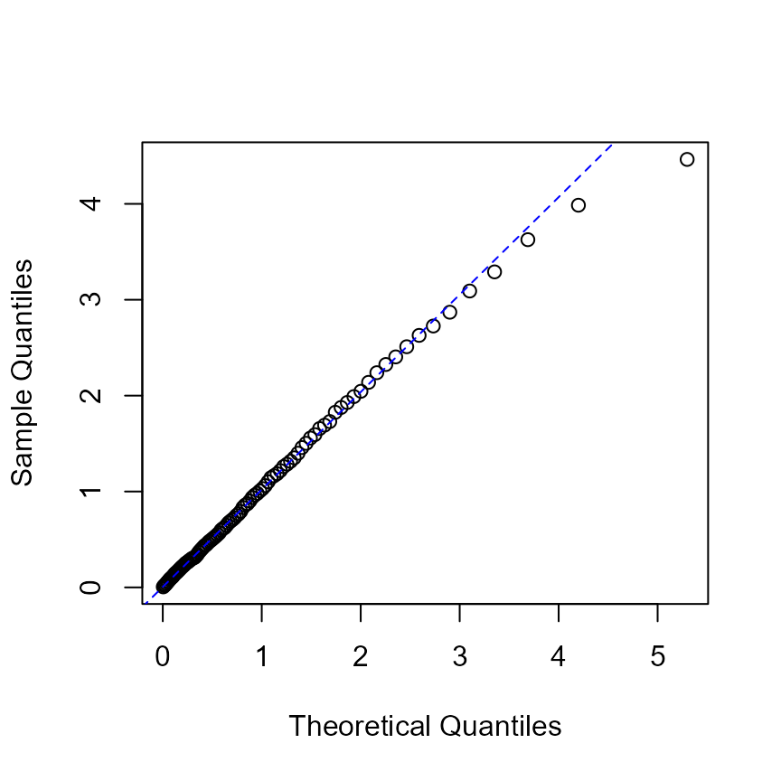
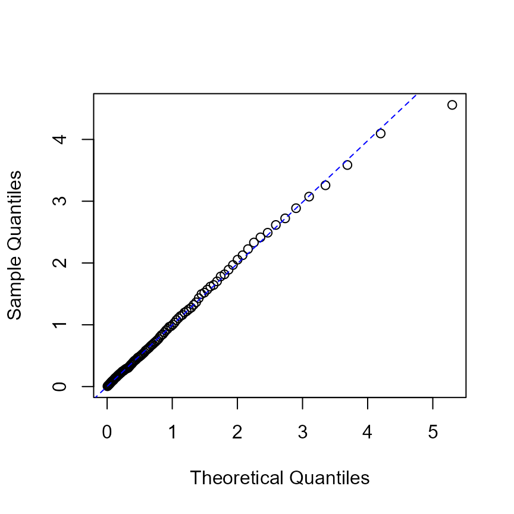
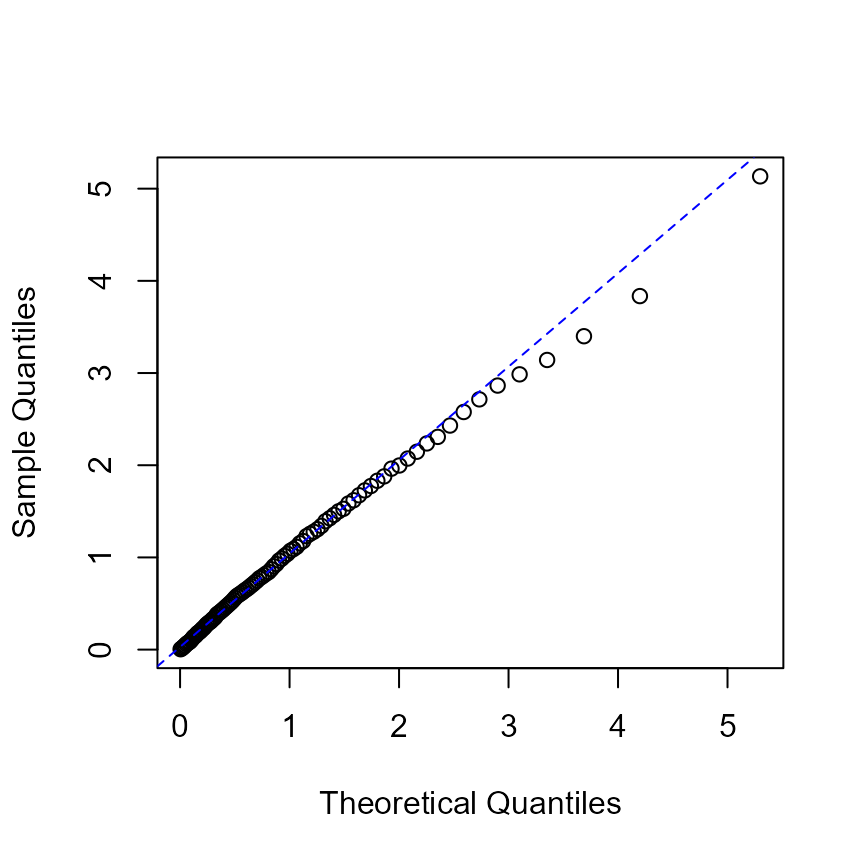
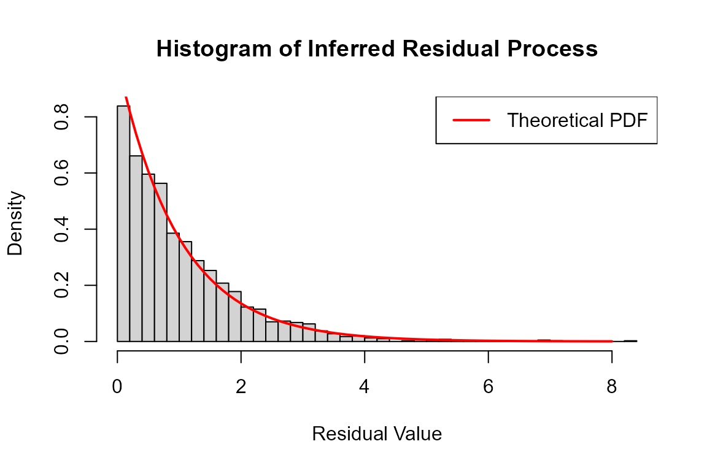

# Fitting and inference

This guide explains estimation and interpretation after the [Get
started](https://ksublee.github.io/emhawkes/articles/example.html)
workflow. See [Extended
examples](https://ksublee.github.io/emhawkes/articles/extended_example.html)
for model specifications and
[Computation](https://ksublee.github.io/emhawkes/articles/computation.html)
for engines, gradients and Jacobians.

## Working example

The following bivariate model supplies the data used below.

[`library`](https://rdrr.io/r/base/library.html)`(`[`emhawkes`](https://github.com/ksublee/emhawkes)`)`` `` ``h`` ``<-`` ``new``(``"hspec"``,`` `` mu ``=`` `[`c`](https://rdrr.io/r/base/c.html)`(``0.2``, ``0.2``)``,`` `` alpha ``=`` `[`matrix`](https://rdrr.io/r/base/matrix.html)`(`[`c`](https://rdrr.io/r/base/c.html)`(``0.5``, ``0.9``, ``0.9``, ``0.5``)``, ``2``, byrow ``=`` ``TRUE``)``,`` `` beta ``=`` `[`matrix`](https://rdrr.io/r/base/matrix.html)`(``2.25``, ``2``, ``2``)`` ``)`` `[`set.seed`](https://rdrr.io/r/base/Random.html)`(``1107``)`` ``path`` ``<-`` `[`hsim`](https://ksublee.github.io/emhawkes/reference/hsim.md)`(``h``, size ``=`` ``1000``)`` ``fit`` ``<-`` `[`hfit`](https://ksublee.github.io/emhawkes/reference/hfit.md)`(``h``, ``path``$``inter_arrival``, ``path``$``type``)`` ``#> hfit: equal starting values within each matrix share a parameter (reduced = TRUE; mu, alpha, beta).`` ``#> Use reduced = FALSE to estimate matrix entries separately.`` `[`summary`](https://rdrr.io/r/base/summary.html)`(``fit``)`` ``#> --------------------------------------------`` ``#> Maximum Likelihood estimation`` ``#> BFGS maximization, 35 iterations`` ``#> Return code 0: successful convergence `` ``#> Log-Likelihood: -970.1408 `` ``#> 4 free parameters`` ``#> Estimates:`` ``#> Estimate Std. error t value Pr(> t) `` ``#> mu1 0.19095 0.01635 11.68 < 2e-16 ***`` ``#> alpha1.1 0.48217 0.07373 6.54 6.15e-11 ***`` ``#> alpha1.2 0.98625 0.09484 10.40 < 2e-16 ***`` ``#> beta1.1 2.07987 0.16728 12.43 < 2e-16 ***`` ``#> ---`` ``#> Signif. codes: 0 '***' 0.001 '**' 0.01 '*' 0.05 '.' 0.1 ' ' 1`` ``#> --------------------------------------------`

## Parameter sharing and fixed entries

By default, `reduced = TRUE` treats equal starting values **within each
parameter matrix** as one parameter. This example estimates four
parameters: one for `mu`, two for `alpha`, and one for `beta`.
[`hfit()`](https://ksublee.github.io/emhawkes/reference/hfit.md)
explains this rule once before optimization.

Use `reduced = FALSE` to estimate the ten matrix entries separately,
even when their starting values are equal. Function components share
parameters by name under either setting. A zero in a numeric matrix is
also a starting value; use a component function to fix selected entries
at zero.

The following examples show how starting values change the parameter
map.

`hspec2`` ``<-`` ``h`` ``res2`` ``<-`` ``path`

The sharing rule is applied separately to each matrix; equal values in
`mu` and `alpha` do not link those components. The startup message lists
matrices with shared entries. Use `suppressMessages(hfit(...))` to hide
it.

For example, if `alpha[1,1]` and `alpha[1,2]` have different initial
values, `hfit` estimates them separately. If they have the same initial
value, `hfit` treats them as a single parameter.

The previous example uses a symmetric Hawkes model: `alpha` is
symmetric, and all entries of `beta` are equal.

[`print`](https://rdrr.io/r/base/print.html)`(``hspec2``)`` ``#> An object of class "hspec" of 2-dimensional Hawkes process`` ``#> `` ``#> Slot mu: `` ``#> [,1]`` ``#> [1,] 0.2`` ``#> [2,] 0.2`` ``#> `` ``#> Slot alpha: `` ``#> [,1] [,2]`` ``#> [1,] 0.5 0.9`` ``#> [2,] 0.9 0.5`` ``#> `` ``#> Slot beta: `` ``#> [,1] [,2]`` ``#> [1,] 2.25 2.25`` ``#> [2,] 2.25 2.25`

[`set.seed`](https://rdrr.io/r/base/Random.html)`(``1107``)`` ``res2`` ``<-`` `[`hsim`](https://ksublee.github.io/emhawkes/reference/hsim.md)`(``hspec2``, size ``=`` ``1000``)`

In the first example, all entries of `alpha0` are set to 0.75. This
constrains `alpha11`, `alpha12`, `alpha21`, and `alpha22` to share one
estimated value, even though their simulation values differ. The same
rule applies within `mu0` and `beta0`.

`mu0`` ``<-`` `[`matrix`](https://rdrr.io/r/base/matrix.html)`(`[`c`](https://rdrr.io/r/base/c.html)`(``0.15``, ``0.15``)``, nrow ``=`` ``2``)`` ``alpha0`` ``<-`` `[`matrix`](https://rdrr.io/r/base/matrix.html)`(`[`c`](https://rdrr.io/r/base/c.html)`(``0.75``, ``0.75``, ``0.75``, ``0.75``)``, nrow ``=`` ``2``, byrow``=``TRUE``)`` ``beta0`` ``<-`` `[`matrix`](https://rdrr.io/r/base/matrix.html)`(`[`c`](https://rdrr.io/r/base/c.html)`(``2.6``, ``2.6``, ``2.6``, ``2.6``)``, nrow ``=`` ``2``, byrow``=``TRUE``)`` `` ``hspec0`` ``<-`` ``new``(``"hspec"``, mu``=``mu0``, alpha``=``alpha0``, beta``=``beta0``)`` `[`summary`](https://rdrr.io/r/base/summary.html)`(`[`hfit`](https://ksublee.github.io/emhawkes/reference/hfit.md)`(``hspec0``, inter_arrival ``=`` ``res2``$``inter_arrival``, type ``=`` ``res2``$``type``)``)`` ``#> hfit: equal starting values within each matrix share a parameter (reduced = TRUE; mu, alpha, beta).`` ``#> Use reduced = FALSE to estimate matrix entries separately.`` ``#> --------------------------------------------`` ``#> Maximum Likelihood estimation`` ``#> BFGS maximization, 45 iterations`` ``#> Return code 0: successful convergence `` ``#> Log-Likelihood: -979.5687 `` ``#> 3 free parameters`` ``#> Estimates:`` ``#> Estimate Std. error t value Pr(> t) `` ``#> mu1 0.19125 0.01641 11.65 <2e-16 ***`` ``#> alpha1.1 0.73981 0.06270 11.80 <2e-16 ***`` ``#> beta1.1 2.09707 0.17502 11.98 <2e-16 ***`` ``#> ---`` ``#> Signif. codes: 0 '***' 0.001 '**' 0.01 '*' 0.05 '.' 0.1 ' ' 1`` ``#> --------------------------------------------`

This fit estimates one excitation parameter for both self-excitation and
mutual excitation, whose simulation values are 0.5 and 0.9,
respectively.

In the second example, `alpha0` has the same symmetry as the simulation
model. Its diagonal entries are equal, and its off-diagonal entries
share a different value. The model therefore has two excitation
parameters to estimate.

`mu0`` ``<-`` `[`matrix`](https://rdrr.io/r/base/matrix.html)`(`[`c`](https://rdrr.io/r/base/c.html)`(``0.15``, ``0.15``)``, nrow ``=`` ``2``)`` ``alpha0`` ``<-`` `[`matrix`](https://rdrr.io/r/base/matrix.html)`(`[`c`](https://rdrr.io/r/base/c.html)`(``0.75``, ``0.751``, ``0.751``, ``0.75``)``, nrow ``=`` ``2``, byrow``=``TRUE``)`` ``beta0`` ``<-`` `[`matrix`](https://rdrr.io/r/base/matrix.html)`(`[`c`](https://rdrr.io/r/base/c.html)`(``2.6``, ``2.6``, ``2.6``, ``2.6``)``, nrow ``=`` ``2``, byrow``=``TRUE``)`` `` ``hspec0`` ``<-`` ``new``(``"hspec"``, mu``=``mu0``, alpha``=``alpha0``, beta``=``beta0``)`` `[`summary`](https://rdrr.io/r/base/summary.html)`(`[`hfit`](https://ksublee.github.io/emhawkes/reference/hfit.md)`(``hspec0``, inter_arrival ``=`` ``res2``$``inter_arrival``, type ``=`` ``res2``$``type``)``)`` ``#> hfit: equal starting values within each matrix share a parameter (reduced = TRUE; mu, alpha, beta).`` ``#> Use reduced = FALSE to estimate matrix entries separately.`` ``#> --------------------------------------------`` ``#> Maximum Likelihood estimation`` ``#> BFGS maximization, 30 iterations`` ``#> Return code 0: successful convergence `` ``#> Log-Likelihood: -970.1408 `` ``#> 4 free parameters`` ``#> Estimates:`` ``#> Estimate Std. error t value Pr(> t) `` ``#> mu1 0.19095 0.01635 11.676 < 2e-16 ***`` ``#> alpha1.1 0.48226 0.07204 6.694 2.17e-11 ***`` ``#> alpha1.2 0.98626 0.09114 10.821 < 2e-16 ***`` ``#> beta1.1 2.08008 0.15980 13.017 < 2e-16 ***`` ``#> ---`` ``#> Signif. codes: 0 '***' 0.001 '**' 0.01 '*' 0.05 '.' 0.1 ' ' 1`` ``#> --------------------------------------------`

The third example allows `mu1` and `mu2` to differ, even though they are
equal in the simulation model.

`mu0`` ``<-`` `[`matrix`](https://rdrr.io/r/base/matrix.html)`(`[`c`](https://rdrr.io/r/base/c.html)`(``0.15``, ``0.14``)``, nrow ``=`` ``2``)`` ``alpha0`` ``<-`` `[`matrix`](https://rdrr.io/r/base/matrix.html)`(`[`c`](https://rdrr.io/r/base/c.html)`(``0.75``, ``0.751``, ``0.751``, ``0.75``)``, nrow ``=`` ``2``, byrow``=``TRUE``)`` ``beta0`` ``<-`` `[`matrix`](https://rdrr.io/r/base/matrix.html)`(`[`c`](https://rdrr.io/r/base/c.html)`(``2.6``, ``2.6``, ``2.6``, ``2.6``)``, nrow ``=`` ``2``, byrow``=``TRUE``)`` `` ``hspec0`` ``<-`` ``new``(``"hspec"``, mu``=``mu0``, alpha``=``alpha0``, beta``=``beta0``)`` `[`summary`](https://rdrr.io/r/base/summary.html)`(`[`hfit`](https://ksublee.github.io/emhawkes/reference/hfit.md)`(``hspec0``, inter_arrival ``=`` ``res2``$``inter_arrival``, type ``=`` ``res2``$``type``)``)`` ``#> hfit: equal starting values within each matrix share a parameter (reduced = TRUE; alpha, beta).`` ``#> Use reduced = FALSE to estimate matrix entries separately.`` ``#> --------------------------------------------`` ``#> Maximum Likelihood estimation`` ``#> BFGS maximization, 44 iterations`` ``#> Return code 0: successful convergence `` ``#> Log-Likelihood: -969.9914 `` ``#> 5 free parameters`` ``#> Estimates:`` ``#> Estimate Std. error t value Pr(> t) `` ``#> mu1 0.18300 0.02157 8.483 < 2e-16 ***`` ``#> mu2 0.19872 0.02206 9.009 < 2e-16 ***`` ``#> alpha1.1 0.48149 0.07355 6.546 5.89e-11 ***`` ``#> alpha1.2 0.98720 0.09427 10.472 < 2e-16 ***`` ``#> beta1.1 2.07973 0.17051 12.197 < 2e-16 ***`` ``#> ---`` ``#> Signif. codes: 0 '***' 0.001 '**' 0.01 '*' 0.05 '.' 0.1 ' ' 1`` ``#> --------------------------------------------`

Set `reduced = FALSE` to estimate each matrix entry separately,
including entries with equal initial values.

[`summary`](https://rdrr.io/r/base/summary.html)`(`[`hfit`](https://ksublee.github.io/emhawkes/reference/hfit.md)`(``hspec2``, inter_arrival ``=`` ``res2``$``inter_arrival``, type ``=`` ``res2``$``type``, reduced``=``FALSE``)``)`` ``#> --------------------------------------------`` ``#> Maximum Likelihood estimation`` ``#> BFGS maximization, 51 iterations`` ``#> Return code 0: successful convergence `` ``#> Log-Likelihood: -966.5055 `` ``#> 10 free parameters`` ``#> Estimates:`` ``#> Estimate Std. error t value Pr(> t) `` ``#> mu1 0.17997 0.02271 7.926 2.27e-15 ***`` ``#> mu2 0.20060 0.02430 8.255 < 2e-16 ***`` ``#> alpha1.1 0.44726 0.16076 2.782 0.005400 ** `` ``#> alpha2.1 1.17743 0.26171 4.499 6.83e-06 ***`` ``#> alpha1.2 0.97048 0.13597 7.137 9.51e-13 ***`` ``#> alpha2.2 0.48979 0.11381 4.304 1.68e-05 ***`` ``#> beta1.1 2.52210 1.00909 2.499 0.012441 * `` ``#> beta2.1 3.15498 0.88787 3.553 0.000380 ***`` ``#> beta1.2 1.80167 0.23773 7.579 3.49e-14 ***`` ``#> beta2.2 1.51338 0.40168 3.768 0.000165 ***`` ``#> ---`` ``#> Signif. codes: 0 '***' 0.001 '**' 0.01 '*' 0.05 '.' 0.1 ' ' 1`` ``#> --------------------------------------------`

The same rules apply to higher-dimensional models. For function
components, the named entries in `param` define the estimated
parameters. Matching parameter names are shared across functions, even
with `reduced = FALSE`. Use different names for independent parameters
with equal starting values. Conflicting starting values for a shared
name produce a warning, and the first value is used. A zero in a numeric
matrix is an estimated starting value; constants inside a component
function remain fixed.

## Observed data and initial state

The first data row is the initial state. `inter_arrival`, `type`, and
`mark` start with zero, followed by the observed events. `hsim(size)`
includes this initial row. `N0` and `Nc0` specify initial counts and
mark totals; `Nc0` must be named in
[`hfit()`](https://ksublee.github.io/emhawkes/reference/hfit.md).

The likelihood ends at the last supplied event. `N0` and `Nc0` accept a
scalar or one value per event type. Supplied `N` and `Nc` matrices must
agree with the event data and initial counts. Explicit `type_col_map`
requires initial kernel components for simulation and the built-in
likelihood.

Event order is preserved when times coincide. Use the same initial
counts and `lambda_component0` for simulation and likelihood evaluation
when comparing paths. A scalar `lambda_component0` is expanded to all
kernel components; a matrix must match the kernel dimensions. For
multi-kernel models, supply it explicitly.

Counting-process matrices supplied as `N` or `Nc` must agree with the
event data and initial counts. Each row contains the values after that
event. A baseline function called with index `n` uses row `n - 1` for
the preceding state; an impact function uses row `n` for the current
event. Component functions can declare only the arguments they need, and
use `...` to receive the remaining context.

Prepare observed event times measured from the observation start as
follows:

`inter_arrival`` ``<-`` `[`c`](https://rdrr.io/r/base/c.html)`(``0``, `[`diff`](https://rdrr.io/r/base/diff.html)`(`[`c`](https://rdrr.io/r/base/c.html)`(``0``, ``event_times``)``)``)`` ``type`` ``<-`` `[`c`](https://rdrr.io/r/base/c.html)`(``0``, ``event_types``)`` ``mark`` ``<-`` `[`c`](https://rdrr.io/r/base/c.html)`(``0``, ``event_marks``)`

Omit `type` for a univariate model and `mark` for unit marks. The
vectors must have the same length; event types range from 1 to the model
dimension.

## Restoring and saving a fitted model

Use `fitted_hspec(fit)` to restore the estimated model and
`fit_initial_state(fit)` to retrieve the initial-state arguments:

`estimated`` ``<-`` `[`fitted_hspec`](https://ksublee.github.io/emhawkes/reference/fitted_hspec.md)`(``fit``)`` ``initial`` ``<-`` `[`fit_initial_state`](https://ksublee.github.io/emhawkes/reference/fit_initial_state.md)`(``fit``)`` ``inferred`` ``<-`` `[`do.call`](https://rdrr.io/r/base/do.call.html)`(``logLik``, `[`c`](https://rdrr.io/r/base/c.html)`(`[`list`](https://rdrr.io/r/base/list.html)`(``object ``=`` ``estimated``,`` `` inter_arrival ``=`` ``path``$``inter_arrival``, type ``=`` ``path``$``type``, mark ``=`` ``path``$``mark``,`` `` infer ``=`` ``TRUE``)``, ``initial``)``)`` ``#> The initial values for intensity processes are not provided. Internally determined initial values are used.`

The result remains a `maxLik` object, so
[`coef()`](https://rdrr.io/r/stats/coef.html),
[`summary()`](https://rdrr.io/r/base/summary.html), and
[`vcov()`](https://rdrr.io/r/stats/vcov.html) keep their existing
behavior. The saved parameter map preserves shared parameters and fixed
constants in component functions. Simulation generators are retained,
and their named parameters are updated when they match estimated
coefficient names. Automatic initial intensity remains `NULL` and is
recalculated for the restored model. Initial counts are retained. A
custom objective is not incorporated into the restored model.

Save the fit with [`saveRDS()`](https://rdrr.io/r/base/readRDS.html) to
retain this information between sessions. Keep the observed data
separately and supply them again for inference. The stored optimization
objective can retain data in its function environment. The saved initial
state describes the start of the observation window. Pass it to
[`hsim()`](https://ksublee.github.io/emhawkes/reference/hsim.md) to
start a new path from the estimated model. Continuing after the last
observed event requires that event’s state. Fits created without the new
metadata need to be refitted before using the reconstruction helpers.

Pass the restored specification and the saved initial-state arguments to
[`hsim()`](https://ksublee.github.io/emhawkes/reference/hsim.md) to
generate a new path after checking convergence and model suitability.

[`set.seed`](https://rdrr.io/r/base/Random.html)`(``1108``)`` ``simulated`` ``<-`` `[`do.call`](https://rdrr.io/r/base/do.call.html)`(``hsim``, `[`c`](https://rdrr.io/r/base/c.html)`(`[`list`](https://rdrr.io/r/base/list.html)`(``object ``=`` ``estimated``, size ``=`` ``100``)``, ``initial``)``)`` `[`head`](https://rdrr.io/r/utils/head.html)`(``simulated``$``arrival``)`` ``#> [1] 0.000000 2.526746 2.946904 3.216280 3.253234 4.359288`

[`saveRDS`](https://rdrr.io/r/base/readRDS.html)`(``fit``, ``"hawkes-fit.rds"``)`` ``saved_fit`` ``<-`` `[`readRDS`](https://rdrr.io/r/base/readRDS.html)`(``"hawkes-fit.rds"``)`` ``estimated`` ``<-`` `[`fitted_hspec`](https://ksublee.github.io/emhawkes/reference/fitted_hspec.md)`(``saved_fit``)`` ``initial`` ``<-`` `[`fit_initial_state`](https://ksublee.github.io/emhawkes/reference/fit_initial_state.md)`(``saved_fit``)`

## Curvature and standard errors

By default,
[`hfit()`](https://ksublee.github.io/emhawkes/reference/hfit.md) uses
the final Hessian and standard errors from `maxLik`. It does not run the
additional stabilization checks. If numerical Hawkes standard errors
contain `NaN`, a short message suggests trying
`final_hessian = "stable"`. Request this option to check numerical
Hawkes curvature with scaled central differences and Richardson
extrapolation. This preserves the optimizer’s coefficients and
log-likelihood. [`summary()`](https://rdrr.io/r/base/summary.html) and
[`vcov()`](https://rdrr.io/r/stats/vcov.html) then use the checked
covariance; free-parameter standard errors are `NA` when stable
inversion is unavailable. Inspect `fit_diagnostics(fit)` for the
requested checks. Supplied Hessians, disabled final curvature, BHHH,
custom objectives, and residual models retain their calculation choices.

A stable Hessian does not guarantee reliable Wald intervals. Nearby
kernel decay rates, weak excitation, boundaries, short samples, and
nonsmooth callbacks can still make inference unreliable. The [Hawkes
standard-error
report](https://github.com/ksublee/emhawkes/blob/main/tools/hawkes-standard-errors.md)
compares unchanged estimates and corrected standard errors, and
discusses profile likelihood and bootstrap. The [earlier diagnostic
report](https://github.com/ksublee/emhawkes/blob/main/tools/fit-diagnostics.md)
records the original Hawkes and FRPP issues.

Check convergence, score, and multiple starting values before
interpreting intervals.

`fit_checked`` ``<-`` `[`hfit`](https://ksublee.github.io/emhawkes/reference/hfit.md)`(``h``, ``path``$``inter_arrival``, ``path``$``type``, final_hessian ``=`` ``"stable"``)`` ``#> hfit: equal starting values within each matrix share a parameter (reduced = TRUE; mu, alpha, beta).`` ``#> Use reduced = FALSE to estimate matrix entries separately.`` `[`fit_diagnostics`](https://ksublee.github.io/emhawkes/reference/fit_diagnostics.md)`(``fit_checked``)``[`[`c`](https://rdrr.io/r/base/c.html)`(``"status"``, ``"scaled_condition"``, ``"newton_decrement"``)``]`` ``#> $status`` ``#> [1] "ok"`` ``#> `` ``#> $scaled_condition`` ``#> [1] 25.35156`` ``#> `` ``#> $newton_decrement`` ``#> [1] 8.293406e-06`

The calculation record is explained in
[Computation](https://ksublee.github.io/emhawkes/articles/computation.html#recorded-calculation-methods).

## Residual diagnostics

`logLik(h, ..., infer = TRUE)` returns a list with the likelihood,
intensity paths, and residual vectors. Use it in place of the deprecated
[`infer_lambda()`](https://ksublee.github.io/emhawkes/reference/infer_lambda.md)
and
[`residual_process()`](https://ksublee.github.io/emhawkes/reference/residual_process.md)
helpers. Simulation returns an `hreal` object.

Set `infer = TRUE` in `logLik` to obtain the log-likelihood, intensity
paths, and residual processes. These are computed using the parameters
in the supplied `hspec` object. For a univariate model, `res_process1`
contains the residual inter-arrival times.

`hrp`` ``<-`` ``new``(``"hspec"``, mu ``=`` ``0.3``, alpha ``=`` ``1.2``, beta ``=`` ``1.5``)`` ``res_rp`` ``<-`` `[`hsim`](https://ksublee.github.io/emhawkes/reference/hsim.md)`(``hrp``, size ``=`` ``1000``)`` `` ``# inferred result`` ``infered_res`` ``<-`` `[`logLik`](https://ksublee.github.io/emhawkes/reference/logLik.md)`(``hrp``, ``res_rp``$``inter_arrival``, infer ``=`` ``TRUE``)`` `` ``## QQ-plot`` ``p`` ``<-`` `[`ppoints`](https://rdrr.io/r/stats/ppoints.html)`(``100``)`` ``q`` ``<-`` `[`quantile`](https://rdrr.io/r/stats/quantile.html)`(``infered_res``$``res_process1``, p ``=`` ``p``)`` `[`plot`](https://rdrr.io/r/graphics/plot.default.html)`(`[`qexp`](https://rdrr.io/r/stats/Exponential.html)`(``p``)``, ``q``, xlab``=``"Theoretical Quantiles"``,ylab``=``"Sample Quantiles"``)`` `[`qqline`](https://rdrr.io/r/stats/qqnorm.html)`(``q``, distribution``=``qexp``,col``=``"blue"``, lty``=``2``)`

For observed data, estimate the parameters before computing the residual
processes.

` ``# estimation`` ``mle_rp`` ``<-`` `[`hfit`](https://ksublee.github.io/emhawkes/reference/hfit.md)`(``new``(``"hspec"``, mu ``=`` ``0.2``, alpha ``=`` ``1``, beta ``=`` ``2``)``,`` `` ``res_rp``$``inter_arrival``)`` `` ``# Restore the estimated model and the initial-state arguments.`` ``he`` ``<-`` `[`fitted_hspec`](https://ksublee.github.io/emhawkes/reference/fitted_hspec.md)`(``mle_rp``)`` ``initial_rp`` ``<-`` `[`fit_initial_state`](https://ksublee.github.io/emhawkes/reference/fit_initial_state.md)`(``mle_rp``)`` `` ``# infer intensity`` ``infered_res`` ``<-`` `[`do.call`](https://rdrr.io/r/base/do.call.html)`(``logLik``, `[`c`](https://rdrr.io/r/base/c.html)`(`[`list`](https://rdrr.io/r/base/list.html)`(``object ``=`` ``he``,`` `` inter_arrival ``=`` ``res_rp``$``inter_arrival``, type ``=`` ``res_rp``$``type``, infer ``=`` ``TRUE``)``, ``initial_rp``)``)`` `` ``rpe`` ``<-`` ``infered_res``$``res_process1`` `` ``p`` ``<-`` `[`ppoints`](https://rdrr.io/r/stats/ppoints.html)`(``100``)`` ``q`` ``<-`` `[`quantile`](https://rdrr.io/r/stats/quantile.html)`(``rpe``, p``=``p``)`` `[`plot`](https://rdrr.io/r/graphics/plot.default.html)`(`[`qexp`](https://rdrr.io/r/stats/Exponential.html)`(``p``)``, ``q``, xlab``=``"Theoretical Quantiles"``,ylab``=``"Sample Quantiles"``)`` `[`qqline`](https://rdrr.io/r/stats/qqnorm.html)`(``q``, distribution``=``qexp``,col``=``"blue"``, lty``=``2``)`

For an $`n`$-dimensional model, `logLik` returns one residual process
for each event type. In the following bivariate example, these are
`infer_res2$res_process1` and `infer_res2$res_process2`.

`hrp2`` ``<-`` ``new``(``"hspec"``, mu ``=`` `[`rep`](https://rdrr.io/r/base/rep.html)`(``0.3``, ``2``)``, `` `` alpha ``=`` `[`matrix`](https://rdrr.io/r/base/matrix.html)`(`[`c`](https://rdrr.io/r/base/c.html)`(``1.2``, ``1.5``, ``1.5``, ``1.2``)``, nrow``=``2``)``, `` `` beta ``=`` `[`matrix`](https://rdrr.io/r/base/matrix.html)`(`[`rep`](https://rdrr.io/r/base/rep.html)`(``3``, ``4``)``, nrow``=``2``)``)`` ``res_hrp2`` ``<-`` `[`hsim`](https://ksublee.github.io/emhawkes/reference/hsim.md)`(``hrp2``, size ``=`` ``2000``)`` `` ``infer_res2`` ``<-`` `[`logLik`](https://ksublee.github.io/emhawkes/reference/logLik.md)`(``hrp2``, ``res_hrp2``$``inter_arrival``, ``res_hrp2``$``type``, infer ``=`` ``TRUE``)`` `` ``p`` ``<-`` `[`ppoints`](https://rdrr.io/r/stats/ppoints.html)`(``100``)`` ``q`` ``<-`` `[`quantile`](https://rdrr.io/r/stats/quantile.html)`(`[`c`](https://rdrr.io/r/base/c.html)`(``infer_res2``$``res_process1``, ``infer_res2``$``res_process2``)``, p``=``p``)`` `[`plot`](https://rdrr.io/r/graphics/plot.default.html)`(`[`qexp`](https://rdrr.io/r/stats/Exponential.html)`(``p``)``, ``q``, xlab``=``"Theoretical Quantiles"``,ylab``=``"Sample Quantiles"``)`` `[`qqline`](https://rdrr.io/r/stats/qqnorm.html)`(``q``, distribution``=``qexp``,col``=``"blue"``, lty``=``2``)`

`# Plot the pooled residuals for both event types.`` `` `[`hist`](https://rdrr.io/r/graphics/hist.html)`(`` `` `[`c`](https://rdrr.io/r/base/c.html)`(``infer_res2``$``res_process1``, ``infer_res2``$``res_process2``)``,`` `` breaks ``=`` ``50``,`` `` probability ``=`` ``TRUE``,`` `` main ``=`` ``"Histogram of Inferred Residual Process"``,`` `` xlab ``=`` ``"Residual Value"``,`` `` ylab ``=`` ``"Density"`` ``)`` `` ``x`` ``<-`` `[`seq`](https://rdrr.io/r/base/seq.html)`(``0``, ``8``, ``0.1``)`` `` `[`lines`](https://rdrr.io/r/graphics/lines.html)`(`` `` ``x``,`` `` `[`dexp`](https://rdrr.io/r/stats/Exponential.html)`(``x``)``,`` `` col ``=`` ``'red'``,`` `` lwd ``=`` ``2`` ``)`` `` `[`legend`](https://rdrr.io/r/graphics/legend.html)`(``"topright"``, legend ``=`` ``"Theoretical PDF"``, col ``=`` ``"red"``, lwd ``=`` ``2``)`

Residual checks assess model adequacy; they do not replace convergence
or curvature checks. See the [flexible residual
examples](https://ksublee.github.io/emhawkes/articles/extended_example.html#point-processes-with-flexible-residuals)
for models with a non-exponential residual law.
