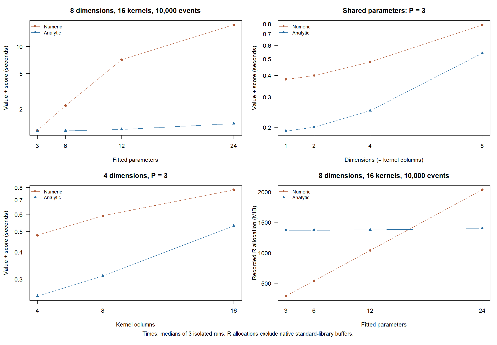

# Markov gradient scaling

Runtime source: `4d6ea845cbce711b3b778bde2f0decfe07a75138`.
This study adds measurement tools and results. It does not change the R or C++
likelihood, derivative, optimizer, or default settings.

## Scope

Nineteen configurations vary event count (1,000, 10,000, 100,000), event dimensions
(1, 2, 4, 8), kernel columns (1 to 16), and fitted parameters (3, 6, 12, 24).
Every impact uses `lambda_component_n`; no full intensity history is requested.
The largest component matrix is 8 by 16, or 128 states.

The synthetic Markov family uses positive, unequal exponential rates and
nonnegative current-state feedback. Its diagonal impact is
`q * C / (1 + C)`, multiplied by `1 + 0.1 * (mark[n] - 1)`.
The dense variant replaces that componentwise function with
`q * mean(C) / (1 + mean(C))` at every entry. A coupled variant also adds
`0.1 * alpha` inside the same mark multiplier. Here `q = 0.12` is fixed.
The supplied Jacobians differentiate these functions exactly. The direct impact
parameter Jacobian is a constant zero matrix except in the alpha-coupled variant.
The state Jacobian is a full numeric matrix in both diagonal and dense variants.

The observed baseline is
`mu_weight[i] * exp(log_mu[group[i]]) * (1 + 0.08 * (N[n-1,i] %% 3))`.
At the initial row it uses the supplied initial counts. A parameter-only baseline
variant removes the count multiplier. Alpha and beta have fixed matrix weights
and positive log-scale parameters grouped by target row. With `g` groups,
there are `3*g` fitted parameters. Equal physical truth and starting values allow
sharing to vary while the data and initial matrices stay identical within each
parameter-count comparison. All fitted coefficients in the CSV files are these
log-scale optimization parameters.

Marks are geometric plus one, with probability 0.7. The likelihood conditions
on the observed marks; no mark-density parameters are fitted. The initial
component matrix has every entry `0.03 / kernels`; initial counts and mark totals are zero.
Model-generated paths use existing R `hsim()` in 500-event chunks. Each chunk
receives the previous post-event components, event counts, and cumulative marks.
A full replay verifies every boundary state within tolerance `1e-11`. These
fixtures depend on current components and cumulative counts, so no additional
history is required for continuation. Simulation is excluded from all timings.

The 100,000-event case uses seeded exponential intervals, uniform event types,
and geometric marks for fixed-point evaluation only. It is not used for parameter
recovery or whole-fit comparisons. All whole-fit paths are model-generated.
See [design.csv](gradient-scaling-results/design.csv) and the preparation script.

## Measurements

Windows 11, Intel Core Ultra 7 356H, about 31.4 GiB installed RAM, R 4.6.0,
maxLik 1.5-2.2, Rcpp 1.1.2. Each sample runs in an isolated R
process with the same processor affinity mask 4. No timing worker runs alongside
another benchmark, memory trace, simulation, or derivative check.

A controlled operation evaluates the likelihood and its full score at the same
parameter vector. Numerical scores use `maxLik::numericGradient()` with its
default `eps = 1e-6`; analytic scores use the new native recursion. Preparation
and a short warm-up are excluded. Small cases are batched; every proposal changes
to avoid cache hits. Method order alternates across three rounds, and reported
controlled-operation times are medians. Both methods receive identical proposals.
These times are distinct from complete estimation times.

Whole fits include public `hfit()` setup, BFGS optimization, and the default final
maxLik Hessian. Both methods use identical data, starts, initial states and
`control = list(iterlim = 500, reltol = 1e-10)`. Numerical differentiation is the
unchanged default. Each whole-fit pair is measured once, except the near-break-even
8-dimension, 16-column, 3-parameter case, which has three alternating rounds and
uses their median. Other whole-fit times are individual elapsed measurements.
Dimensions of at least four use a 2,500-event
prefix to keep the full numerical-Hessian study bounded; lower-dimensional
fits include 1,000 and 10,000 events. `events_used` records the actual event count
for each operation; fixture IDs refer to the available longer sequence.

Memory profiling is separate from controlled-operation timing. `Rprofmem()`
records cumulative R allocation bytes and the largest allocation for one
value-and-score pair. It excludes small-block reuse, `new page` notices, and
native standard-library buffers. Full-fit allocation logs are not collected.
Whole fits record GC heap maxima and process peak working set, with RSS queries
outside the timed call. The R-heap column sums node and vector maxima, which need
not occur simultaneously. Process peak RSS includes package loading, fixtures,
and warm-up; it is not an isolated native-buffer peak. Cumulative allocation is
not peak RAM.

## Accuracy

At two parameter vectors per configuration, native values are compared with the
R likelihood. Full analytic scores are checked against central differences at
two step sizes and an independent directional difference of the R likelihood.
The memory-profiled and timed proposals are also checked for value and score
agreement between methods. Whole fits compare estimates, likelihoods, return
codes, and analytic scores at the fitted vectors, with independent R likelihood
replay and scaled optimizer-Hessian diagnostics.

All 19 configurations pass the independent checks. Across 76 central-difference
comparisons, R and native likelihoods agree exactly in the recorded outputs.
The maximum score error after scaling each coordinate by
`max(1, abs(reference))` is **4.50e-6**. The largest unscaled error is **1.40e-4**
in the 100,000-event case. Independent directional differences of the R
likelihood also pass the `5e-5` scaled tolerance.
See [derivative checks](gradient-scaling-results/derivative-checks.csv).

All 12 whole-fit configurations converge with return code 0. Across the 28 fitted
runs (including the targeted repeats), the maximum numerical/analytic likelihood
difference is **2.33e-10**, and the largest absolute coefficient difference is
**4.03e-5**. Repeating the same method gives identical saved coefficients,
likelihood, gradient, Hessian, convergence code and iteration count.
All fitted vectors replay to the same likelihood with the independent R engine.
Directional differences at the fitted vectors agree with analytic scores within
**1.45e-6** after scaling. The largest score coordinate is 0.00342; the largest
score per event is 4.65e-7. Convergence codes alone do not establish a global
maximum or an exactly zero score.

The recorded execution metadata confirms `auto` used C++ in every fit, with the
requested numeric or analytic gradient and the unchanged maxLik numerical final
Hessian. Thus timing comparisons below measure the gradient choice on the same
C++ likelihood engine, not R-engine or CRAN timings.
See [fit checks](gradient-scaling-results/checks.csv),
[coefficients](gradient-scaling-results/estimates.csv), and
[execution methods](gradient-scaling-results/methods.csv).

The default final Hessian is a separate limitation. In **5 of the 12 numerical-gradient
fits**, its symmetrized negative Hessian has a nonpositive eigenvalue. All 12
analytic-gradient fits return positive definite observed information in this
study. Although both routes report `maxLik_numeric`, maxLik differentiates the
likelihood when no gradient is supplied and differentiates the supplied gradient
when one is available.

At each of the five problematic numerical-fit vectors, central differences of
the analytic score at steps `1e-4` and `2e-5` give positive definite information.
The maximum scaled matrix change between steps is **2.94e-08**.
This supports numerical differentiation error in the default likelihood-based
Hessian rather than a discrepancy between the fitted maxima. It does not prove
that every model has well-identified parameters or reliable standard errors.
The existing `final_hessian = "stable"` option remains available for separate
inference checks; it is not used or timed in this study. No Hessian policy changes
are included. See [Hessian cross-checks](gradient-scaling-results/hessian-cross-checks.csv).

## Complete estimation timing

These times include setup, optimization, and the default final Hessian.
All rows use diagonal feedback and an observed baseline unless noted.

| Events used | Dimensions | Kernel columns | Parameters | Numeric (s) | Analytic (s) | Speedup |
| ---: | ---: | ---: | ---: | ---: | ---: | ---: |
| 10,000 | 1 | 1 | 3 | 13.94 | 7.99 | 1.74x |
| 10,000 | 2 | 4 | 3 | 15.48 | 11.08 | 1.40x |
| 2,500 | 4 | 8 | 12 | 49.55 | 9.46 | 5.24x |
| 2,500 | 8 | 16 | 24 | 358.41 | 73.65 | 4.87x |
| 2,500 | 8 | 16 | 24, dense | 549.28 | 153.70 | 3.57x |
| 2,500 | 8 | 16 | 24, constant baseline | 266.00 | 62.78 | 4.24x |
| 2,500 | 4 | 8 | 12, dense and alpha-coupled | 94.05 | 20.50 | 4.59x |
| 2,500 | 8 | 16 | 3 | 8.67 | 9.36 | 0.93x |

The last row uses three-run medians: numerical times are 8.67, 8.73 and 8.67
seconds; analytic times are 9.34, 9.48 and 9.36 seconds. In this many-state,
few-parameter configuration the analytic method is about **8% slower**.
Other rows are single matched pairs. Across rows, event counts, paths and
optimizer iteration counts can differ; controlled value-and-score comparisons
are more suitable for isolating evaluation cost. The measurements support
selective use of analytic gradients rather than a universal speed claim.

## Controlled value-and-score timing

These are three-run median seconds for one likelihood and full score, not
complete estimation times. All rows below use diagonal state feedback and an
observed baseline.

| Events | Dimensions | Kernel columns | Parameters | Numeric | Analytic | Speedup |
| ---: | ---: | ---: | ---: | ---: | ---: | ---: |
| 10,000 | 8 | 16 | 3 | 1.16 | 1.14 | 1.02x |
| 10,000 | 8 | 16 | 6 | 2.19 | 1.15 | 1.90x |
| 10,000 | 8 | 16 | 12 | 7.11 | 1.19 | 5.97x |
| 10,000 | 8 | 16 | 24 | 17.42 | 1.38 | 12.62x |
| 100,000 | 2 | 4 | 3 | 10.39 | 2.83 | 3.67x |

At 8 dimensions, 16 kernel columns and 24 parameters, dense state feedback takes
27.33 versus 3.31 seconds (**8.26x**). With diagonal feedback and a parameter-only
baseline, the same comparison is 12.38 versus 1.21 seconds (**10.23x**).
These are fixture-specific comparisons; changing feedback or baseline also
changes the generating model and simulated data.



## Memory and next steps

For one value-and-score operation at 10,000 events, 8 dimensions and 16 kernel
columns, diagonal feedback with 3 parameters records **291 MiB** of cumulative
R allocations numerically and **1,368 MiB** analytically. Process peak RSS is
about **174 versus 188 MiB**. With 24 parameters, cumulative allocations are
**2,034 versus 1,399 MiB**, while peak RSS is about **177 versus 195 MiB**.
The analytic route does not uniformly reduce allocations or peak memory.

The supplied state Jacobian currently returns a full 128-by-128 numeric matrix
after each event, even for diagonal derivatives. Its raw payload alone is
128 KiB per event, or about **1.22 GiB** across 10,000 events. This explains most
of the analytic allocation volume in that fixture. A diagonal or sparse state
Jacobian interface is the first candidate for the next optimization step.

For the observed baseline, the analytic path also stores a
`dimensions * parameters` by `events + 1` Jacobian path. At 8 dimensions,
24 parameters and 10,000 events, its payload is **14.65 MiB**, matching the
largest recorded R allocation. Streaming these derivatives is a second candidate.
The native forward state sensitivities themselves scale with states times
parameters, rather than a full event history.

No runtime optimization is included in this study. Small parameter counts with
many states can have little timing benefit or a regression; the analytic option
remains explicit. Full history derivative support is outside the current plan.
Faster scores do not establish parameter identification, a global maximum, or
reliable Wald standard errors.

See [comparisons](gradient-scaling-results/comparisons.csv),
[all timing samples](gradient-scaling-results/timings.csv),
[hardware](gradient-scaling-results/hardware.txt),
[memory measurements](gradient-scaling-results/memory.csv), and
[fitted likelihood diagnostics](gradient-scaling-results/fitted-reference-checks.csv).

## Reproduce

From the repository root, with the tested package installed into a separate
library. Keep large fixtures, sample RDS files and temporary logs outside the
repository; the published CSV files and figure are sufficient to inspect results.

```r
# Set EMHAWKES_BENCH_AFFINITY=4 on Windows for the recorded affinity.
# Rscript tools/benchmark-gradient-scaling.R prepare LIB OUT
# Rscript tools/benchmark-gradient-scaling.R check LIB OUT
# Rscript tools/benchmark-gradient-scaling.R run LIB OUT
# Rscript tools/benchmark-gradient-scaling.R compare LIB OUT
# Rscript tools/check-gradient-scaling-fits.R LIB OUT
# Rscript tools/check-gradient-scaling-hessians.R LIB OUT
# Rscript tools/plot-gradient-scaling.R OUT
```

The run resumes completed samples. Use an empty output directory when changing
models or measurement protocols. The tools make no claim that one simulated path
establishes parameter recovery or a global optimum for every Hawkes model.
