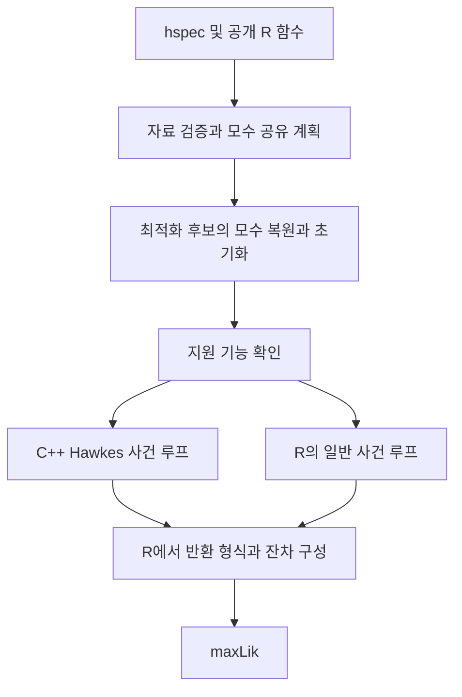

# emhawkes Rcpp 적용 계획

emhawkes 내부에 C++ 계산 엔진을 추가한다. 모형 지정, 모수 공유, 자료 검증, 사용자 정의 함수, `maxLik` 최적화는 R에서 관리한다. 첫 적용 대상은 **이벤트마다 R 함수를 호출할 필요가 없는 Hawkes 로그우도**다. 상태 의존 모형과 FRPP는 별도 경로로 유지하며, 실제 성능과 호환성을 확인한 범위부터 확대한다.

우선 별도 R 패키지는 만들지 않는다. FRPP의 패키지 분리와 계산 엔진의 가속은 독립적으로 진행할 수 있게 설계한다. C++ 엔진 도입은 아래 단계별 완료 기준에 따라 진행한다.

## 2026년 10월 11일 구현 현황

숫자형 `mu`, `alpha`, `beta`, `eta`를 사용하는 Hawkes 로그우도와 추론 엔진을 추가했다. 기존 `hfit()`의 후보 복원과 생성자 검증 뒤에 연결했다. 사건별 감쇠·적분·강도 갱신과 추론의 잔차 누적을 한 native 호출에서 처리한다. 일반 R 계산은 `loglik_hspec_r()`로 유지했다.

`options(emhawkes.engine = "auto")`가 기본이다. `"r"`은 R 기준 경로를 사용하고, `"cpp"`는 지원하지 않는 모형에서 이유를 알린다. 함수형 모수, 사용자 impact·mark 밀도, FRPP, 사용자 클래스가 붙은 숫자 입력은 R 경로를 사용한다. 시뮬레이션과 해석적 gradient는 후속 단계다.

Windows에서 기존 결과 비교, 두 실행 경로의 회귀 테스트, 소스 패키지 빌드와 `R CMD check --no-manual`을 통과했다. 세 운영체제의 CI를 추가했으며 원격 실행 결과는 아직 확인하지 않았다. 측정 결과와 재현 방법은 [Rcpp 구현 검증 기록](rcpp-results.md)에 남긴다.

## 현재 구조와 측정 기준

현재 `hfit()`은 `build_parameter_map()`과 `normalize_observation()`을 먼저 실행한다. 각 최적화 후보에서 모수를 복원하고 `hspec`을 구성한 다음, 이미 정리된 자료를 `loglik_hspec()`에 전달한다. 이 경계를 C++ 엔진의 진입점으로 사용한다.

`loglik_hspec()`의 사건 루프는 감쇠, 커널 적분, 사건 직전 강도, mark 밀도, 사건 후 갱신을 계산한다. `infer = TRUE`에서는 강도 경로와 구간별 적분도 저장한다. `mu`, `impact`, `dmark`가 함수이면 사건 루프 안에서 R 함수를 호출한다. FRPP는 여기에 잔차분포의 밀도와 생존확률 계산이 추가된다.

2026년 10월 9일, Windows와 R 4.6.0에서 다음 R 기준값을 측정했다. 초기 행을 포함한 10,001행, 2차원, 명시적인 초기 커널 성분을 사용했다. 자료 정규화와 callback 계획은 측정 전에 준비했고, 준비 실행 후 3회 elapsed time의 중앙값을 기록했다.

| 모형 | 커널 열 수 | 로그우도 한 번 | 추론 한 번 |
| --- | ---: | ---: | ---: |
| 상수 모수 Hawkes | 2 | 0.06초 | 0.18초 |
| 상수 모수 multi-kernel Hawkes | 4 | 0.07초 | 0.19초 |
| 상태 의존 `mu`와 mark 의존 `impact` | 2 | 0.23초 | 1.29초 |
| `tzexp` 잔차분포를 쓰는 FRPP | 2 | 0.87초 | 2.22초 |

이 값은 합성 자료의 기준 측정이며 실제 `hfit()` 전체 시간이나 C++의 예상 배속을 뜻하지 않는다. `Rprof`에서는 상수 모형의 사건 루프와 `integrate_exp_kernel()`이 주요 대상이었다. 상태 의존 모형에서는 `call_component()`와 context 생성, FRPP에서는 잔차분포 함수 호출의 비중이 컸다. 따라서 커널 적분만 가속해서 모든 모형이 같은 비율로 빨라지지는 않는다.

재측정은 [profile-rcpp.R](profile-rcpp.R)을 사용한다. 설치된 패키지에서 실행하므로, 비교할 소스를 먼저 설치한다. 프로파일의 누적 할당량과 최대 사용 메모리는 구분한다.

## R과 C++의 역할



| 책임 | 위치 | 이유 |
| --- | --- | --- |
| S4 `hspec`과 공개 함수 인수 | R | 기존 사용자 인터페이스를 유지한다. |
| 같은 초기값과 같은 모수 이름의 공유 규칙 | R | 계산 엔진이 모형의 자유모수 수를 바꾸면 안 된다. |
| 자료 검증과 `N`, `Nc`, 초기 상태 준비 | R | 엔진 사이에서 같은 입력을 사용한다. |
| 함수형 모수 평가와 callback 인수 선택 | R | R 함수의 환경, 기본값, `...`를 유지한다. |
| 감쇠, 커널 적분, 강도 합산, 수치 상태 갱신 | C++ | 사건 전체를 한 번의 native 호출로 처리한다. |
| 최적화, 제약식, 사용자 지정 `grad`, `hess` | R의 `maxLik` | 최적화 알고리즘 교체를 이번 작업과 섞지 않는다. |
| 공개 반환값의 이름, 차원, 클래스, 메시지 | R | 계산 결과와 사용자 경험을 함께 검증한다. |

`integrate_exp_kernel()`을 사건마다 `.Call()`하는 형태는 첫 엔진으로 채택하지 않는다. 사건마다 R과 C++를 왕복하면 작은 행렬에서는 호출과 객체 생성 비용이 남는다. C++ 내부의 작은 수치 함수는 전체 사건 루프에서 재사용한다.

## 모형별 실행 경로

지원 여부는 함수의 겉모양이나 한 번의 출력값만으로 추측하지 않는다. 연산 종류별로 필요한 기능을 판정한다. 예를 들어 `rmark`는 시뮬레이션에 관계하지만 관측 자료의 로그우도 가속을 막을 이유는 없다.

| 기능 | 첫 C++ 엔진 | 후속 적용 조건 |
| --- | --- | --- |
| 숫자형 `mu`, `alpha`, `beta` | 지원 | 같은 행의 서로 다른 `beta`도 첫 단계부터 지원한다. |
| 숫자형 `eta`와 관측 `mark` | 지원 | 기존 `eta * (mark - 1)`을 그대로 계산한다. |
| 비정방 커널 행렬과 `type_col_map` | 지원 | 기본 Hawkes와 같은 핵심 엔진을 사용한다. |
| 음수인 커널 성분과 계수 | 지원 범위에 포함 | 관측 우도의 기존 수치 계약을 따른다. 시뮬레이션의 검증 조건을 우도에 그대로 적용하지 않는다. |
| `param`만 받는 함수형 모수 | 1차는 R | 후보마다 R에서 평가한 숫자 모형을 전달하는 단계에서 확대한다. |
| 사건별 상태 의존 `mu` | R | 명시적인 상태 계약과 성능 개선을 확인한 후 별도 엔진을 검토한다. |
| 사용자 `impact`, `dmark` | R | 실행 순서, 상태 인수, 경로 의존성을 먼저 검증한다. |
| 사용자 `mylogLik` | R | 사용자가 지정한 목적함수를 C++ 엔진으로 대체하지 않는다. |
| 사용자 잔차분포와 FRPP | R | Hawkes 가속 출시의 선행 조건으로 삼지 않는다. |
| 강도 경로와 잔차 추론 | 지원 | 같은 수치 코어에서 경로와 잔차를 계산한다. |
| 시뮬레이션과 사용자 `rmark` | 후속 단계 또는 R | 난수 재현성과 callback 순서를 별도로 검증한다. |

개발 중에는 내부 실행 선택자로 `r`, `cpp`, `auto`를 비교한다. 강제 `cpp`에서 지원하지 않는 기능을 만나면 이유를 명확히 알린다. `auto`는 지원 범위 밖의 모형을 R로 보낸다. C++ 계산 오류나 DLL 로딩 오류를 잡아서 조용히 R로 재실행하지 않는다. 계산을 두 번 실행하면 callback의 부작용이나 난수 상태도 달라질 수 있다.

공개 `engine` 인수가 필요해지면 별도 호환성 검토 후 도입한다. 현재 `hfit()`의 `...`는 최적화 인수 전달에 쓰이므로 여기에 실행 선택자를 임의로 섞지 않는다. 실행 경로 안내가 필요하면 `verbose = TRUE`에서 시작 시 한 번 출력한다.

## 엔진 입력과 메모리

C++ 엔진에는 S4 객체와 임의의 R 환경을 통째로 넘기지 않는다. 검증한 숫자 자료, 모수, 초기 성분, 커널 매핑, 출력 요구를 전달한다.

| 입력 | 계약 |
| --- | --- |
| 사건 자료 | 첫 초기 행을 포함한 `inter_arrival`, `type`, `mark`를 같은 순서로 유지한다. |
| 모형 크기 | 사건 차원 `D`와 커널 열 수 `K`를 구분한다. `K = D`를 가정하지 않는다. |
| 수치 모수 | `mu`는 길이 `D`, 커널 모수는 `D × K`로 전달한다. |
| 초기 상태 | `lambda_component0`는 R에서 정리한 `D × K` 행렬이다. |
| 커널 매핑 | 사건 유형마다 갱신할 열 목록을 전달한다. C++용 0-based 변환은 경계에서 한 번만 한다. |
| 출력 요구 | 우도만, 구간 적분, 강도 경로 등을 구분한다. 우도만 계산할 때 추론 경로를 만들지 않는다. |

입력 행렬을 C++의 작업 공간으로 직접 수정하지 않는다. Rcpp 행렬은 원본 R 객체와 메모리를 공유할 수 있으므로, 재귀 상태는 별도 버퍼에 둔다. 행렬은 R의 열 우선 저장을 기준으로 접근하고, 공개 `lambda_component`의 행별 성분 배열 순서는 출력 변환에서 맞춘다.

초기 구현은 매 호출마다 필요한 작업 버퍼를 소유한다. 외부 포인터, 세션 전체의 가변 캐시, 객체 주소를 이용한 캐시는 도입하지 않는다. 일반 우도 계산의 추가 재귀 상태는 `O(DK)`로 유지한다. 전체 성분 경로를 반환하는 추론은 본질적으로 `O(NDK)` 메모리가 필요하다.

## 사건 처리와 수치 계산 계약

각 사건에서 다음 순서를 고정한다.

1. 직전 사건 후 커널 성분과 해당 구간의 baseline을 가져온다.
2. 모든 성분을 각자의 `beta`로 감쇠하고 적분한다.
3. 사건 직전 강도를 계산해 해당 유형의 로그강도를 더한다.
4. mark 밀도가 있으면 기존 상태와 순서로 평가한다.
5. `alpha`, `eta`, `impact`를 기존 순서로 적용한다.
6. 다음 구간의 baseline과 사건 후 강도를 구성한다.

baseline 함수의 `n - 1` 상태와 impact 함수의 현재 사건 상태를 혼동하지 않는다. 일반 우도와 추론 우도는 같은 적분 코어를 사용한다. 추론의 유무가 적분식을 바꾸는 별도 최적화 분기를 만들지 않는다.

성분 `x`, 감쇠율 `b`, 구간 길이 `dt`의 적분은 `x * (-expm1(-b * dt)) / b`를 사용한다. `dt = 0`, 매우 작은 `b * dt`, 성분이 0인 경우의 현재 처리를 유지한다. 첫 번째 `beta`로 행 전체를 적분하지 않는다. signed 성분을 `pmax(component, 0)`로 잘라 계산하지 않는다.

특수값의 계약도 먼저 표로 고정한다. 현재 직접 우도 계산에서 사건 강도가 음수이면 `NaN`, 0이면 `-Inf`가 생길 수 있다. 최적화에서 허용하지 않는 `beta` 후보를 `-Inf`로 돌려주는 처리와 구분한다. 이 동작을 정리할 필요가 있으면 R의 별도 계산 수정으로 먼저 처리하고, C++ 이식과 섞지 않는다.

제약을 위반한 후보값과 잘못된 자료·내부 버그는 다른 결과로 처리한다. 모든 C++ 예외를 `-Inf`로 바꾸지 않는다. `NA`, `NaN`, `Inf`의 위치와 반환값 이름도 비교한다. 부동소수점 규칙을 바꾸는 `-ffast-math`는 사용하지 않는다.

## 복잡한 함수 인터페이스의 처리

`eval_param()`은 현재 형식 인수가 정확히 `param`인 함수를 수치 모수로 평가한다. 이 함수들은 매 최적화 후보에서 새로 평가해야 한다. 최초 평가값을 최적화 전체에서 재사용하면 함수형 재매개화가 고정되어 잘못된 추정이 된다.

함수형 모수의 빠른 경로는 R 기준 경로와 공통으로 쓰는 후보 평가 계층을 만든 뒤 도입한다. 기존 중복 평가를 줄이는 변경은 함수 평가 횟수와 순서에 영향을 줄 수 있으므로 별도로 검토한다. 함수의 환경이나 외부 상태에 의존하는 실행을 수치 행렬과 같다고 단정하지 않는다.

상태 callback은 `n`, 사건 자료, `N`, `Nc`, 현재 커널 성분, 전체 강도 경로를 사용할 수 있다. 선택적 기본값, 필수 인수, `...`, 초기화 시의 `NULL` 상태를 유지한다. 특히 `...`로 context를 받는 함수에서 어떤 경로가 실제로 준비되는지 명시적 경로 인수를 받는 경우와 함께 점검한다.

현재 baseline에는 일반 벡터 외에 구간 내부의 여러 값을 표현하려는 별도 행렬 분기도 있다. 이 분기는 값·기간의 배열과 적분 의미를 독립 예제로 확정한 뒤 지원한다. 첫 C++ 엔진에서는 이 형태를 R로 보낸다.

C++ 루프에서 사건마다 `Rcpp::Function`으로 R callback을 호출하는 혼합 엔진은 자동으로 채택하지 않는다. R 함수 호출, context 구성, 경로 복사가 그대로 남을 수 있다. 실제 대표 모형에서 속도와 메모리 이득이 확인되어야 별도 단계로 진행한다.

상태 의존 모형의 추가 가속은 현재 상태만 필요한 모형과 전체 경로가 필요한 모형을 나누어 검토한다. 필요하면 순수한 상태 전이 규격을 선택적으로 제공하되, 기존 임의 R 함수 인터페이스를 계속 지원한다. 함수 본문을 분석해 특정 모형이라고 추측하지 않는다.

## 모수 공유와 최적화

공유 인덱스는 최적화 시작 전에 현재 `build_parameter_map()`으로 확정한다. `reduced = TRUE`의 행렬 내 같은 초기값, 함수 간 같은 모수 이름, `reduced = FALSE`, 함수 내부의 고정 상수와 0을 모두 같은 방식으로 처리한다. 최적화 도중 두 후보값이 우연히 같아졌다고 모수를 새로 묶지 않는다.

처음에는 현재 후보 복원과 `hspec` 생성 뒤에 C++ 우도를 연결한다. 성능 측정에서 객체 재구성이 의미 있는 비용으로 남으면 다음 단계에서 숫자 후보의 직접 전달을 검토한다. 이때 생성자 검증을 생략하지 않고 공통 후보 검증으로 옮긴다.

자료, 매핑, 공유 인덱스는 추정 한 번에 준비한다. `mu`, `alpha`, `beta`, `eta`, 함수 평가값과 기본 초기 강도는 후보값에 따라 다시 계산한다. 같은 감쇠율 판정도 후보마다 달라질 수 있다.

`lambda_component0 = NULL`이면 현재 R의 `get_lambda0()`를 사용한다. 특히 일변량의 현재 초기화식과 다변량의 선형계 풀이를 임의로 바꾸지 않는다. multi-kernel의 명시적 초기값 요구도 유지한다.

## 도입 순서와 완료 기준

| 단계 | 작업 | 완료 기준 |
| --- | --- | --- |
| 0 | R 기준 동작과 성능 고정 | 현재 회귀 테스트, 수치 독립 기준, 특수값·callback·출력 계약과 프로파일 자료를 확보한다. |
| 1 | 숫자 모수 Hawkes 우도 | 단변량·다변량·multi-kernel·숫자 `eta`·signed 성분을 한 사건 루프로 계산하고 R과 비교한다. |
| 2 | `hfit()` 연결과 함수형 모수 | 모수 공유와 기존 인수를 유지하며, 후보 평가와 초기화를 공통화한다. 지원하지 않는 모형의 R 경로를 검증한다. |
| 3 | 추론과 잔차 | 같은 코어에서 경로를 저장하고, 일반 우도·추론 우도·독립 적분을 비교한다. |
| 4 | 선택적 해석적 gradient | 지원 모형과 초기값 조건을 명확히 제한하고 공유 모수의 미분을 검증한다. |
| 5 | 상태 의존 모형의 추가 가속 | 실제 callback 및 메모리 비용을 줄일 수 있는 규격이나 혼합 방식을 대표 모형으로 검증한다. |
| 6 | 시뮬레이션 | 난수 소비 순서, 소멸, 사건 유형, signed 성분 검증을 통과한다. |
| 7 | FRPP 확장 | 패키지 경계와 잔차분포 계약을 결정한 뒤 별도 개발 범위로 진행한다. |

단계 1과 2만으로도 호환 가능한 Hawkes 추정의 가속을 먼저 출시할 수 있다. 모든 상태 의존 모형과 FRPP의 C++ 변환을 첫 출시 조건으로 삼지 않는다. 단계 4 이후의 우선순위는 실제 사용 모형의 측정 결과로 조정한다.

### 추론과 잔차

`infer = TRUE`의 `lambda`, `rambda`, 성분 경로, `res_process1` 등의 이름과 차원을 유지한다. 초기 행과 첫 사건을 구분하고, 사건이 없거나 한 번만 나온 유형의 잔차는 길이 0으로 반환한다. 현재 관측 우도는 마지막 사건에서 끝나며, 별도 관측 종료시각을 추가하는 기능은 다른 변경으로 다룬다.

### Gradient

`hfit(gradient = "analytic")` now provides the Rcpp score for numeric Hawkes models. Numerical differentiation remains the default. It supports explicit initial components and includes the derivatives of automatic initial states. See the [accuracy and timing report](gradient-results.md).

The native loop returns partial scores for `mu`, `alpha`, `beta`, `eta`, and initial components. R sums matrix entries through the parameter map and applies the initial-state chain rule. Likelihood and score share one event loop and one cached result at the current parameter vector. Supplied `grad` and `hess` take precedence. BHHH requires event scores, so the aggregate score is not used for it.

The next extension is a Jacobian adapter for parameter-only functions. Observed `N` and `Nc` paths remain fixed when differentiating state-dependent callbacks. Callbacks that use `lambda_component` also need their state Jacobian: propagate both the parameter and state effects through every event. The current independent-component sensitivities cannot cover that feedback. Parameter-dependent branch thresholds require separate differentiability checks.

Keep these extensions opt-in until their derivatives, likelihoods, fits, and timings agree with independent references. Do not infer reliable Wald inference from a faster score calculation.

### 시뮬레이션

현재 같은 행의 감쇠율이 같으면 후보 대기시간을 직접 생성하고, 하나라도 다른 행이 있으면 thinning 경로를 사용한다. baseline이 0인 경우에는 유한 총 hazard와 소멸을 처리한다. 이 분기들을 한 번에 바꾸지 않는다.

난수는 R의 RNG를 사용한다. Rcpp Attributes의 기본 난수 scope를 이용하고, 각 분포 함수의 rate와 scale 인수를 확인한다. 같은 seed에서 현재 경로를 유지하려면 baseline 후보와 excitation 후보의 생성 순서, 0 강도에서의 난수 소비, thinning의 거절 횟수까지 비교해야 한다. [R 난수 인터페이스](https://cran.r-project.org/doc/manuals/r-release/R-exts.html#Random-number-generation), [Rcpp Attributes](https://www.rcpp.org/pdf/Rcpp-attributes.pdf).

현재 같은 감쇠율 분기는 `rexp(D)`로 baseline 후보를 먼저 만들고 `runif(D)`로 excitation 후보를 만든다. 이를 차원마다 `rexp()`와 `runif()`를 교대로 호출하는 형태로 바꾸면 같은 seed의 경로가 달라진다.

난수를 사용하지 않는 숫자형 우도와 추론의 native 진입점에는 `rng = false`를 지정한다. 이 계산이 `.Random.seed`를 만들거나 바꾸지 않는지도 검증한다. 난수를 사용할 수 있는 혼합 엔진에는 이 설정을 그대로 적용하지 않는다.

사건 유형은 강도 행으로 결정하고 매핑은 사건 후 커널 열 갱신에만 사용한다. 음수 성분의 허용 여부와 감쇠율별 누적합 검증도 보존한다. 소멸 시 무한 대기시간 행을 추가하지 않고 생성된 행까지만 반환한다. 유형과 난수 소비의 동일성, 수치 경로의 근접성, 분포적 검증은 서로 다른 검증으로 기록한다.

## FRPP와 패키지 경계

첫 C++ 엔진은 지수 커널 상태 갱신과 구간 적분을 재사용할 수 있게 구성한다. Hawkes 우도는 이 적분과 사건 강도를 사용한다. FRPP의 잔차분포, 생존확률, 변환 잔차 계산은 그 위의 별도 책임으로 둔다.

FRPP를 별도 패키지로 분리해도 처음에는 emhawkes 내부 엔진을 유지한다. 실제 두 번째 소비자가 필요로 하는 함수와 반환값을 확인한 다음 R 수준 인터페이스 또는 등록된 native 인터페이스를 결정한다. 공유 계산 패키지와 공개 C++ ABI를 지금 함께 도입하지 않는다.

FRPP 가속은 두 접근을 비교한다. 숫자형 강도 모형에서 C++가 구간 적분을 일괄 계산하고 R이 잔차분포를 평가하는 방식과, 명시적으로 등록한 내장 잔차분포를 C++에서 처리하는 방식이다. 일괄 적분은 `N × D` 저장 비용도 측정한다.

임의의 잔차분포 함수를 벡터 호출해도 같은 결과가 나온다고 가정하지 않는다. 함수 길이 의존, 실행 순서, closure 환경이 다를 수 있다. `set_residual()`의 wrapper를 함수 본문이나 환경 검사만으로 해체하지 않는다. 내장 분포 가속이 필요하면 분포 종류와 모수를 명시하는 계약부터 정한다.

`log` 밀도, `lower.tail = FALSE`, `log.p = TRUE`, 유효 모수 영역을 유지한다. 잔차분포가 지수분포인 특수 경우에는 일반 Hawkes의 우도와 잔차로 되돌아오는 검증을 계속 사용한다.

## 검증 계획

현재 `tests/loglik-inference.R`, `tests/computation-regressions.R`, `tests/interfaces.R`, `tests/fit-messages.R`, `tests/signed-components.R`, `tests/tzexp-distribution.R`를 기준으로 확장한다. 같은 입력에서 R과 C++를 비교하는 것과, 전체 사건 이력 및 독립 수치적분으로 검증하는 것을 함께 사용한다.

| 검증 영역 | 포함할 사례 |
| --- | --- |
| 크기와 구조 | `D = 1, 2, 4`, `K = 1, D, 2D`, 비정방 3 × 5 커널, 비연속·순서 변경 매핑 |
| 관측 자료 | 초기 행만 존재, 희소 사건 유형, 같은 시각의 사건, mark 기본값과 명시값, 비영 초기 `N0`, `Nc0` |
| 감쇠와 적분 | 같은 행에서 다른 `beta`, 매우 작은 `beta * dt`, 큰 구간, 0 구간, 극단적 척도 |
| 성분과 갱신 | 0 성분, signed 성분, 커널 분할의 동치, 행·열 재배열, 숫자 `eta` |
| 공유 모수 | `reduced` 두 설정, 초기값 중복, 함수 간 이름 공유, 함수 안의 고정 0, 후보값의 우연한 일치 |
| 초기화 | 명시적 행렬, scalar 확장, 기본 초기화의 후보 의존성, 초기화 실패 처리 |
| Callback | 상태 전후 시점, 기본값과 `...`, 전체 경로 요구, 사용자 `mylogLik`, callback 오류의 전달 |
| 출력과 오류 | 반환값 이름·차원·클래스·결측 위치, 메시지 횟수, `NaN`과 `-Inf`, 지원 밖의 기능 |
| 추정 결과 | 같은 시작점·자료·제약으로 얻은 우도, 모수, 수렴 코드, gradient와 Hessian의 민감도 |
| 시뮬레이션 | 같은 seed의 난수 상태와 유형, 소멸, thinning, 강도 복원, 여러 경로의 분포적 성질 |

작은 독립 기준 예제는 기존 `1e-9` 수준의 비교를 유지한다. 큰 자료의 우도는 누적 오차를 고려해 관측치당 절대 차이 `1e-10`을 초기 기준으로 두고 척도와 플랫폼별 결과를 기록한다. 최적화의 반복 횟수나 모든 모수의 소수점 완전 일치를 통과 조건으로 삼지 않는다. 우도가 평평하면 두 해의 달성 우도와 식별성도 확인한다.

각 단계에서 사용자 입력이 native 호출 전 검증되는지 확인한다. 큰 루프의 사용자 중단과 오류 후 메모리 정리도 점검한다. C++에서는 RAII와 `Rcpp::stop`, `Rcpp::checkUserInterrupt`를 사용한다. [Rcpp의 예외와 사용자 중단 처리](https://www.rcpp.org/pdf/Rcpp-attributes.pdf).

## 성능 판단과 출시 조건

측정 자료는 `N = 1,000, 10,000, 100,000`을 기본으로 하고, 여유가 있는 환경에서 1,000,000을 추가한다. 차원은 1, 2, 4, 8, 커널 수는 각 차원의 1배와 2배를 포함한다. 느린 callback 모형까지 모든 조합을 기계적으로 실행하지 않고 대표 조합을 정한다.

우도 한 번의 준비 시간, 준비된 우도 시간, 추론 시간, `hfit()` 전체 시간과 평가 횟수, 할당량을 따로 기록한다. 같은 자료와 동일한 후보값 집합을 사용하고, R과 C++의 실행 순서를 번갈아 측정한다. 설치와 컴파일 시간은 계산 시간에 포함하지 않는다.

초기 성능 목표는 큰 숫자형 모형의 준비된 우도에서 R 대비 3배 이상, 대표 `hfit()` 전체에서 1.5배 이상의 개선이다. 목표 수치이며 보장 배속은 아니다. 작은 자료의 의미 있는 성능 저하가 있으면 실행 경로 선택을 조정한다. 정확성이나 유지보수 비용을 희생해 목표를 맞추지 않는다.

자동 C++ 경로의 출시는 독립 수치 검증, 기존 기능 비교, 지원 밖의 R 실행, 세 운영체제 빌드, 성능 측정을 통과한 뒤 진행한다. 지원하지 않는 경로도 사용자가 동일하게 실행할 수 있어야 한다.

## 패키지 빌드와 파일 구성

```text
R/hengine.R              실행 경로 선택과 숫자 입력 준비
R/hllf.R                공개 진입점과 R 기준 계산
R/hfit.R                모수 복원과 maxLik 연결
src/exp_kernel.h        안정적인 감쇠와 적분 수치 함수
src/hawkes_loglik.cpp   숫자 모수 Hawkes 사건 루프
R/RcppExports.R         자동 생성
src/RcppExports.cpp     자동 생성
tests/native-*.R        R과 C++ 및 독립 기준 비교
tools/profile-rcpp.R    개발용 측정 도구
```

`DESCRIPTION`에는 `Imports: Rcpp`와 `LinkingTo: Rcpp`, 컴파일 필요 정보를 반영한다. `NAMESPACE`에는 등록된 DLL과 Rcpp import를 추가하고, `Collate`에도 생성 파일을 반영한다. Attributes와 `Rcpp::compileAttributes()`로 wrapper를 생성하며 생성 파일은 직접 수정하지 않는다. [Rcpp 패키지 구성](https://www.rcpp.org/pdf/Rcpp-package.pdf), [Attributes의 패키지 지원](https://www.rcpp.org/pdf/Rcpp-attributes.pdf).

첫 구현에는 `RcppArmadillo`, `RcppEigen`, OpenMP, GPU를 추가하지 않는다. 현재 목표는 작은 행렬의 사건별 반복이며, R의 `solve()`와 고유값 계산은 이미 native 선형대수를 이용한다. 추가 의존성은 측정으로 필요성이 확인될 때 도입한다.

Windows, macOS, Linux의 `R CMD check` CI를 추가한다. R release, Linux의 devel과 oldrel을 확인하고, 현재 선언한 최소 R 버전의 지원 범위도 별도로 검토한다. C++ 표준은 실제 필요한 기능과 Rcpp 요구에 맞추며 불필요한 최신 표준을 강제하지 않는다. 필요하면 native 메모리 검사도 별도 CI에서 수행한다.

현재 로컬의 Rcpp 1.1.2 설치와 C++ 패키지 빌드를 확인했다. 소스 설치에는 컴파일 도구가 필요하며, R 실행 경로 선택만으로 이 설치 요구가 없어지지는 않는다. [R의 C++ 패키지 빌드](https://cran.r-project.org/doc/manuals/r-release/R-exts.html#Using-C_002b_002b-code).

문서 빌드의 임시 패키지 구성에도 새 `src`와 필요한 `inst/include`를 반영한다. 문서 예제가 설치된 현재 DLL을 사용하는지 확인하고, 설치 중이나 패키지 로딩 중에 `sourceCpp()`로 즉석 컴파일하지 않는다.

처음에는 단일 스레드로 개발한다. 사건 `n`의 상태는 사건 `n - 1`에 의존한다. 추후 독립적인 시작점이나 독립 경로의 병렬 실행을 검토한다. R callback과 R API를 임의 worker thread에서 호출하지 않는다. [R의 스레드 제약](https://cran.r-project.org/doc/manuals/r-release/R-exts.html#Writing-portable-packages).

## 첫 구현의 작업 단위

첫 구현은 단계 0과 1을 대상으로 한다. R 기준 계산을 명확히 분리하고, 숫자 모수의 지원 판정과 내부 실행 선택자를 둔다. 이후 native 등록, 안정적인 적분 함수, 전체 Hawkes 사건 루프, 독립 기준 비교를 작은 변경 단위로 추가한다.

성능 결과를 확인한 뒤 `hfit()`에 연결한다. 그다음 함수형 재매개화, 추론, gradient를 순서대로 확대한다. 통계 모형의 변경, FRPP 패키지 분리, 난수 알고리즘 변경, 확장 모형의 표준오차 진단은 각기 별도 변경으로 관리한다.
